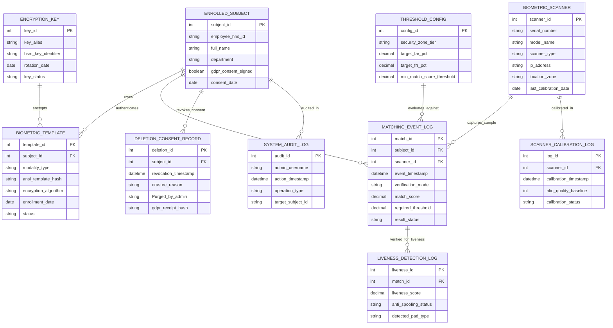

# Conceptual ERD — Biometric Verification System

## Mermaid Code

## Entity Description Table | Bảng mô tả Entity

| # | Entity Name | Vietnamese Name | Description | Key Attributes | Main Relationships |
|---|-------------|-----------------|-------------|----------------|-------------------|
| 1 | BIOMETRIC_TEMPLATE | Mẫu Sinh trắc học Mã hóa | Master table storing non-invertible biometric feature minutiae hashes, modality types, and encryption standards. | template_id, modality_type, ansi_template_hash, encryption_algorithm, status | Owned by ENROLLED_SUBJECT; encrypted by ENCRYPTION_KEY. |
| 2 | ENROLLED_SUBJECT | Chủ thể Đăng ký Sinh trắc | Stores enrolled user demographic details, HRIS links, and signed GDPR privacy consent status. | subject_id, employee_hris_id, full_name, gdpr_consent_signed | Owns BIOMETRIC_TEMPLATE; authenticates in MATCHING_EVENT_LOG. |
| 3 | BIOMETRIC_SCANNER | Thiết bị Quét Sinh trắc (Scanner) | Stores hardware biometric scanner serial numbers, sensor types (Fingerprint/Iris/Face), IP addresses, and zones. | scanner_id, serial_number, scanner_type, location_zone, last_calibration_date | Captures sample in MATCHING_EVENT_LOG; calibrated in SCANNER_CALIBRATION_LOG. |
| 4 | MATCHING_EVENT_LOG | Nhật ký Sự kiện Đối sánh | Logs 1:1 verification and 1:N identification events, timestamps, calculated match scores, and outcomes. | match_id, event_timestamp, verification_mode, match_score, result_status | Belongs to ENROLLED_SUBJECT and BIOMETRIC_SCANNER. |
| 5 | LIVENESS_DETECTION_LOG | Nhật ký Kiểm tra Liveness (Anti-Spoof) | Stores AI liveness detection scores, presentation attack detection (PAD) flags, and spoofing alerts. | liveness_id, liveness_score, anti_spoofing_status, detected_pad_type | Belongs to MATCHING_EVENT_LOG. |
| 6 | THRESHOLD_CONFIG | Cấu hình Ngưỡng (FAR/FRR) | Configures target False Acceptance Rate (FAR) and False Rejection Rate (FRR) match score thresholds per security zone. | config_id, security_zone_tier, target_far_pct, min_match_score_threshold | Evaluates MATCHING_EVENT_LOG. |
| 7 | ENCRYPTION_KEY | Khóa Mã hóa HSM | Tracks Hardware Security Module (HSM) key aliases, key identifiers, and rotation schedules used for template encryption. | key_id, key_alias, hsm_key_identifier, rotation_date | Encrypts BIOMETRIC_TEMPLATE. |
| 8 | DELETION_CONSENT_RECORD | Nhật ký Xóa Dữ liệu (GDPR) | Archives permanent template erasure receipts, consent revocation timestamps, and cryptographic GDPR compliance proofs. | deletion_id, revocation_timestamp, erasure_reason, gdpr_receipt_hash | Revokes consent for ENROLLED_SUBJECT. |
| 9 | SCANNER_CALIBRATION_LOG | Nhật ký Hiệu chuẩn Scanner | Logs optical sensor calibration events, NFIQ quality baselines, and maintenance status. | log_id, calibration_timestamp, nfiq_quality_baseline, calibration_status | Belongs to BIOMETRIC_SCANNER. |
| 10 | SYSTEM_AUDIT_LOG | Nhật ký Kiểm toán Quản trị | Captures administrator configuration changes, enrollment actions, threshold edits, and compliance queries. | audit_id, admin_username, action_timestamp, operation_type | Audits actions on ENROLLED_SUBJECT. |

## Relationship Description | Mô tả Quan hệ

| # | From Entity | Cardinality | To Entity | Relationship Label | Business Explanation |
|---|-------------|-------------|-----------|-------------------|----------------------|
| 1 | ENROLLED_SUBJECT | one-to-many | BIOMETRIC_TEMPLATE | owns | An enrolled subject owns one or more biometric templates (finger, iris, face). |
| 2 | ENROLLED_SUBJECT | one-to-many | MATCHING_EVENT_LOG | authenticates | An enrolled subject authenticates in multiple biometric matching events. |
| 3 | BIOMETRIC_SCANNER | one-to-many | MATCHING_EVENT_LOG | captures_sample | A biometric scanner captures samples for matching events. |
| 4 | MATCHING_EVENT_LOG | one-to-one | LIVENESS_DETECTION_LOG | verified_for_liveness | A matching event is verified for liveness by anti-spoofing modules. |
| 5 | THRESHOLD_CONFIG | one-to-many | MATCHING_EVENT_LOG | evaluates_against | Threshold configurations evaluate matching event scores. |
| 6 | ENCRYPTION_KEY | one-to-many | BIOMETRIC_TEMPLATE | encrypts | HSM encryption keys encrypt stored biometric templates. |
| 7 | ENROLLED_SUBJECT | one-to-many | DELETION_CONSENT_RECORD | revokes_consent | An enrolled subject revokes consent resulting in template erasure records. |
| 8 | BIOMETRIC_SCANNER | one-to-many | SCANNER_CALIBRATION_LOG | calibrated_in | A scanner is calibrated in periodic maintenance logs. |
