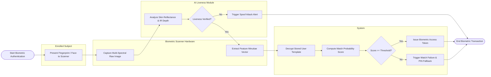

# Swimlane Diagram — Biometric Verification System

## Mermaid Code

## Flow Description | Mô tả luồng

| Lane | Actor | Role in Flow |
|------|-------|-------------|
| 1 | Enrolled Subject | Presents finger, iris, or facial trait to biometric scanner hardware. |
| 2 | Biometric Scanner Hardware | Captures multi-spectral raw optical/IR frames, checks image quality, and extracts minutiae feature vectors. |
| 3 | AI Liveness Module | Analyzes 3D depth, skin reflectance, and micro-expressions to reject fake presentation spoof attacks (photos/masks). |
| 4 | System | Decrypts pre-stored user templates from HSM vault, computes match probability scores against target thresholds, and issues access tokens or fallback prompts. |
