# Action Tree — Biometric Verification System

## Mermaid Code

```mermaid
graph TD
    Root["Biometric Verification System"]

    Root --> M1["Enrollment & Registration"]
    Root --> M2["Biometric Matching Engine"]
    Root --> M3["Anti-Spoofing & Liveness"]
    Root --> M4["Data Encryption & Privacy"]
    Root --> M5["Device Management & Audit"]

    M1 --> A1["Capture Multi-Modal Biometric Trait"]
    M1 --> A2["Check NFIQ Image Quality Score"]
    M1 --> A3["Extract Minutiae Feature Vectors"]
    M1 --> A4["Capture GDPR Privacy Consent"]

    M2 --> B1["Execute 1:1 Verification Matching"]
    M2 --> B2["Execute 1:N Identification Search"]
    M2 --> B3["Calculate Match Probability Score"]
    M2 --> B4["Trigger Secondary Fallback Auth"]

    M3 --> C1["Analyze Multi-Spectral IR Depth"]
    M3 --> C2["Detect 3D Facial Surface Topography"]
    M3 --> C3["Verify Sub-Dermal Blood Pulse"]
    M3 --> C4["Block Presentation Spoof Attack"]

    M4 --> D1["Apply Non-Invertible Bio-Hashing"]
    M4 --> D2["Encrypt Template with AES-256 GCM"]
    M4 --> D3["Purge Raw Image Sample Memory"]
    M4 --> D4["Execute GDPR Right to Erasure"]

    M5 --> E1["Calibrate Optical Scanner Lens"]
    M5 --> E2["Configure Target FAR/FRR Thresholds"]
    M5 --> E3["Issue SAML Biometric Auth Tokens"]
    M5 --> E4["Export Biometric Audit Compliance Log"]
```

## Module Description | Mô tả Module

| # | Module | Description | Actions |
|---|--------|-------------|---------|
| 1 | Enrollment & Registration | Multi-modal trait capture, NFIQ image quality scoring, minutiae feature extraction, and GDPR consent management. | Capture Multi-Modal Biometric Trait, Check NFIQ Image Quality Score, Extract Minutiae Feature Vectors, Capture GDPR Privacy Consent |
| 2 | Biometric Matching Engine | 1:1 authentication verification, 1:N identification search, match score calculation, and secondary PIN fallback logic. | Execute 1:1 Verification Matching, Execute 1:N Identification Search, Calculate Match Probability Score, Trigger Secondary Fallback Auth |
| 3 | Anti-Spoofing & Liveness | AI liveness detection, multi-spectral IR analysis, 3D facial depth verification, and presentation attack blocking. | Analyze Multi-Spectral IR Depth, Detect 3D Facial Surface Topography, Verify Sub-Dermal Blood Pulse, Block Presentation Spoof Attack |
| 4 | Data Encryption & Privacy | Non-invertible template hashing, AES-256 HSM encryption, raw image purging, and GDPR template deletion. | Apply Non-Invertible Bio-Hashing, Encrypt Template with AES-256 GCM, Purge Raw Image Sample Memory, Execute GDPR Right to Erasure |
| 5 | Device Management & Audit | Biometric scanner calibration, FAR/FRR threshold tuning, SAML authentication token issuance, and compliance logging. | Calibrate Optical Scanner Lens, Configure Target FAR/FRR Thresholds, Issue SAML Biometric Auth Tokens, Export Biometric Audit Compliance Log |
