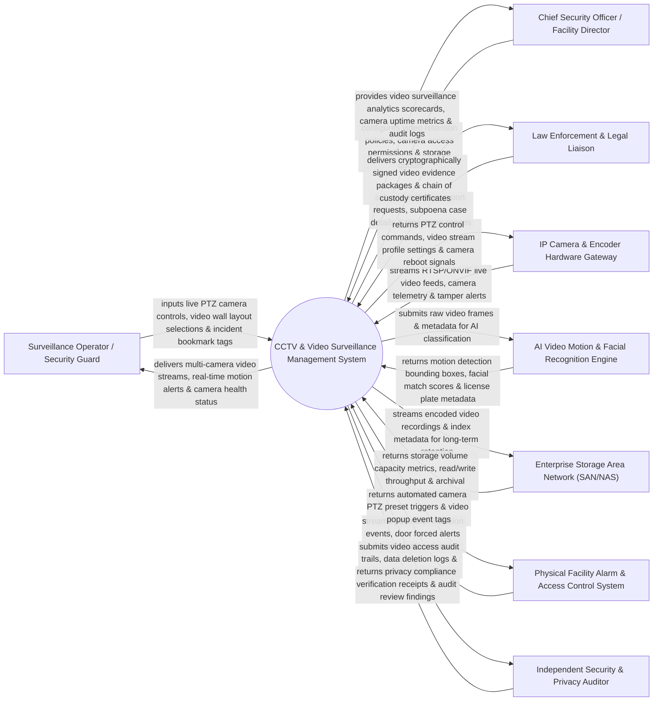

# Context Diagram — CCTV & Video Surveillance Management System

## Mermaid Code

## Actor & Interaction Table | Bảng Actor & Tương tác

| # | Actor | Actor Type | Data Sent TO System | Data Received FROM System | Notes |
|---|-------|------------|---------------------|---------------------------|-------|
| 1 | Surveillance Operator / Security Guard | Primary | Live PTZ camera controls, video wall layout selections, incident bookmark tags. | Multi-camera video streams, real-time motion alerts, camera health status dashboard. | Security staff monitoring live camera feeds in control room and managing PTZ cameras. |
| 2 | Chief Security Officer / Facility Director | Primary | Video retention policies, camera access permissions, storage quotas, camera mapping. | Surveillance analytics scorecards, camera uptime metrics, operator audit logs. | Senior security executive managing overall video surveillance infrastructure and compliance. |
| 3 | Law Enforcement & Legal Liaison | Primary | Evidence export requests, subpoena case details, timestamp ranges, legal authorization. | Cryptographically signed video evidence packages, chain of custody certificates. | External police or legal authority requesting video recordings for criminal investigations. |
| 4 | IP Camera & Encoder Hardware Gateway | Supporting | RTSP/ONVIF live video streams, camera telemetry, video loss alerts, tamper notifications. | PTZ control commands, video stream profile settings (FPS/resolution), camera reboot signals. | Hardware network cameras (Axis, Hikvision, Dahua) streaming ONVIF video to VMS. |
| 5 | AI Video Motion & Facial Recognition Engine | Supporting | Motion detection bounding boxes, facial match scores, license plate metadata, intrusion vectors. | Raw video frames, camera ID tags, ROI (Region of Interest) processing parameters. | AI analytics server processing video streams for object recognition, license plates, and perimeter breach. |
| 6 | Enterprise Storage Area Network (SAN/NAS) | Supporting | Storage volume capacity metrics, read/write throughput status, archival confirmation. | Encoded video recordings, index metadata files, purge execution commands. | High-capacity storage infrastructure storing continuous NVR video recordings. |
| 7 | Physical Facility Alarm & Access Control System | Supporting | Perimeter intrusion events, door forced alerts, panic button signals, glassbreak alarms. | Automated camera PTZ preset triggers, video popup event tags, alarm recording bookmarks. | Integrated physical access control system sending alarm triggers to camera VMS. |
| 8 | Independent Security & Privacy Auditor | Supporting / Regulatory | Privacy compliance verification receipts, audit review findings, compliance policies. | Video access audit trails, data deletion logs, operator activity logs, redaction reports. | Independent auditor verifying video privacy rules (GDPR video masking, auto-deletion). |

## System Boundary Description | Mô tả Phạm vi Hệ thống

The **CCTV & Video Surveillance Management System** is an enterprise Video Management System (VMS), IP camera stream management, AI video analytics, video wall management, and legal evidence export platform.

**Inside System Scope:**
- Multi-channel IP camera streaming management (ONVIF / RTSP protocol ingestion).
- Live video wall grid rendering, interactive PTZ camera movement, and preset positioning.
- Continuous video recording management, edge storage buffering, and SAN storage retention policies.
- AI analytics integration for motion detection, perimeter intrusion, license plate recognition (LPR), and facial matching.
- Watermarked video evidence export with digital signature and chain of custody verification.

**Outside System Scope:**
- Direct physical installation of network camera cabling and pole mounting (handled by Hardware Installers).
- Direct physical security guard response dispatching on-site (handled by Guard Patrol Management System).
- Direct physical repair of damaged camera lenses or hardware circuitry (handled by Hardware Vendors).
