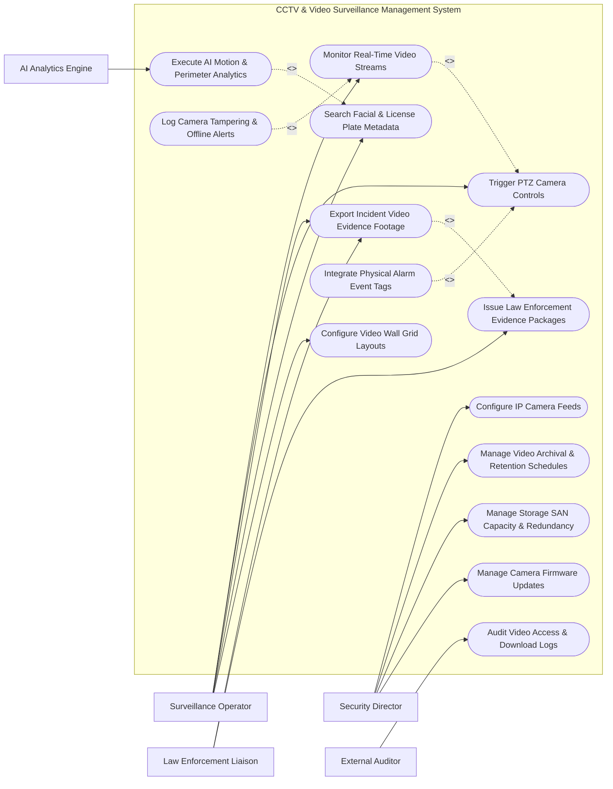

# Use Case Diagram — CCTV & Video Surveillance Management System

## Mermaid Code

## Actor Table | Bảng Actor

| # | Actor | Actor Type | Role Description | Related Use Cases |
|---|-------|------------|------------------|-------------------|
| 1 | Surveillance Operator | Primary | Monitors live video streams, controls PTZ cameras, configures video wall grids, and bookmarks incidents. | UC02, UC03, UC05, UC08, UC09 |
| 2 | Security Director | Primary | Manages IP camera network configurations, defines retention rules, manages SAN storage capacity, and updates camera firmware. | UC01, UC06, UC10, UC14 |
| 3 | Law Enforcement Liaison | Primary | Requests certified video evidence exports and verifies chain of custody documentation. | UC05, UC11 |
| 4 | External Auditor | Secondary | Inspects video access logs, privacy redaction compliance, and auto-deletion policy enforcement. | UC12 |
| 5 | AI Analytics Engine | Supporting / System | Processes raw video feeds in real-time to detect motion, breach lines, facial recognition, and license plates. | UC04 |

## Use Case Table | Bảng Use Case

| # | UC ID | Use Case Name | Primary Actor | Secondary Actor | Description | Priority |
|---|-------|---------------|---------------|-----------------|-------------|----------|
| 1 | UC01 | Configure IP Camera Feeds | Security Director | None | Registers IP camera ONVIF parameters, IP addresses, RTSP stream URLs, and encoding formats. | High |
| 2 | UC02 | Monitor Real-Time Video Streams | Surveillance Operator | None | Displays live multi-channel camera streams on operator workstations and video wall displays. | High |
| 3 | UC03 | Trigger PTZ Camera Controls | Surveillance Operator | None | Controls Pan-Tilt-Zoom (PTZ) camera positioning, optical zoom levels, and preset patrol tours. | High |
| 4 | UC04 | Execute AI Motion & Perimeter Analytics | AI Analytics Engine | Operator | Analyzes camera video streams for tripwire line crossings, motion detection, and restricted area intrusion. | High |
| 5 | UC05 | Export Incident Video Evidence Footage | Surveillance Operator | Law Enforcement | Clips, watermarks, and exports video clips with cryptographic hash for legal evidence. | High |
| 6 | UC06 | Manage Video Archival & Retention Schedules | Security Director | Storage SAN | Configures automated video retention periods (e.g., 30 days continuous, 90 days event-based) and purge rules. | High |
| 7 | UC07 | Log Camera Tampering & Offline Alerts | Security Director | None | Detects camera signal loss, video occlusion, defocusing, or physical spray tampering and triggers alerts. | High |
| 8 | UC08 | Search Facial & License Plate Metadata | Surveillance Operator | AI Analytics Engine | Searches historical video metadata index by license plate string, facial features, or clothing color. | Medium |
| 9 | UC09 | Configure Video Wall Grid Layouts | Surveillance Operator | None | Customizes multi-monitor video wall display matrices (e.g., 2x2, 4x4, 8x8 grid views). | Medium |
| 10 | UC10 | Manage Storage SAN Capacity & Redundancy | Security Director | Storage SAN | Monitors RAID volume health, storage SAN throughput, disk utilization, and failover NVR setups. | High |
| 11 | UC11 | Issue Law Enforcement Evidence Packages | Law Enforcement | Surveillance Operator | Formats exported video evidence into standalone executable player packages with chain of custody receipts. | Medium |
| 12 | UC12 | Audit Video Access & Download Logs | External Auditor | None | Tracks user login timestamps, camera view histories, clip downloads, and privacy video masking actions. | Medium |
| 13 | UC13 | Integrate Physical Alarm Event Tags | Surveillance Operator | Facility Alarm | Links incoming physical door forced alarms to automatically jump PTZ cameras to target alarm coordinates. | Medium |
| 14 | UC14 | Manage Camera Firmware Updates | Security Director | IP Camera Gateway | Pushes over-the-air firmware updates and cybersecurity patches to network camera devices. | Low |

## Use Case Specification | Đặc tả Use Case

---

### UC01 — Configure IP Camera Feeds

| Field | Detail |
|-------|--------|
| **UC ID** | UC01 |
| **Use Case Name** | Configure IP Camera Feeds |
| **Actor(s)** | Primary: Security Director   Secondary: None |
| **Description** | Discovers, authenticates, and configures new ONVIF/RTSP network camera feeds in the Video Management System. |
| **Precondition** | 1. Security Director has System Administrator privileges.   2. IP camera is connected to security VLAN and assigned static IP address. |
| **Main Flow** | 1. Security Director opens "Camera Configuration Module" and clicks "Discover ONVIF Cameras".   2. System scans network VLAN and returns list of discovered IP camera devices.   3. Director selects target camera and enters device admin credentials.   4. System authenticates camera, retrieves supported stream profiles (Main Stream H.265, Sub Stream H.264), and tests RTSP connection.   5. Director assigns camera name, physical facility zone, resolution (e.g., 4K @ 30FPS), and PTZ capabilities.   6. System saves camera configuration and starts continuous video recording schedule. |
| **Alternative Flow** | **AF1** — Manual RTSP Import: Director manually inputs custom RTSP URL string for non-ONVIF video encoder hardware. |
| **Exception Flow** | **EX1** — Camera Auth Failure: System alerts director if camera credentials are rejected and prompts for credential re-entry. |
| **Postcondition** | IP camera feed is registered, online, and streaming to recording NVR servers. |
| **Business Rule** | **BR1**: All network IP cameras must communicate over dedicated encrypted security VLANs using HTTPS/RTSPS. |

---

### UC02 — Monitor Real-Time Video Streams

| Field | Detail |
|-------|--------|
| **UC ID** | UC02 |
| **Use Case Name** | Monitor Real-Time Video Streams |
| **Actor(s)** | Primary: Surveillance Operator   Secondary: None |
| **Description** | Displays multi-channel live video feeds on operator workstations with dynamic layout switching, audio monitoring, and instant playback. |
| **Precondition** | 1. IP cameras are online and streaming to VMS servers. |
| **Main Flow** | 1. Operator logs into VMS Control Console and opens Live Monitoring workspace.   2. System loads operator's default video grid matrix (e.g., 16-camera view).   3. System decodes incoming sub-streams for low latency and renders smooth live video.   4. Operator double-clicks a specific camera tile to expand it to full-screen HD main stream.   5. Operator uses instant replay scrub bar to review the past 60 seconds of video without interrupting live stream.   6. System displays real-time status indicators (Recording OK, Motion Alert, Audio Active). |
| **Alternative Flow** | **AF1** — Alarm Auto-Popup: When perimeter alarm triggers, system automatically pops up target camera in high-priority window tile. |
| **Exception Flow** | **EX1** — Video Stream Loss: If camera loses connection, system displays black tile with "VIDEO LOSS - CHECK CAMERA IP" warning icon. |
| **Postcondition** | Real-time video monitoring is active and operator actions are logged. |
| **Business Rule** | **BR1**: Live stream latency on control room monitors shall not exceed 300 milliseconds. |

---

### UC04 — Execute AI Motion & Perimeter Analytics

| Field | Detail |
|-------|--------|
| **UC ID** | UC04 |
| **Use Case Name** | Execute AI Motion & Perimeter Analytics |
| **Actor(s)** | Primary: AI Analytics Engine   Secondary: Surveillance Operator |
| **Description** | Analyzes live camera video frames using computer vision to detect virtual line crossing, loitering, direction violation, and perimeter breach. |
| **Precondition** | 1. AI Analytics Engine is assigned to processing target camera streams.   2. Virtual tripwire lines or Region of Interest (ROI) boundaries are configured. |
| **Main Flow** | 1. AI Analytics Engine ingests live video frames from VMS stream processor.   2. Computer vision model performs object detection (Person, Vehicle, Animal).   3. Engine tracks object trajectory across video frame coordinates.   4. Engine detects an object crossing a defined virtual tripwire into a restricted zone.   5. Engine generates "PERIMETER BREACH DETECTED" event with bounding box coordinates and confidence score (e.g., 94%).   6. System bookmarks video recording timestamp, triggers audible alert on operator console, and pops up camera feed. |
| **Alternative Flow** | **AF1** — Loitering Detection: Engine tracks an individual lingering within an ROI box longer than 30 seconds and triggers loitering alert. |
| **Exception Flow** | **EX1** — Weather Occlusion: Engine detects heavy rain/fog degrading detection accuracy and flags "ANALYTICS DEGRADED - WEATHER" warning. |
| **Postcondition** | Perimeter breach event is recorded, bookmarked, and alerted to security operators. |
| **Business Rule** | **BR1**: Perimeter detection analytics must maintain a true positive detection rate exceeding 95%. |

---

### UC05 — Export Incident Video Evidence Footage

| Field | Detail |
|-------|--------|
| **UC ID** | UC05 |
| **Use Case Name** | Export Incident Video Evidence Footage |
| **Actor(s)** | Primary: Surveillance Operator   Secondary: Law Enforcement Liaison |
| **Description** | Clips, watermarks, redacts privacy faces, and exports authenticated video footage with cryptographic SHA-256 digital signature for legal proceedings. |
| **Precondition** | 1. Operator has Video Export permission.   2. Target incident video footage is available in archive SAN. |
| **Main Flow** | 1. Operator selects target camera and specifies incident start time and end time range.   2. System previews target video clip and displays export options (MP4, AVI, Native VMS Format).   3. Operator applies video privacy blurring masks over innocent bystander faces if required by privacy policy.   4. Operator clicks "Generate Video Evidence Export".   5. System embeds digital watermark overlay (Timestamp, Camera Name, Facility Location) and computes SHA-256 cryptographic hash of raw video data.   6. System packages video file, standalone player, and Chain of Custody Certificate into encrypted zip package.   7. Operator downloads export file and logs incident justification note. |
| **Alternative Flow** | **AF1** — Direct Law Enforcement Portal Upload: Operator uploads exported evidence package directly to secure police e-discovery portal API. |
| **Exception Flow** | **EX1** — Video Data Corruption: System detects missing storage frames during clipping, alerts operator, and attempts recovery from secondary redundant NVR. |
| **Postcondition** | Authenticated video evidence file is exported and download audit record is permanently stored. |
| **Business Rule** | **BR1**: All exported video evidence must include a SHA-256 digital signature to guarantee tamper-proof legal admissibility. |

---

### UC08 — Search Facial & License Plate Metadata

| Field | Detail |
|-------|--------|
| **UC ID** | UC08 |
| **Use Case Name** | Search Facial & License Plate Metadata |
| **Actor(s)** | Primary: Surveillance Operator   Secondary: AI Analytics Engine |
| **Description** | Searches indexed video metadata repository to locate video clips matching specific license plate numbers, vehicle models, or facial feature templates. |
| **Precondition** | 1. AI Analytics Engine has generated and indexed metadata tags for recorded video archives. |
| **Main Flow** | 1. Operator opens "Smart AI Video Search" workspace.   2. Operator selects search category (License Plate Number [LPR] OR Facial Feature Match).   3. Operator inputs search parameters (e.g., License Plate string "7XYZ89", Date Range, Facility Gate Cameras).   4. System queries metadata database index and returns list of matching video snapshot thumbnails with timestamps.   5. Operator clicks a snapshot thumbnail.   6. System opens exact video archive segment, cueing playback 5 seconds prior to detected event. |
| **Alternative Flow** | **AF1** — Appearance Search (Clothing Color): Operator searches for "Person with Red Shirt and Black Pants" across all cameras during a 2-hour window. |
| **Exception Flow** | **EX1** — No Metadata Matches: System displays "0 Results Found" and suggests expanding search date range or lowering AI match threshold percentage. |
| **Postcondition** | Target video events are located rapidly without manual playback of hours of video footage. |
| **Business Rule** | **BR1**: Metadata index queries must return search results across a 30-day video database in less than 3 seconds. |
