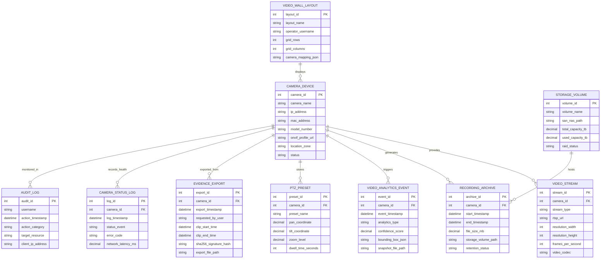

# Conceptual ERD — CCTV & Video Surveillance Management System

## Mermaid Code

## Entity Description Table | Bảng mô tả Entity

| # | Entity Name | Vietnamese Name | Description | Key Attributes | Main Relationships |
|---|-------------|-----------------|-------------|----------------|-------------------|
| 1 | CAMERA_DEVICE | Thiết bị Camera IP | Master table storing IP camera hardware configurations, network IPs, location zones, and status. | camera_id, camera_name, ip_address, location_zone, status | Primary entity; provides VIDEO_STREAM, generates RECORDING_ARCHIVE. |
| 2 | VIDEO_STREAM | Luồng Video Stream | Stores video streaming parameters (RTSP URL, codec, resolution, FPS, main vs sub stream). | stream_id, stream_type, rtsp_url, resolution_width, video_codec | Belongs to CAMERA_DEVICE. |
| 3 | RECORDING_ARCHIVE | Lưu trữ Video NVR | Tracks recorded continuous video file segments stored on SAN/NAS storage volumes. | archive_id, start_timestamp, file_size_mb, retention_status | Belongs to CAMERA_DEVICE; hosted on STORAGE_VOLUME. |
| 4 | VIDEO_ANALYTICS_EVENT | Sự kiện Phân tích Video AI | Stores AI computer vision detection logs (motion, tripwire, LPR plate string, face match bounding box). | event_id, analytics_type, confidence_score, snapshot_file_path | Belongs to CAMERA_DEVICE. |
| 5 | PTZ_PRESET | Tọa độ PTZ Định sẵn | Stores Pan-Tilt-Zoom coordinate positions and automatic patrol tour dwell times for PTZ cameras. | preset_id, preset_name, pan_coordinate, tilt_coordinate, zoom_level | Belongs to CAMERA_DEVICE. |
| 6 | STORAGE_VOLUME | Ô Đĩa Lưu trữ (SAN/NAS) | Tracks storage array volumes, RAID status, total capacity, and available storage space. | volume_id, volume_name, total_capacity_tb, used_capacity_tb | Hosts multiple RECORDING_ARCHIVE files. |
| 7 | EVIDENCE_EXPORT | Trích xuất Bằng chứng Video | Stores video clip export logs, timestamps, operator usernames, and SHA-256 digital signature hashes. | export_id, requested_by_user, clip_start_time, sha256_signature_hash | Exported from CAMERA_DEVICE. |
| 8 | CAMERA_STATUS_LOG | Nhật ký Trạng thái Camera | Logs camera health events, video loss incidents, network latency, and tampering alerts. | log_id, log_timestamp, status_event, network_latency_ms | Belongs to CAMERA_DEVICE. |
| 9 | VIDEO_WALL_LAYOUT | Bố cục Màn hình Video Wall | Stores operator custom video matrix grid layouts and camera tile position JSON mappings. | layout_id, layout_name, grid_rows, grid_columns, camera_mapping_json | Displays multiple CAMERA_DEVICE feeds. |
| 10 | AUDIT_LOG | Nhật ký Kiểm toán Hệ thống | Captures user authentication timestamps, video viewing histories, export requests, and system edits. | audit_id, username, action_timestamp, target_resource | Audits system actions on CAMERA_DEVICE. |

## Relationship Description | Mô tả Quan hệ

| # | From Entity | Cardinality | To Entity | Relationship Label | Business Explanation |
|---|-------------|-------------|-----------|-------------------|----------------------|
| 1 | CAMERA_DEVICE | one-to-many | VIDEO_STREAM | provides | An IP camera device provides multiple video streams (Main/Sub). |
| 2 | CAMERA_DEVICE | one-to-many | RECORDING_ARCHIVE | generates | An IP camera generates multiple continuous recording file segments. |
| 3 | CAMERA_DEVICE | one-to-many | VIDEO_ANALYTICS_EVENT | triggers | An IP camera triggers AI video analytics detection events. |
| 4 | CAMERA_DEVICE | one-to-many | PTZ_PRESET | stores | A PTZ camera stores multiple predefined position presets. |
| 5 | CAMERA_DEVICE | one-to-many | EVIDENCE_EXPORT | exported_from | Video clips can be exported from a camera device for evidence. |
| 6 | CAMERA_DEVICE | one-to-many | CAMERA_STATUS_LOG | records_health | A camera device records continuous health and connectivity logs. |
| 7 | STORAGE_VOLUME | one-to-many | RECORDING_ARCHIVE | hosts | A storage SAN volume hosts multiple video recording archive files. |
| 8 | VIDEO_WALL_LAYOUT | many-to-many | CAMERA_DEVICE | displays | A video wall layout displays multiple camera feeds in grid tiles. |
