# Swimlane Diagram — CCTV & Video Surveillance Management System

## Mermaid Code

```mermaid
flowchart LR
    Start(["Start Motion Incident Handling"])

    subgraph Lane1["AI Analytics Engine"]
        A1["Detect Motion & Virtual Line Breach"]
        A2["Generate Incident Bounding Box Snapshot"]
    end

    subgraph Lane2["System"]
        S1["Bookmark Video Timestamp & Trigger Alert"]
        S2["Pop Up Camera Feed on Operator Console"]
        S3{"Operator Verifies Breach?"}
        S4["Apply Digital Watermark & SHA-256 Hash"]
        S5["Package Video Evidence Zip & Certificate"]
        S6["Close Incident Ticket as False Alarm"]
    end

    subgraph Lane3["Surveillance Operator"]
        O1["Inspect Live Video Popup & Replay"]
        O2["Confirm Perimeter Intrusion Incident"]
        O3["Select Incident Time Range for Export"]
        O4["Dispatch On-Site Guard Response"]
    end

    subgraph Lane4["Security Director"]
        D1["Review Exported Video Evidence Package"]
        D2["Sign Off Chain of Custody Approval"]
    end

    Finish(["End Incident Process"])

    Start --> A1 --> A2 --> S1 --> S2 --> O1 --> S3
    S3 -->|"Real Incident"| O2 --> O3 --> S4 --> S5 --> D1 --> D2 --> O4 --> Finish
    S3 -->|"False Alarm"| S6 --> Finish
```

## Flow Description | Mô tả luồng

| Lane | Actor | Role in Flow |
|------|-------|-------------|
| 1 | AI Analytics Engine | Analyzes live camera streams, detects tripwire breaches, draws bounding boxes, and generates snapshot event metadata. |
| 2 | System | Automates timestamp bookmarking, pops up high-priority camera tiles on control consoles, applies cryptographic SHA-256 evidence hashing, and packages export bundles. |
| 3 | Surveillance Operator | Inspects live video popups, verifies whether the alert is a real intrusion or false alarm, selects timestamp boundaries, and dispatches guard patrols. |
| 4 | Security Director | Reviews compiled video evidence packages, signs legal Chain of Custody certificates, and authorizes evidence release. |
