# Action Tree — CCTV & Video Surveillance Management System

## Mermaid Code

```mermaid
graph TD
    Root["CCTV & Video Surveillance System"]

    Root --> M1["Camera Management"]
    Root --> M2["Real-Time Video Monitoring"]
    Root --> M3["AI Analytics & Metadata"]
    Root --> M4["Archival & Storage"]
    Root --> M5["Evidence & Audit"]

    M1 --> A1["Discover ONVIF Camera Devices"]
    M1 --> A2["Configure RTSP Stream Codecs"]
    M1 --> A3["Set PTZ Coordinates & Presets"]
    M1 --> A4["Update Camera Firmware"]

    M2 --> B1["Render Multi-Tile Video Wall"]
    M2 --> B2["Execute PTZ Pan-Tilt-Zoom"]
    M2 --> B3["Scrub Instant Video Replay"]
    M2 --> B4["Trigger Video Popup on Alarm"]

    M3 --> C1["Set Virtual Tripwire Lines"]
    M3 --> C2["Process License Plate Search"]
    M3 --> C3["Process Facial Match Query"]
    M3 --> C4["Log Video Tampering Alert"]

    M4 --> D1["Define Retention Days Schedule"]
    M4 --> D2["Monitor SAN RAID Capacity"]
    M4 --> D3["Configure NVR Failover Cluster"]
    M4 --> D4["Execute Auto-Purge Old Clips"]

    M5 --> E1["Clip & Watermark Evidence Video"]
    M5 --> E2["Compute SHA-256 Signature Hash"]
    M5 --> E3["Export Law Enforcement Bundle"]
    M5 --> E4["Audit Operator Activity Logs"]
```

## Module Description | Mô tả Module

| # | Module | Description | Actions |
|---|--------|-------------|---------|
| 1 | Camera Management | IP camera ONVIF discovery, RTSP stream configuration, PTZ preset positioning, and firmware patching. | Discover ONVIF Camera Devices, Configure RTSP Stream Codecs, Set PTZ Coordinates & Presets, Update Camera Firmware |
| 2 | Real-Time Video Monitoring | Multi-grid video wall rendering, interactive PTZ controls, 60-second instant replay scrub, and alarm auto-popups. | Render Multi-Tile Video Wall, Execute PTZ Pan-Tilt-Zoom, Scrub Instant Video Replay, Trigger Video Popup on Alarm |
| 3 | AI Analytics & Metadata | Virtual tripwire setup, license plate recognition (LPR), facial feature metadata search, and video tamper logging. | Set Virtual Tripwire Lines, Process License Plate Search, Process Facial Match Query, Log Video Tampering Alert |
| 4 | Archival & Storage | Continuous recording retention schedules, storage SAN capacity monitoring, failover NVR setup, and auto-purge execution. | Define Retention Days Schedule, Monitor SAN RAID Capacity, Configure NVR Failover Cluster, Execute Auto-Purge Old Clips |
| 5 | Evidence & Audit | Cryptographic video evidence export, SHA-256 tamper-proof hashing, law enforcement player packaging, and operator audit trail. | Clip & Watermark Evidence Video, Compute SHA-256 Signature Hash, Export Law Enforcement Bundle, Audit Operator Activity Logs |
