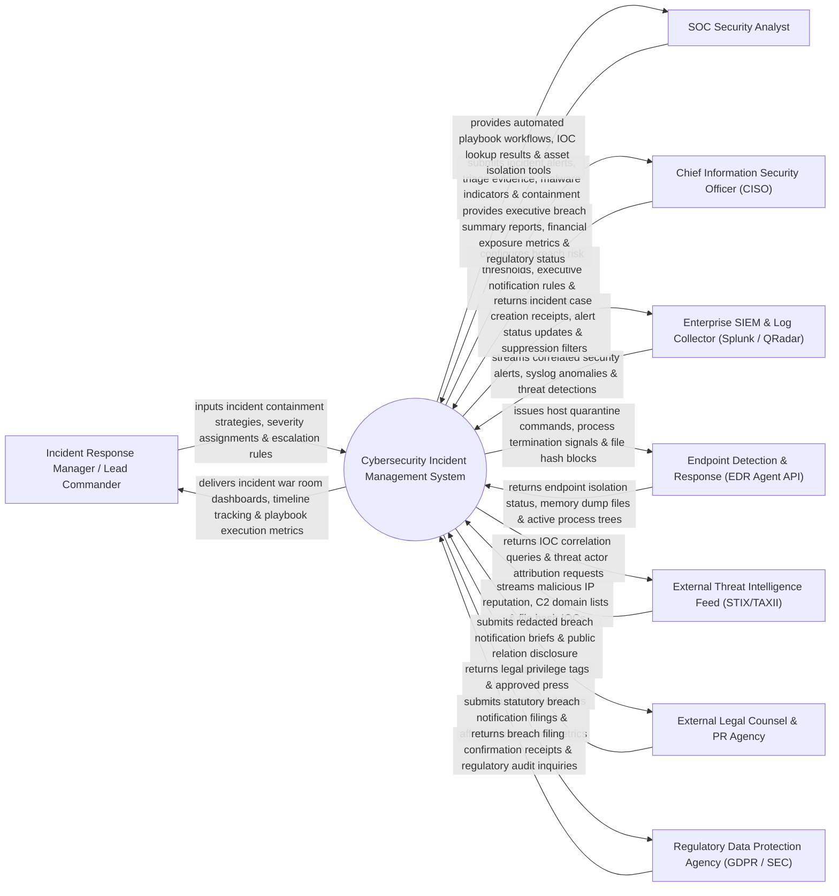

# Context Diagram — Cybersecurity Incident Management System

## Mermaid Code

## Actor & Interaction Table | Bảng Actor & Tương tác

| # | Actor | Actor Type | Data Sent TO System | Data Received FROM System | Notes |
|---|-------|------------|---------------------|---------------------------|-------|
| 1 | Incident Response Manager / Lead Commander | Primary | Incident containment strategies, severity assignments, escalation rules, task assignments. | Incident war room dashboards, timeline tracking, playbook execution metrics, task status. | Lead security commander leading incident response teams during major cyber breaches. |
| 2 | SOC Security Analyst | Primary | Incident alerts, triage evidence, malware indicators (IOCs), containment activity notes. | Automated playbook workflows, IOC lookup results, asset isolation tools, investigation tickets. | Tier 1/2 security analyst conducting initial triage and evidence collection for alerts. |
| 3 | Chief Information Security Officer (CISO) | Primary | Breach risk thresholds, executive notification rules, public disclosure policy limits. | Executive breach summary reports, financial exposure metrics, regulatory filing status. | Executive officer monitoring overall cybersecurity incident impact and compliance. |
| 4 | Enterprise SIEM & Log Collector | Supporting | Correlated security alerts, syslog anomaly detections, network intrusion triggers. | Incident case creation receipts, alert status updates, SIEM rule suppression filters. | Centralized SIEM platform (Splunk, IBM QRadar, Microsoft Sentinel) streaming alert data. |
| 5 | Endpoint Detection & Response (EDR Agent API) | Supporting | Endpoint isolation status, memory dump files, active process trees, network connection logs. | Host quarantine commands, process termination signals, file hash block requests. | EDR platform (CrowdStrike, Defender, SentinelOne) executing automated endpoint containment. |
| 6 | External Threat Intelligence Feed | Supporting | Malicious IP reputation scores, C2 domain lists, file hash IOCs, threat actor TTPs. | IOC correlation queries, threat actor attribution requests, indicator enrichment requests. | External threat intelligence provider supplying real-time IOC enrichment data. |
| 7 | External Legal Counsel & PR Agency | Supporting | Legal privilege tags (`ATTORNEY-CLIENT PRIVILEGED`), approved press releases. | Redacted breach notification briefs, public relation disclosure statements, timeline summaries. | External legal team ensuring legal privilege and PR firm managing breach public communications. |
| 8 | Regulatory Data Protection Agency | Supporting / Regulatory | Breach filing confirmation receipts, regulatory audit inquiries, statutory investigation demands. | Statutory breach notification filings, affected user count metrics, incident timeline logs. | Government regulator (GDPR DPA, SEC, FTC) receiving statutory data breach notifications. |

## System Boundary Description | Mô tả Phạm vi Hệ thống

The **Cybersecurity Incident Management System** is an enterprise incident response orchestration, triage, automated containment playbook, forensic evidence tracking, and statutory breach reporting platform.

**Inside System Scope:**
- Ingestion and correlation of security alerts from SIEM, EDR, and network IDS/IPS platforms.
- Automated incident severity classification (P1 Critical to P4 Low) and war room collaboration.
- Orchestration of automated response playbooks (host isolation, user credential reset, IP blocking).
- Forensic evidence chain of custody documentation and malware Indicator of Compromise (IOC) tracking.
- Compliance management for statutory data breach disclosures (GDPR 72-hour notification rules, SEC 4-day filing).

**Outside System Scope:**
- Direct low-level kernel reverse-engineering of malware binaries (handled by Specialized Reverse Engineering Tools).
- Direct physical repair of corrupted server motherboard hardware (handled by Infrastructure Hardware Vendor).
- General employee IT helpdesk password resets (handled by IT Service Desk).
