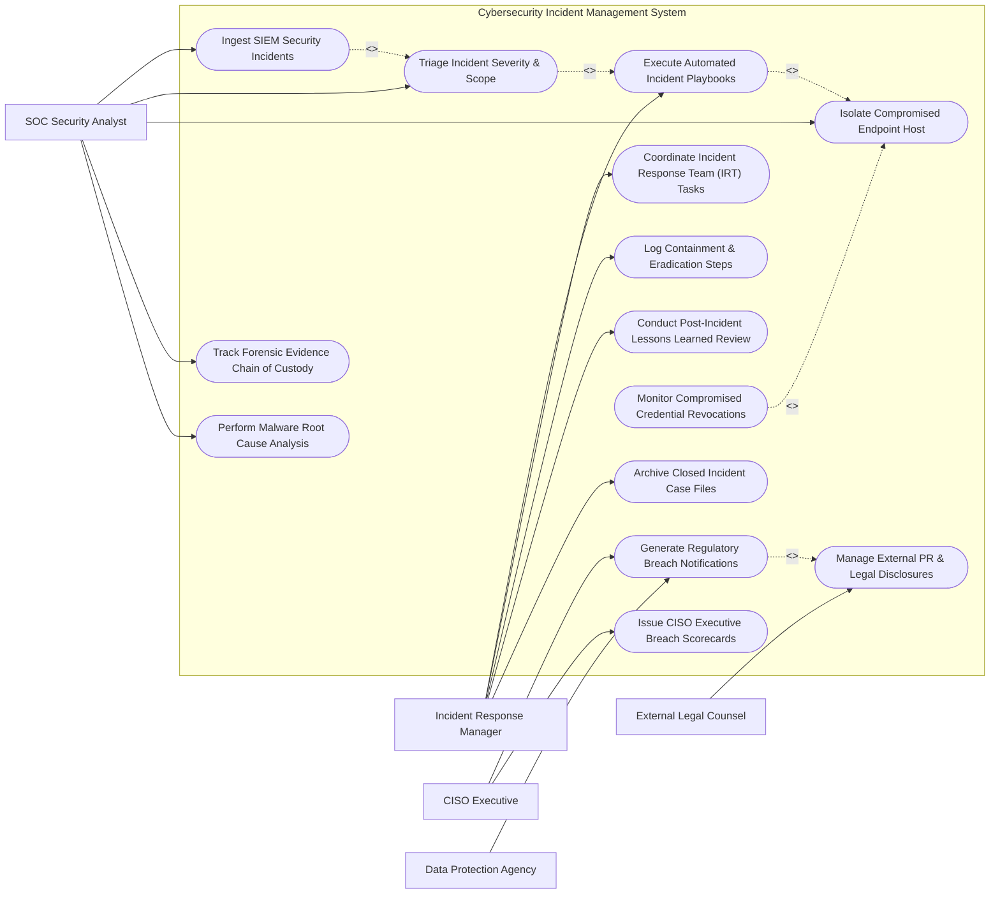

# Use Case Diagram — Cybersecurity Incident Management System

## Mermaid Code

## Actor Table | Bảng Actor

| # | Actor | Actor Type | Role Description | Related Use Cases |
|---|-------|------------|------------------|-------------------|
| 1 | SOC Security Analyst | Primary | Conducts initial alert ingestion, triages incident severity, executes host isolation, and analyzes malware IOCs. | UC01, UC02, UC04, UC05, UC07 |
| 2 | Incident Response Manager | Primary | Oversees war room coordination, executes automated playbooks, assigns team tasks, and conducts post-incident reviews. | UC03, UC06, UC09, UC10, UC14 |
| 3 | CISO Executive | Primary | Reviews executive breach scorecards, approves regulatory breach disclosures, and evaluates corporate cybersecurity risk. | UC08, UC13 |
| 4 | External Legal Counsel | Secondary | Reviews legal privilege tags, advises on regulatory disclosure obligations, and approves PR press releases. | UC11 |
| 5 | Data Protection Agency | Supporting / Regulatory | Government regulator receiving statutory data breach notifications and compliance reports. | UC08 |

## Use Case Table | Bảng Use Case

| # | UC ID | Use Case Name | Primary Actor | Secondary Actor | Description | Priority |
|---|-------|---------------|---------------|-----------------|-------------|----------|
| 1 | UC01 | Ingest SIEM Security Incidents | SOC Analyst | SIEM System | Automatically ingests high-fidelity security alerts and creates structured incident case tickets. | High |
| 2 | UC02 | Triage Incident Severity & Scope | SOC Analyst | None | Evaluates attack impact, affected asset criticality, and classifies severity rating (P1 Critical to P4 Low). | High |
| 3 | UC03 | Execute Automated Incident Playbooks | IR Manager | EDR System | Triggers automated SOAR playbooks to quarantine network segments, block IPs, and disable compromised accounts. | High |
| 4 | UC04 | Isolate Compromised Endpoint Host | SOC Analyst | EDR System | Issues instant network isolation commands via EDR API to sever compromised host network connections. | High |
| 5 | UC05 | Track Forensic Evidence Chain of Custody | SOC Analyst | None | Logs memory dumps, disk image hashes (SHA-256), and custodian signatures to preserve evidence integrity. | High |
| 6 | UC06 | Coordinate Incident Response Team (IRT) Tasks | IR Manager | SOC Analyst | Assigns investigation sub-tasks, sets SLA deadlines, and tracks progress across technical response teams. | Medium |
| 7 | UC07 | Perform Malware Root Cause Analysis | SOC Analyst | Threat Intel | Analyzes attack vector, entry points, vulnerability exploitation, and maps threat actor TTPs (MITRE ATT&CK). | High |
| 8 | UC08 | Generate Regulatory Breach Notifications | CISO Executive | DPA Regulator | Compiles and submits statutory data breach notification packages to regulators within statutory deadlines. | High |
| 9 | UC09 | Log Containment & Eradication Steps | IR Manager | SOC Analyst | Documents technical steps taken to remove malware, patch vulnerabilities, and verify system sanitization. | High |
| 10 | UC10 | Conduct Post-Incident Lessons Learned Review | IR Manager | CISO Executive | Facilitates post-incident review meeting, documents response gaps, and creates preventative security action items. | Medium |
| 11 | UC11 | Manage External PR & Legal Disclosures | Legal Counsel | CISO Executive | Reviews public press releases and customer communications under attorney-client privilege protection. | Medium |
| 12 | UC12 | Monitor Compromised Credential Revocations | SOC Analyst | IAM System | Tracks forced password resets, OAuth token revocations, and MFA reset statuses for affected user accounts. | Medium |
| 13 | UC13 | Issue CISO Executive Breach Scorecards | CISO Executive | IR Manager | Renders executive dashboards displaying breach impact, financial loss estimations, and resolution timelines. | Medium |
| 14 | UC14 | Archive Closed Incident Case Files | IR Manager | None | Permanently encrypts and archives closed incident records, evidence files, and timelines for legal retention. | Low |

## Use Case Specification | Đặc tả Use Case

---

### UC01 — Ingest SIEM Security Incidents

| Field | Detail |
|-------|--------|
| **UC ID** | UC01 |
| **Use Case Name** | Ingest SIEM Security Incidents |
| **Actor(s)** | Primary: SOC Security Analyst   Secondary: SIEM System |
| **Description** | Ingests correlated security alerts from SIEM/EDR platforms via API webhook, deduplicates events, and creates a master incident case file. |
| **Precondition** | 1. SIEM API integration is configured.   2. Alert threshold rule triggers an incident creation payload. |
| **Main Flow** | 1. SIEM platform detects ransomware behavior alert and transmits JSON payload to System API.   2. System parses payload data (Alert Title, Severity, Host IP, User Account, Process Hash, MITRE Technique ID).   3. System checks for existing open cases involving the same target host or user account.   4. If no active case exists, system creates new master incident record (e.g., `INC-2026-0813`), setting status to "NEW INTAKE".   5. System correlates IP/Hash with Threat Intelligence API for instant enrichment score.   6. System notifies on-duty SOC Security Analyst via incident queue dashboard. |
| **Alternative Flow** | **AF1** — Existing Case Correlation: If related case is active, system appends new alert data to existing incident file instead of creating duplicate. |
| **Exception Flow** | **EX1** — Malformed Payload: System logs API parsing error, places raw payload in DLQ (Dead Letter Queue), and alerts SOC Analyst. |
| **Postcondition** | Incident case file is created, enriched with threat intel, and queued for analyst triage. |
| **Business Rule** | **BR1**: High-severity SIEM alerts (P1/P2) must generate an active incident case file within 10 seconds of alert detection. |

---

### UC02 — Triage Incident Severity & Scope

| Field | Detail |
|-------|--------|
| **UC ID** | UC02 |
| **Use Case Name** | Triage Incident Severity & Scope |
| **Actor(s)** | Primary: SOC Security Analyst   Secondary: None |
| **Description** | Evaluates initial alert findings, assesses affected business assets, and determines incident severity rating and escalation path. |
| **Precondition** | 1. Incident case file is created in NEW INTAKE status. |
| **Main Flow** | 1. SOC Analyst opens newly assigned incident ticket.   2. Analyst reviews alert details, process execution trees, and affected host asset tags (e.g., Data Center Server vs Guest Laptop).   3. Analyst queries EDR telemetry to identify blast radius (number of compromised internal hosts).   4. System prompts analyst for Severity Rating inputs (Impact [High/Medium/Low] + Urgency [High/Medium/Low]).   5. Analyst selects "P1 - CRITICAL BREACH" (e.g., Domain Controller compromised with Active Ransomware).   6. System updates case status to "TRIAGED - P1 CRITICAL", opens Incident War Room channel, and sends SMS alert to Incident Response Manager. |
| **Alternative Flow** | **AF1** — False Positive Triage: Analyst confirms alert is a benign false positive, inputs resolution notes, and closes case ticket as "FALSE POSITIVE". |
| **Exception Flow** | **EX1** — Unassigned Critical Incident: If P1 incident remains unassigned after 15 minutes, system automatically escalates alert to CISO. |
| **Postcondition** | Severity rating is confirmed and emergency response escalation is triggered. |
| **Business Rule** | **BR1**: P1 Critical Incidents require mandatory immediate notification to the Incident Response Manager and CISO within 15 minutes. |

---

### UC03 — Execute Automated Incident Playbooks

| Field | Detail |
|-------|--------|
| **UC ID** | UC03 |
| **Use Case Name** | Execute Automated Incident Playbooks |
| **Actor(s)** | Primary: Incident Response Manager   Secondary: EDR System |
| **Description** | Triggers automated Security Orchestration, Automation, and Response (SOAR) playbooks to contain cyber attacks rapidly. |
| **Precondition** | 1. Incident severity is triaged as P1 or P2.   2. Automated playbooks (e.g., "Ransomware Containment Playbook") are configured. |
| **Main Flow** | 1. Incident Manager selects "Execute Containment Playbook" on incident dashboard.   2. Manager selects "Ransomware Emergency Response Playbook".   3. System displays proposed automated actions:     a. Isolate host `SERVER-FIN-01` via EDR API.     b. Revoke active Kerberos/OAuth tokens for user `admin_jdoe`.     c. Block C2 IP address `192.0.2.45` on Perimeter Firewalls.   4. Manager clicks "Confirm & Execute Playbook".   5. System issues parallel API commands to EDR, Active Directory, and Firewall platforms.   6. Systems acknowledge execution, and System updates incident timeline with containment confirmation logs. |
| **Alternative Flow** | **AF1** — Fully Automated Execution: For pre-approved P1 signatures, system executes containment playbook automatically without waiting for manual confirmation. |
| **Exception Flow** | **EX1** — API Execution Timeout: If firewall API times out, system retries via secondary API gateway and alerts network security engineer. |
| **Postcondition** | Automated containment actions are executed across enterprise security infrastructure. |
| **Business Rule** | **BR1**: Automated containment playbooks must complete execution within 60 seconds of trigger confirmation. |

---

### UC04 — Isolate Compromised Endpoint Host

| Field | Detail |
|-------|--------|
| **UC ID** | UC04 |
| **Use Case Name** | Isolate Compromised Endpoint Host |
| **Actor(s)** | Primary: SOC Security Analyst   Secondary: EDR System |
| **Description** | Severs all network connectivity to a compromised host computer while maintaining EDR management tunnel for forensic inspection. |
| **Precondition** | 1. Target host computer has an active EDR agent installed.   2. Analyst has Host Containment authorization. |
| **Main Flow** | 1. Analyst inspects compromised host profile in incident workstation module.   2. Analyst selects "Isolate Host From Network".   3. System issues API request to EDR management server specifying target host GUID.   4. EDR agent on target host applies local firewall driver rules, blocking all inbound/outbound TCP/UDP network traffic except EDR management port.   5. Host loses internet and internal LAN access, stopping lateral movement and data exfiltration.   6. EDR agent returns "HOST ISOLATED SUCCESS" confirmation payload.   7. System updates asset status to "NETWORK ISOLATED" and records event in incident timeline. |
| **Alternative Flow** | **AF1** — Lift Host Isolation: Once host is sanitized, analyst selects "Release Host Isolation", restoring normal network connectivity. |
| **Exception Flow** | **EX1** — Offline Host: If target host is offline, system queues isolation command to execute immediately upon host reconnection. |
| **Postcondition** | Host is network-isolated, preventing malware spread while allowing remote forensic analysis. |
| **Business Rule** | **BR1**: Network isolation shall preserve the EDR agent control channel to permit remote memory acquisition and triage. |

---

### UC08 — Generate Regulatory Breach Notifications

| Field | Detail |
|-------|--------|
| **UC ID** | UC08 |
| **Use Case Name** | Generate Regulatory Breach Notifications |
| **Actor(s)** | Primary: CISO Executive   Secondary: Data Protection Agency |
| **Description** | Compiles required statutory data breach documentation, affected PII user metrics, and incident timelines for regulatory filings (GDPR, SEC, HIPAA). |
| **Precondition** | 1. Incident investigation confirms unauthorized exfiltration or exposure of Personally Identifiable Information (PII). |
| **Main Flow** | 1. CISO selects "Generate Regulatory Breach Disclosure Package".   2. System aggregates incident metadata (Breach Discovery Timestamp, Root Cause, Number of Affected Records, Data Types Exposed [SSN, Financial, Medical]).   3. System checks statutory filing requirements (e.g., GDPR 72-hour notification deadline, SEC Form 8-K 4-day rule).   4. System drafts standardized regulatory disclosure filing document.   5. CISO and External Legal Counsel review draft, apply attorney-client privilege edits, and sign off.   6. System transmits notification package to Data Protection Agency portal API.   7. System records submission confirmation receipt and updates regulatory compliance ledger. |
| **Alternative Flow** | **AF1** — No Breach Exfiltration Exemption: Forensic evidence proves encrypted data was unreadable; system records "No Breach Disclose Required" exemption rationale. |
| **Exception Flow** | **EX1** — Deadline Approaching Alert: System sends high-priority SMS countdown alert to CISO 12 hours before statutory filing deadline expires. |
| **Postcondition** | Statutory breach notification is submitted to regulatory agencies and documented in corporate legal records. |
| **Business Rule** | **BR1**: GDPR regulatory notifications must be filed within 72 hours of confirming a personal data breach. |
