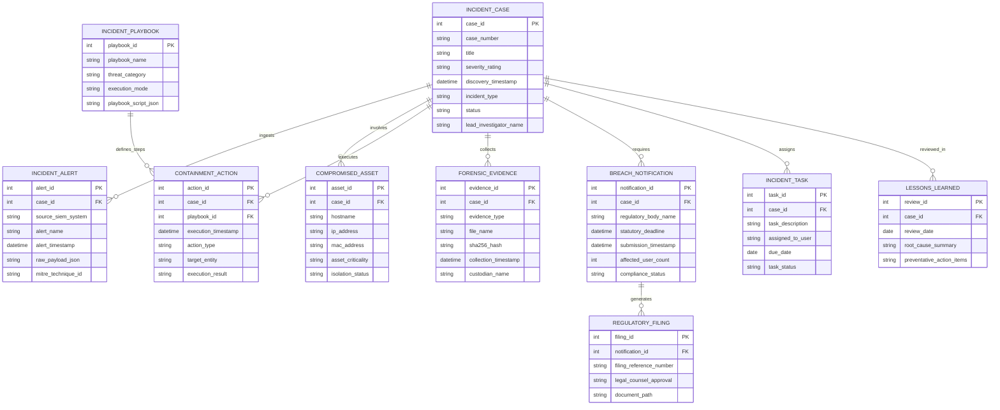

# Conceptual ERD — Cybersecurity Incident Management System

## Mermaid Code

## Entity Description Table | Bảng mô tả Entity

| # | Entity Name | Vietnamese Name | Description | Key Attributes | Main Relationships |
|---|-------------|-----------------|-------------|----------------|-------------------|
| 1 | INCIDENT_CASE | Hồ sơ Sự cố An ninh | Master case file record tracking incident numbers, severity, discovery timestamps, status, and lead investigators. | case_id, case_number, severity_rating, status, lead_investigator_name | Primary entity; ingests alerts, involves assets, executes actions. |
| 2 | INCIDENT_ALERT | Cảnh báo An ninh SIEM | Stores raw SIEM alert payloads, alert names, timestamps, and mapped MITRE ATT&CK technique IDs. | alert_id, source_siem_system, alert_name, mitre_technique_id | Belongs to INCIDENT_CASE. |
| 3 | COMPROMISED_ASSET | Thiết bị / Tài sản bị Thâm nhập | Tracks compromised host computer names, IP addresses, asset criticality ratings, and network isolation status. | asset_id, hostname, ip_address, asset_criticality, isolation_status | Belongs to INCIDENT_CASE. |
| 4 | INCIDENT_PLAYBOOK | Kịch bản Ứng phó Tự động (SOAR) | Stores pre-configured automated SOAR response playbooks (Ransomware, Phishing, Data Exfiltration). | playbook_id, playbook_name, threat_category, execution_mode | Defines steps for CONTAINMENT_ACTION. |
| 5 | CONTAINMENT_ACTION | Hành động Khoanh vùng & Nguồn chặn | Logs executed containment actions (Host Isolation, Account Lockout, IP Block), timestamps, and API results. | action_id, execution_timestamp, action_type, target_entity, execution_result | Belongs to INCIDENT_CASE and INCIDENT_PLAYBOOK. |
| 6 | FORENSIC_EVIDENCE | Bằng chứng Pháp lý Kỹ thuật số | Archives memory dumps, disk image file names, SHA-256 cryptographic hashes, collection dates, and custodians. | evidence_id, evidence_type, sha256_hash, collection_timestamp, custodian_name | Belongs to INCIDENT_CASE. |
| 7 | BREACH_NOTIFICATION | Báo cáo Vi phạm cho Cơ quan Quản lý | Tracks statutory breach notification requirements, regulatory deadlines, affected user counts, and status. | notification_id, regulatory_body_name, statutory_deadline, compliance_status | Belongs to INCIDENT_CASE; generates REGULATORY_FILING. |
| 8 | INCIDENT_TASK | Nhiệm vụ Điều tra & Phân công | Tracks assigned investigation sub-tasks, responsible technical team members, due dates, and completion status. | task_id, task_description, assigned_to_user, due_date, task_status | Belongs to INCIDENT_CASE. |
| 9 | LESSONS_LEARNED | Báo cáo Rút kinh nghiệm Post-Incident | Stores post-incident review summaries, root cause analysis notes, and preventative security action items. | review_id, review_date, root_cause_summary, preventative_action_items | Belongs to INCIDENT_CASE. |
| 10 | REGULATORY_FILING | Hồ sơ Khai báo Pháp lý | Stores final regulatory filing documents, legal counsel approvals, and agency confirmation reference numbers. | filing_id, filing_reference_number, legal_counsel_approval, document_path | Belongs to BREACH_NOTIFICATION. |

## Relationship Description | Mô tả Quan hệ

| # | From Entity | Cardinality | To Entity | Relationship Label | Business Explanation |
|---|-------------|-------------|-----------|-------------------|----------------------|
| 1 | INCIDENT_CASE | one-to-many | INCIDENT_ALERT | ingests | An incident case ingests one or more correlated SIEM security alerts. |
| 2 | INCIDENT_CASE | one-to-many | COMPROMISED_ASSET | involves | An incident case involves one or more compromised host assets. |
| 3 | INCIDENT_CASE | one-to-many | CONTAINMENT_ACTION | executes | An incident case executes multiple automated containment actions. |
| 4 | INCIDENT_CASE | one-to-many | FORENSIC_EVIDENCE | collects | An incident case collects multiple forensic evidence artifacts. |
| 5 | INCIDENT_CASE | one-to-many | BREACH_NOTIFICATION | requires | A critical incident case may require statutory breach notifications. |
| 6 | INCIDENT_CASE | one-to-many | INCIDENT_TASK | assigns | An incident case assigns response sub-tasks to analysts. |
| 7 | INCIDENT_CASE | one-to-many | LESSONS_LEARNED | reviewed_in | An incident case is reviewed in post-incident lessons learned sessions. |
| 8 | INCIDENT_PLAYBOOK | one-to-many | CONTAINMENT_ACTION | defines_steps | An automated playbook defines the steps for containment actions. |
| 9 | BREACH_NOTIFICATION | one-to-many | REGULATORY_FILING | generates | A breach notification requirement generates formal regulatory filings. |
