# Swimlane Diagram — Cybersecurity Incident Management System

## Mermaid Code

```mermaid
flowchart LR
    Start(["Start Cybersecurity Incident Handling"])

    subgraph Lane1["SIEM / EDR System"]
        S1["Detect High-Severity Ransomware Alert"]
        S2["Transmit Incident Payload API"]
    end

    subgraph Lane2["SOC Security Analyst"]
        A1["Receive & Triage Incident Ticket"]
        A2["Assess Blast Radius & Asset Criticality"]
        A3["Confirm P1 Critical Ransomware Breach"]
    end

    subgraph Lane3["System"]
        C1["Create Master Case Record & War Room"]
        C2["Enrich IOCs with Threat Intel API"]
        C3["Issue Host Isolation Command via EDR API"]
        C4["Revoke Compromised User Tokens"]
        C5["Update Incident Timeline & Log Action"]
    end

    subgraph Lane4["Incident Response Manager"]
        M1["Approve SOAR Containment Playbook"]
        M2["Conduct Post-Incident Lessons Learned Review"]
    end

    Finish(["End Incident Response"])

    Start --> S1 --> S2 --> C1 --> C2 --> A1 --> A2 --> A3 --> M1 --> C3 --> C4 --> C5 --> M2 --> Finish
```

## Flow Description | Mô tả luồng

| Lane | Actor | Role in Flow |
|------|-------|-------------|
| 1 | SIEM / EDR System | Detects high-fidelity ransomware threats, correlates logs, and transmits JSON incident alert payloads. |
| 2 | SOC Security Analyst | Receives queued incident tickets, evaluates affected host criticality, calculates blast radius, and confirms P1 severity. |
| 3 | System | Automates case creation, queries threat intelligence APIs for IOC enrichment, executes host isolation API calls, and updates containment audit logs. |
| 4 | Incident Response Manager | Approves emergency SOAR containment playbooks, leads technical response war rooms, and conducts post-incident lessons learned reviews. |
