# Action Tree — Cybersecurity Incident Management System

## Mermaid Code

```mermaid
graph TD
    Root["Cybersecurity Incident System"]

    Root --> M1["Incident Intake & Triage"]
    Root --> M2["Automated Playbooks & Containment"]
    Root --> M3["Forensic & Asset Analysis"]
    Root --> M4["Regulatory & Breach Reporting"]
    Root --> M5["Post-Incident Review"]

    M1 --> A1["Ingest SIEM Security Alerts"]
    M1 --> A2["Classify P1-P4 Incident Severity"]
    M1 --> A3["Enrich IOCs with Threat Intel"]
    M1 --> A4["Open Incident War Room"]

    M2 --> B1["Trigger Host Network Isolation"]
    M2 --> B2["Revoke Compromised User OAuth Tokens"]
    M2 --> B3["Block C2 IP at Firewall"]
    M2 --> B4["Kill Malicious Process via EDR"]

    M3 --> C1["Log Forensic Evidence SHA-256 Hash"]
    M3 --> C2["Map MITRE ATT&CK TTPs"]
    M3 --> C3["Analyze Memory & Disk Artifacts"]
    M3 --> C4["Track Custodian Chain of Custody"]

    M4 --> D1["Compile Statutory GDPR Disclosure"]
    M4 --> D2["Generate SEC Form 8-K Notice"]
    M4 --> D3["Tag Attorney-Client Privilege"]
    M4 --> D4["Draft External PR Press Release"]

    M5 --> E1["Conduct Lessons Learned Review"]
    M5 --> E2["Track Preventative Action Items"]
    M5 --> E3["Calculate MTTD & MTTR Metrics"]
    M5 --> E4["Archive Closed Incident Record"]
```

## Module Description | Mô tả Module

| # | Module | Description | Actions |
|---|--------|-------------|---------|
| 1 | Incident Intake & Triage | SIEM alert ingestion, P1-P4 severity classification, threat intelligence enrichment, and incident war room channel creation. | Ingest SIEM Security Alerts, Classify P1-P4 Incident Severity, Enrich IOCs with Threat Intel, Open Incident War Room |
| 2 | Automated Playbooks & Containment | SOAR containment playbook execution, host network isolation, OAuth token revocation, and firewall IP blocking. | Trigger Host Network Isolation, Revoke Compromised User OAuth Tokens, Block C2 IP at Firewall, Kill Malicious Process via EDR |
| 3 | Forensic & Asset Analysis | SHA-256 evidence hashing, MITRE ATT&CK TTP mapping, memory artifact analysis, and chain of custody tracking. | Log Forensic Evidence SHA-256 Hash, Map MITRE ATT&CK TTPs, Analyze Memory & Disk Artifacts, Track Custodian Chain of Custody |
| 4 | Regulatory & Breach Reporting | GDPR 72-hour notification builder, SEC Form 8-K disclosure, legal privilege tagging, and PR press release management. | Compile Statutory GDPR Disclosure, Generate SEC Form 8-K Notice, Tag Attorney-Client Privilege, Draft External PR Press Release |
| 5 | Post-Incident Review | Post-incident review meetings, preventative security action items, MTTD/MTTR analytics, and encrypted case archiving. | Conduct Lessons Learned Review, Track Preventative Action Items, Calculate MTTD & MTTR Metrics, Archive Closed Incident Record |
