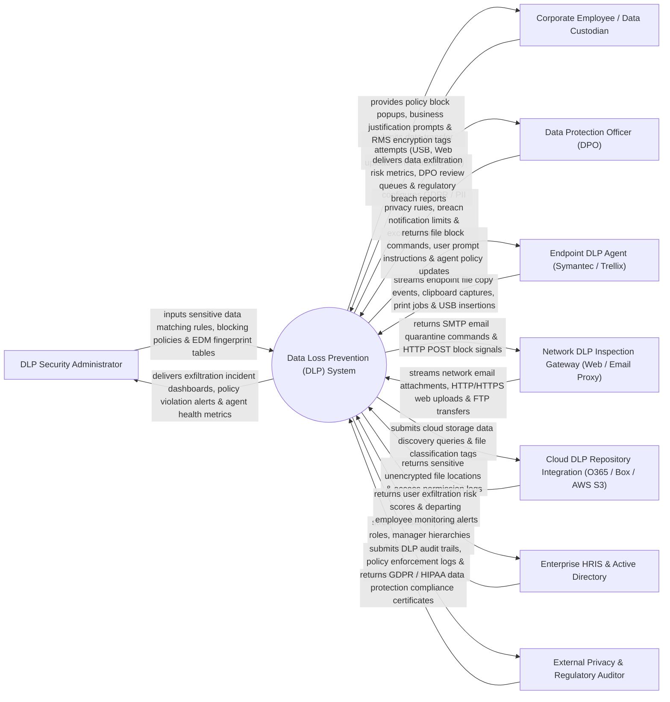

# Context Diagram — Data Loss Prevention (DLP) System

## Mermaid Code

## Actor & Interaction Table | Bảng Actor & Tương tác

| # | Actor | Actor Type | Data Sent TO System | Data Received FROM System | Notes |
|---|-------|------------|---------------------|---------------------------|-------|
| 1 | DLP Security Administrator | Primary | Sensitive data matching rules, blocking policies, Exact Data Match (EDM) tables, RMS tags. | Exfiltration incident dashboards, policy violation alerts, agent health metrics, rule logs. | Security specialist managing DLP policies, endpoint blocking rules, and data classification. |
| 2 | Corporate Employee / Data Custodian | Primary | Data transfer attempts (USB copy, web upload, email attachment, clipboard paste). | Policy block popups, business justification prompts, Rights Management (RMS) encryption tags. | Corporate employee interacting with sensitive company files and data transfer channels. |
| 3 | Data Protection Officer (DPO) | Primary | GDPR / PII privacy rules, breach notification limits, exception approvals, policy rules. | Data exfiltration risk metrics, DPO review queues, regulatory breach reports, compliance logs. | Executive privacy officer reviewing sensitive data exposure and regulatory breach risk. |
| 4 | Endpoint DLP Agent | Supporting | Endpoint file copy events, clipboard captures, print jobs, USB storage insertions. | File block commands, user prompt instructions, agent policy updates, local agent rules. | Local software agent (Symantec DLP, Trellix, Forcepoint) monitoring endpoint OS actions. |
| 5 | Network DLP Inspection Gateway | Supporting | Network email attachments, HTTP/HTTPS web uploads, FTP transfers, cloud sync streams. | SMTP email quarantine commands, HTTP POST block signals, TLS decryption payloads. | Network gateway (Web Proxy, Email Gateway) inspecting network data in transit. |
| 6 | Cloud DLP Repository Integration | Supporting | Sensitive unencrypted file locations, public sharing links, access permission logs. | Cloud storage data discovery queries, file classification tags, sharing link revocation API. | Cloud storage platform (Office 365, Box, AWS S3) scanned for sensitive data at rest. |
| 7 | Enterprise HRIS & Active Directory | Supporting | User department roles, manager hierarchies, involuntary departure notices. | User exfiltration risk scores, departing employee monitoring alerts, risk tags. | Directory service supplying user department context and high-risk departing employee flags. |
| 8 | External Privacy & Regulatory Auditor | Supporting / Regulatory | Compliance audit mandates, inspection inquiries, regulatory policies. | DLP audit trails, policy enforcement logs, privacy redaction proofs, DPO review files. | Independent auditor verifying GDPR, HIPAA, and PCI-DSS data protection compliance. |

## System Boundary Description | Mô tả Phạm vi Hệ thống

The **Data Loss Prevention (DLP) System** is an enterprise data discovery, sensitive content classification (PCI/PII/PHI), endpoint USB/print blocking, network email/web upload inspection, and cloud repository protection platform.

**Inside System Scope:**
- Sensitive data pattern matching using Regex, Exact Data Match (EDM), and Indexed Document Matching (IDM).
- Real-time endpoint enforcement blocking unauthorized file copies to USB drives, network shares, and clipboards.
- Network DLP inspection quarantining sensitive email attachments and blocking HTTPS web uploads.
- User business justification prompt workflows allowing pre-approved operational policy overrides.
- Automated Rights Management Services (RMS) encryption tagging and DPO breach reporting.

**Outside System Scope:**
- Direct physical destruction of hard drives or paper documents (handled by Shredding Services).
- Direct hosting of external SaaS cloud application servers (handled by Cloud Service Providers).
- General non-security network firewall routing (handled by Enterprise Network Engineers).
