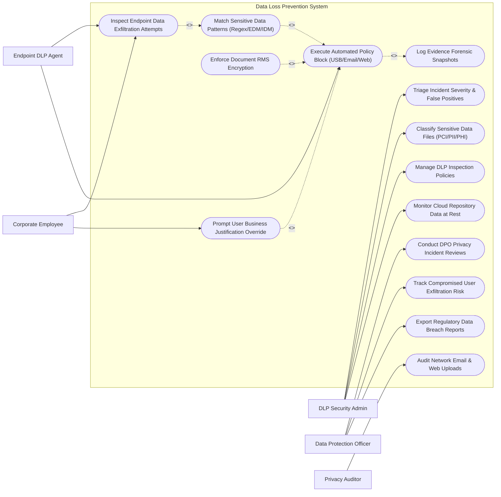

# Use Case Diagram — Data Loss Prevention (DLP) System

## Mermaid Code

## Actor Table | Bảng Actor

| # | Actor | Actor Type | Role Description | Related Use Cases |
|---|-------|------------|------------------|-------------------|
| 1 | DLP Security Admin | Primary | Defines DLP detection policies, manages classification rules, scans cloud repositories, and triages incident alerts. | UC05, UC07, UC09, UC10 |
| 2 | Corporate Employee | Primary | Interacts with sensitive data files, attempts data transfers, and provides business justification overrides. | UC01, UC06 |
| 3 | Data Protection Officer (DPO) | Primary | Oversees privacy compliance, monitors high-risk exfiltration trends, and files regulatory breach reports. | UC12, UC13, UC14 |
| 4 | Privacy Auditor | Secondary | Audits network email inspection logs, web upload blocks, and GDPR privacy compliance controls. | UC08 |
| 5 | Endpoint DLP Agent | Supporting / System | Local software agent inspecting endpoint file system actions, USB copies, and executing active blocks. | UC01, UC03 |

## Use Case Table | Bảng Use Case

| # | UC ID | Use Case Name | Primary Actor | Secondary Actor | Description | Priority |
|---|-------|---------------|---------------|-----------------|-------------|----------|
| 1 | UC01 | Inspect Endpoint Data Exfiltration Attempts | Employee | Endpoint Agent | Monitors local endpoint actions (USB copy, print, screen capture, cloud sync) for unauthorized data transfer. | High |
| 2 | UC02 | Match Sensitive Data Patterns (Regex/EDM/IDM) | Endpoint Agent | DLP Admin | Analyzes content payloads against credit card regex (PCI), SSN rules (PII), or Exact Data Match (EDM) databases. | High |
| 3 | UC03 | Execute Automated Policy Block (USB/Email/Web) | Endpoint Agent | DLP Admin | Instantly blocks non-compliant file transfers, ejects unauthorized USB drives, or quarantines emails. | High |
| 4 | UC04 | Enforce Document RMS Encryption | Endpoint Agent | Employee | Automatically applies Microsoft Rights Management (RMS) encryption tags to sensitive files before transmission. | High |
| 5 | UC05 | Triage Incident Severity & False Positives | DLP Admin | None | Evaluates flagged DLP incident alerts, reviews reconstructed evidence files, and marks false positive exceptions. | High |
| 6 | UC06 | Prompt User Business Justification Override | Employee | Endpoint Agent | Displays a popup window prompting the user to select an operational business justification to override a blocked transfer. | Medium |
| 7 | UC07 | Classify Sensitive Data Files (PCI/PII/PHI) | DLP Admin | None | Scans file servers and endpoints to apply metadata tags (Confidential, Restricted, Internal) based on content. | High |
| 8 | UC08 | Audit Network Email & Web Uploads | Privacy Auditor | None | Audits outbound SMTP email attachments and HTTPS web POST uploads for unencrypted sensitive data leaks. | High |
| 9 | UC09 | Manage DLP Inspection Policies | DLP Admin | None | Configures inspection rulesets, channel action matrices (Block, Quarantine, Audit, Encrypt), and exclusion lists. | High |
| 10 | UC10 | Monitor Cloud Repository Data at Rest | DLP Admin | None | Scans cloud storage buckets (O365 SharePoint, Box, AWS S3) to detect publicly accessible sensitive documents. | Medium |
| 11 | UC11 | Log Evidence Forensic Snapshots | Endpoint Agent | DLP Admin | Captures a 100-character snippet or full redacted file snapshot of exfiltrated data as evidence for legal audit. | High |
| 12 | UC12 | Conduct DPO Privacy Incident Reviews | DPO | Legal Counsel | Facilitates executive privacy review of severe data leaks, evaluating legal breach notification triggers. | Medium |
| 13 | UC13 | Track Compromised User Exfiltration Risk | DPO | HRIS System | Monitors high-risk employees (e.g., users who submitted resignation) for spike in data copying activities. | High |
| 14 | UC14 | Export Regulatory Data Breach Reports | DPO | Privacy Auditor | Generates certified data breach reports detailing exposed PII record counts, timestamps, and containment steps. | Medium |

## Use Case Specification | Đặc tả Use Case

---

### UC01 — Inspect Endpoint Data Exfiltration Attempts

| Field | Detail |
|-------|--------|
| **UC ID** | UC01 |
| **Use Case Name** | Inspect Endpoint Data Exfiltration Attempts |
| **Actor(s)** | Primary: Corporate Employee   Secondary: Endpoint DLP Agent |
| **Description** | Monitors local endpoint operating system events (USB copy, clipboard paste, local print, web browser upload) in real-time for sensitive data exfiltration. |
| **Precondition** | 1. Endpoint DLP Agent is active and running as a system service.   2. Inspection driver hooks OS file system and I/O channels. |
| **Main Flow** | 1. Employee attempts to copy a 5MB spreadsheet `Q3_Customer_Financials.xlsx` to a USB flash drive.   2. Endpoint DLP Agent intercepts the OS file copy I/O request.   3. Agent reads file header, metadata, and extracts text content stream.   4. Agent passes text stream to UC02 Match Sensitive Data Patterns.   5. If match is found, agent executes UC03 Execute Automated Policy Block.   6. Agent releases OS file lock if no policy violation is detected. |
| **Alternative Flow** | **AF1** — Web Browser Upload Inspection: Agent hooks browser process (Chrome/Edge) to inspect files attached to personal webmail or cloud forms. |
| **Exception Flow** | **EX1** — Agent Tamper Attempt: If user attempts to kill DLP agent process, agent driver blocks action and triggers high-severity "AGENT TAMPER ALERT". |
| **Postcondition** | Endpoint file copy event is inspected and policy enforcement is applied. |
| **Business Rule** | **BR1**: File inspection on local endpoints shall not introduce a file copy delay exceeding 1 second for files under 50MB. |

---

### UC02 — Match Sensitive Data Patterns (Regex/EDM/IDM)

| Field | Detail |
|-------|--------|
| **UC ID** | UC02 |
| **Use Case Name** | Match Sensitive Data Patterns (Regex/EDM/IDM) |
| **Actor(s)** | Primary: Endpoint DLP Agent   Secondary: DLP Security Admin |
| **Description** | Analyzes extracted text streams against regular expressions (Luhn algorithm PCI), Exact Data Match (EDM) database hashes, and Indexed Document Templates. |
| **Precondition** | 1. Text stream is extracted from target file.   2. Active DLP pattern rulesets are loaded in memory. |
| **Main Flow** | 1. Pattern Engine evaluates text stream against Luhn algorithm regex for Credit Card Numbers (PCI-DSS).   2. Engine finds 250 valid credit card numbers in the document payload.   3. Engine checks Exact Data Match (EDM) hash table for customer SSN database matches.   4. Engine matches 15 customer SSN hashes against active corporate customer database.   5. Engine calculates total Violation Severity: **CRITICAL (PCI & PII Violation Count > 10)**.   6. Engine returns violation match result payload to Policy Enforcement Engine. |
| **Alternative Flow** | **AF1** — Indexed Document Match (IDM): Engine compares document structure against proprietary source code template and detects 90% structural match. |
| **Exception Flow** | **EX1** — Encrypted Zip File: If file is password-encrypted preventing text extraction, engine flags "UNINSPECTABLE ENCRYPTED CONTAINER" and blocks transfer. |
| **Postcondition** | Sensitive data patterns are matched, quantified, and assigned policy severity. |
| **Business Rule** | **BR1**: Credit card number pattern matching must validate Luhn check digits to prevent false positive matches on random numbers. |

---

### UC03 — Execute Automated Policy Block (USB/Email/Web)

| Field | Detail |
|-------|--------|
| **UC ID** | UC03 |
| **Use Case Name** | Execute Automated Policy Block (USB/Email/Web) |
| **Actor(s)** | Primary: Endpoint DLP Agent   Secondary: DLP Security Admin |
| **Description** | Executes active blocking actions (terminating file copies, ejecting USB drives, quarantining emails) upon detecting a sensitive data violation. |
| **Precondition** | 1. Pattern matching engine confirms a policy violation matching a "BLOCK" action policy rule. |
| **Main Flow** | 1. Policy Engine receives violation match result (250 Credit Cards -> Policy: Block USB Transfer).   2. Endpoint Agent aborts OS file copy I/O operation and deletes temporary target file from USB drive.   3. Agent displays desktop notification popup: "TRANSFER BLOCKED - Sensitive Financial Data (PCI) Cannot Be Copied to Removable Media".   4. System executes UC11 Log Evidence Forensic Snapshots.   5. Agent transmits incident alert payload to DLP Management Console.   6. System updates DLP Incident Dashboard. |
| **Alternative Flow** | **AF1** — SMTP Email Quarantine: Network DLP Gateway intercepts outbound email, holds message in quarantine queue, and alerts Sender and DLP Admin. |
| **Exception Flow** | **EX1** — Block Action Failure: If OS fails to abort file write, agent unmounts/ejects USB drive hardware instantly. |
| **Postcondition** | Sensitive data transfer is blocked and incident details are logged. |
| **Business Rule** | **BR1**: Files containing more than 10 unencrypted credit card numbers shall be blocked automatically without exception. |

---

### UC05 — Triage Incident Severity & False Positives

| Field | Detail |
|-------|--------|
| **UC ID** | UC05 |
| **Use Case Name** | Triage Incident Severity & False Positives |
| **Actor(s)** | Primary: DLP Security Admin   Secondary: None |
| **Description** | Reviews flagged DLP incident alerts, inspects redacted evidence snippets, and marks false positive exceptions or escalates to DPO. |
| **Precondition** | 1. DLP incident ticket is created in DLP Console. |
| **Main Flow** | 1. DLP Admin opens DLP Incident Management queue.   2. Admin filters by severity "HIGH - Web Upload Violation".   3. Admin opens incident ticket `DLP-INC-9912` (User: `jdoe`, Channel: HTTPS Upload, Matched Rule: PII SSN).   4. Admin inspects redacted evidence snippet (showing masked SSNs `XXX-XX-1234`) and destination URL (`analytics-vendor.com`).   5. Admin verifies destination is an approved corporate vendor under contract.   6. Admin marks incident "CLOSED - APPROVED VENDOR EXCEPTION" and updates policy exclusion rule. |
| **Alternative Flow** | **AF1** — Escalate to DPO: Admin discovers user uploading 5,000 customer records to personal Google Drive; admin escalates ticket to DPO for breach investigation. |
| **Exception Flow** | **EX1** — Evidence File Missing: If evidence snippet storage is purged due to retention rules, system displays "EVIDENCE SNIPPET PURGED" note. |
| **Postcondition** | Incident ticket is triaged, categorized, and resolved or escalated. |
| **Business Rule** | **BR1**: All High and Critical DLP incidents must be triaged by a security admin within 24 hours. |

---

### UC06 — Prompt User Business Justification Override

| Field | Detail |
|-------|--------|
| **UC ID** | UC06 |
| **Use Case Name** | Prompt User Business Justification Override |
| **Actor(s)** | Primary: Corporate Employee   Secondary: Endpoint DLP Agent |
| **Description** | Displays an interactive popup dialog prompting employees to provide an operational business justification to override a blocked transfer. |
| **Precondition** | 1. Policy rule is configured as "NOTIFY & PROMPT JUSTIFICATION". |
| **Main Flow** | 1. Employee attempts to email an encrypted customer report to an external audit partner.   2. Agent detects sensitive data pattern but policy rule permits override with justification.   3. Agent blocks immediate transfer and displays desktop modal dialog: "SENSITIVE DATA TRANSFER PROMPT".   4. Dialog presents dropdown options: [Authorized Partner Audit, Legal Requirement, Emergency Operations, Other].   5. Employee selects "Authorized Partner Audit" and enters required ticket reference number (`AUD-8821`).   6. Employee clicks "Submit Justification & Allow Transfer".   7. Agent permits file transfer to proceed, logs user justification text, and emails copy to Manager and DLP Admin. |
| **Alternative Flow** | **AF1** — User Aborts Transfer: Employee clicks "Cancel Transfer", agent aborts file copy, and logs "USER ABORTED TRANSFER". |
| **Exception Flow** | **EX1** — Blank Justification Text: System blocks submission if user attempts to submit without entering required ticket reference. |
| **Postcondition** | User business justification is logged, manager is notified, and file transfer is permitted. |
| **Business Rule** | **BR1**: User justification overrides shall automatically notify the employee direct supervisor via email. |
