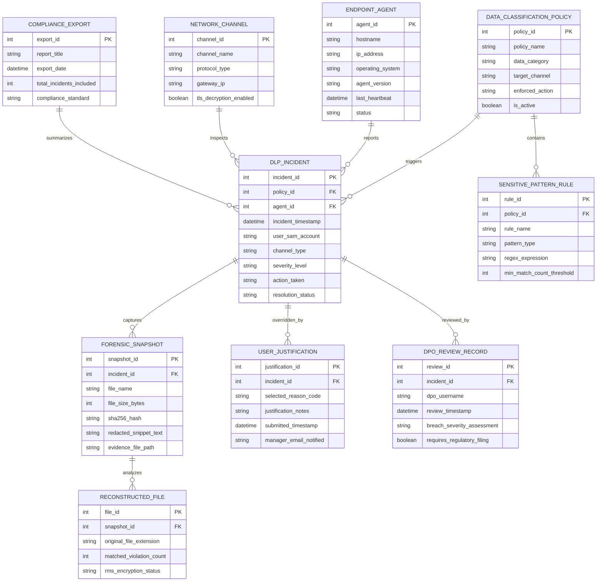

# Conceptual ERD — Data Loss Prevention (DLP) System

## Mermaid Code

## Entity Description Table | Bảng mô tả Entity

| # | Entity Name | Vietnamese Name | Description | Key Attributes | Main Relationships |
|---|-------------|-----------------|-------------|----------------|-------------------|
| 1 | DLP_INCIDENT | Sự kiện Vi phạm DLP | Master incident record capturing user accounts, transfer channels, severity ratings, actions taken, and status. | incident_id, incident_timestamp, user_sam_account, channel_type, action_taken | Primary entity; triggered by DATA_CLASSIFICATION_POLICY; captures FORENSIC_SNAPSHOT. |
| 2 | DATA_CLASSIFICATION_POLICY | Chính sách Phân loại Du liệu | Defines DLP inspection policies (PCI, PII, PHI), target channels (USB, Email, Web), and enforcement actions (Block, Encrypt). | policy_id, policy_name, data_category, target_channel, enforced_action | Triggers DLP_INCIDENT; contains SENSITIVE_PATTERN_RULE. |
| 3 | SENSITIVE_PATTERN_RULE | Quy tắc Nhận dạng Mẫu nhạy cảm | Stores regular expressions, Luhn algorithm check parameters, Exact Data Match (EDM) table hashes, and match thresholds. | rule_id, rule_name, pattern_type, min_match_count_threshold | Belongs to DATA_CLASSIFICATION_POLICY. |
| 4 | ENDPOINT_AGENT | Cảm biến Agent trên Endpoint | Stores endpoint hostnames, IP addresses, OS versions, DLP agent software versions, and heartbeat status. | agent_id, hostname, ip_address, agent_version, status | Reports DLP_INCIDENT. |
| 5 | NETWORK_CHANNEL | Kênh Giám sát Mạng | Tracks network inspection channels (HTTP/HTTPS Web, SMTP Email, FTP, Cloud Sync), gateway IPs, and TLS decryption status. | channel_id, channel_name, protocol_type, tls_decryption_enabled | Inspects DLP_INCIDENT. |
| 6 | FORENSIC_SNAPSHOT | Trích xuất Bằng chứng Vi phạm | Archives file names, SHA-256 hashes, redacted text snippets, and evidence file paths for legal investigation. | snapshot_id, file_name, sha256_hash, redacted_snippet_text, evidence_file_path | Belongs to DLP_INCIDENT; analyzes RECONSTRUCTED_FILE. |
| 7 | USER_JUSTIFICATION | Lý do Giải trình của Người dùng | Stores user business justification override codes, notes, submission timestamps, and manager email notification tags. | justification_id, selected_reason_code, justification_notes, manager_email_notified | Overrides DLP_INCIDENT. |
| 8 | RECONSTRUCTED_FILE | Phân tích Tệp tin Vi phạm | Stores reconstructed file metadata, original extensions, matched violation counts, and RMS encryption status. | file_id, original_file_extension, matched_violation_count, rms_encryption_status | Belongs to FORENSIC_SNAPSHOT. |
| 9 | DPO_REVIEW_RECORD | Hồ sơ Thẩm định DPO Privacy | Records Data Protection Officer (DPO) incident reviews, breach severity assessments, and regulatory filing requirements. | review_id, dpo_username, breach_severity_assessment, requires_regulatory_filing | Belongs to DLP_INCIDENT. |
| 10 | COMPLIANCE_EXPORT | Báo cáo Tuân thủ Báo cáo Quy định | Tracks generated GDPR, HIPAA, and PCI-DSS compliance reports summarizing DLP incident trends and policy enforcement. | export_id, report_title, export_date, compliance_standard | Summarizes DLP_INCIDENT. |

## Relationship Description | Mô tả Quan hệ

| # | From Entity | Cardinality | To Entity | Relationship Label | Business Explanation |
|---|-------------|-------------|-----------|-------------------|----------------------|
| 1 | DATA_CLASSIFICATION_POLICY | one-to-many | DLP_INCIDENT | triggers | A DLP data classification policy triggers multiple incident events. |
| 2 | DATA_CLASSIFICATION_POLICY | one-to-many | SENSITIVE_PATTERN_RULE | contains | A DLP policy contains multiple sensitive pattern matching rules. |
| 3 | ENDPOINT_AGENT | one-to-many | DLP_INCIDENT | reports | An endpoint agent reports multiple DLP exfiltration incidents. |
| 4 | DLP_INCIDENT | one-to-many | FORENSIC_SNAPSHOT | captures | A DLP incident captures forensic evidence snapshots. |
| 5 | DLP_INCIDENT | one-to-one | USER_JUSTIFICATION | overridden_by | A DLP incident can be overridden by a user business justification. |
| 6 | FORENSIC_SNAPSHOT | one-to-one | RECONSTRUCTED_FILE | analyzes | A forensic snapshot analyzes file metadata and violation counts. |
| 7 | DLP_INCIDENT | one-to-many | DPO_REVIEW_RECORD | reviewed_by | A severe DLP incident is reviewed by the Data Protection Officer. |
| 8 | NETWORK_CHANNEL | one-to-many | DLP_INCIDENT | inspects | A network channel inspects and reports network data loss incidents. |
