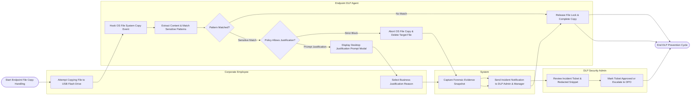

# Swimlane Diagram — Data Loss Prevention (DLP) System

## Mermaid Code

## Flow Description | Mô tả luồng

| Lane | Actor | Role in Flow |
|------|-------|-------------|
| 1 | Corporate Employee | Attempts copying a sensitive file to a USB flash drive and inputs operational business justification if prompted. |
| 2 | Endpoint DLP Agent | Hooks local OS file system I/O, extracts text streams, matches sensitive patterns (PCI/PII/EDM), blocks non-compliant file copies, and displays popups. |
| 3 | System | Captures redacted forensic evidence snippets, generates incident alerts, and emails notification summaries to managers and DLP admins. |
| 4 | DLP Security Admin | Reviews triaged incident tickets, inspects evidence snippets, confirms policy enforcement, or escalates severe leaks to the DPO. |
