# Action Tree — Data Loss Prevention (DLP) System

## Mermaid Code

```mermaid
graph TD
    Root["Data Loss Prevention System"]

    Root --> M1["Data Classification & Discovery"]
    Root --> M2["Policy Engine & Inspection"]
    Root --> M3["Real-Time Prevention & Enforcement"]
    Root --> M4["Incident Triage & Forensic Capture"]
    Root --> M5["Compliance & DPO Reporting"]

    M1 --> A1["Scan Unencrypted Cloud Repositories"]
    M1 --> A2["Tag Files as PCI, PII, or PHI"]
    M1 --> A3["Build Exact Data Match EDM Tables"]
    M1 --> A4["Index Proprietary Document Templates"]

    M2 --> B1["Inspect Endpoint File System Copies"]
    M2 --> B2["Inspect Outbound SMTP Email Attachments"]
    M2 --> B3["Inspect HTTPS Web POST Uploads"]
    M2 --> B4["Evaluate Luhn Credit Card Regex"]

    M3 --> C1["Block USB Removable Media Copy"]
    M3 --> C2["Quarantine Non-Compliant Emails"]
    M3 --> C3["Apply Microsoft RMS Encryption Tags"]
    M3 --> C4["Prompt User Business Justification"]

    M4 --> D1["Capture Redacted Evidence Snippet"]
    M4 --> D2["Log SHA-256 File Hash Signature"]
    M4 --> D3["Triage Incident Severity Level"]
    M4 --> D4["Notify Employee Manager via Email"]

    M5 --> E1["Conduct DPO Breach Privacy Review"]
    M5 --> E2["Track High-Risk Departing Employees"]
    M5 --> E3["Export GDPR Data Protection Audit Log"]
    M5 --> E4["Generate PCI-DSS Compliance Certificate"]
```

## Module Description | Mô tả Module

| # | Module | Description | Actions |
|---|--------|-------------|---------|
| 1 | Data Classification & Discovery | Cloud repository data scanning, PCI/PII/PHI metadata tagging, Exact Data Match (EDM) table generation, and template indexing. | Scan Unencrypted Cloud Repositories, Tag Files as PCI, PII, or PHI, Build Exact Data Match EDM Tables, Index Proprietary Document Templates |
| 2 | Policy Engine & Inspection | Endpoint file system copy inspection, outbound email attachment checking, HTTPS web upload inspection, and regex matching. | Inspect Endpoint File System Copies, Inspect Outbound SMTP Email Attachments, Inspect HTTPS Web POST Uploads, Evaluate Luhn Credit Card Regex |
| 3 | Real-Time Prevention & Enforcement | Automated USB copy blocking, email quarantine, Microsoft RMS encryption enforcement, and user business justification prompts. | Block USB Removable Media Copy, Quarantine Non-Compliant Emails, Apply Microsoft RMS Encryption Tags, Prompt User Business Justification |
| 4 | Incident Triage & Forensic Capture | Redacted evidence snippet capture, SHA-256 file hashing, incident severity triage, and manager notification dispatches. | Capture Redacted Evidence Snippet, Log SHA-256 File Hash Signature, Triage Incident Severity Level, Notify Employee Manager via Email |
| 5 | Compliance & DPO Reporting | DPO breach privacy reviews, high-risk departing employee exfiltration tracking, GDPR audit logging, and PCI-DSS certification. | Conduct DPO Breach Privacy Review, Track High-Risk Departing Employees, Export GDPR Data Protection Audit Log, Generate PCI-DSS Compliance Certificate |
