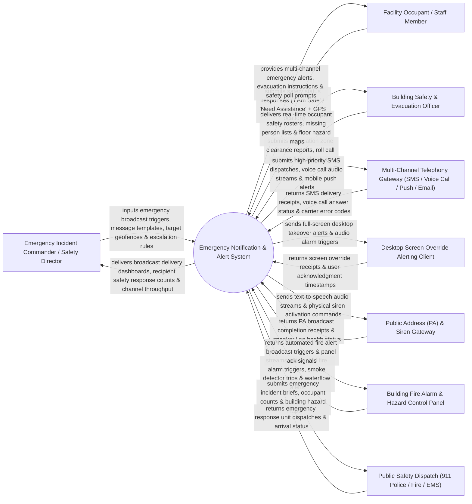

# Context Diagram — Emergency Notification & Alert System

## Mermaid Code

## Actor & Interaction Table | Bảng Actor & Tương tác

| # | Actor | Actor Type | Data Sent TO System | Data Received FROM System | Notes |
|---|-------|------------|---------------------|---------------------------|-------|
| 1 | Emergency Incident Commander / Safety Director | Primary | Emergency broadcast triggers, message templates, target geofence zones, escalation rules. | Broadcast delivery dashboards, recipient safety response counts, channel throughput. | Executive incident commander initiating mass emergency broadcasts and managing crisis response. |
| 2 | Facility Occupant / Staff Member | Primary | Safety status responses ("I Am Safe" / "Need Assistance"), GPS location drops. | Multi-channel emergency alerts, evacuation instructions, safety poll prompts. | Employee, contractor, or visitor receiving mass emergency notifications. |
| 3 | Building Safety & Evacuation Officer | Primary | Evacuation zone clearance reports, roll call status, floor check-ins. | Real-time occupant safety rosters, missing person lists, floor hazard maps. | Floor warden conducting physical evacuation roll calls and verifying occupant safety. |
| 4 | Multi-Channel Telephony Gateway | Supporting | SMS delivery receipts, voice call answer status, mobile push receipts, carrier error codes. | High-priority SMS dispatches, voice call audio streams, mobile push alerts. | External mass notification gateway (Twilio, Everbridge, OnSolve) dispatching SMS/Voice. |
| 5 | Desktop Alerting Client | Supporting | Screen override receipts, user acknowledgment timestamps, workstation IDs. | Full-screen desktop takeover alerts, audio alarm triggers, evacuation instructions. | Lightweight enterprise desktop agent displaying full-screen emergency popups. |
| 6 | Public Address (PA) & Siren Gateway | Supporting | PA broadcast completion receipts, speaker line health status, amplifier metrics. | Text-to-speech audio streams, physical siren activation commands, zone audio. | Facility PA system (Valcom/Bogen) broadcasting text-to-speech audio over loudspeakers. |
| 7 | Building Fire Alarm & Hazard Panel | Supporting | Automated fire alarm triggers, smoke detector trips, waterflow pressure drops. | Automated fire alert broadcast triggers, panel acknowledgment signals. | Hardware fire alarm panel triggering automated mass emergency broadcasts. |
| 8 | Public Safety Agency | Supporting / Regulatory | Emergency response unit dispatches, arrival status, police/fire incident numbers. | Emergency incident briefs, occupant counts, building hazard maps, access codes. | Public 911 police and fire department receiving real-time emergency crisis briefs. |

## System Boundary Description | Mô tả Phạm vi Hệ thống

The **Emergency Notification & Alert System** is an enterprise mass notification, multi-channel broadcast (SMS/Voice/Push/Email/PA/Desktop), geofenced audience selection, recipient safety status polling ("I Am Safe"), and emergency drill simulation platform.

**Inside System Scope:**
- Pre-configuration of emergency message templates (Active Shooter, Severe Weather, Hazardous Material, Fire).
- Multi-channel simultaneous broadcast dispatches across SMS, automated voice calls, push notifications, emails, desktop screen overrides, and PA loudspeakers.
- Dynamic geofence audience targeting specifying physical buildings or GPS radius zones.
- Real-time recipient safety status polling ("I Am Safe" vs "Need Assistance") with GPS location tracking.
- Automated escalation rules for unacknowledged critical emergency alerts.

**Outside System Scope:**
- Direct physical fighting of building fires (handled by Firefighters).
- Direct physical maintenance of municipal cellular towers (handled by Telecom Providers).
- General non-emergency corporate newsletter email marketing (handled by Marketing Systems).
