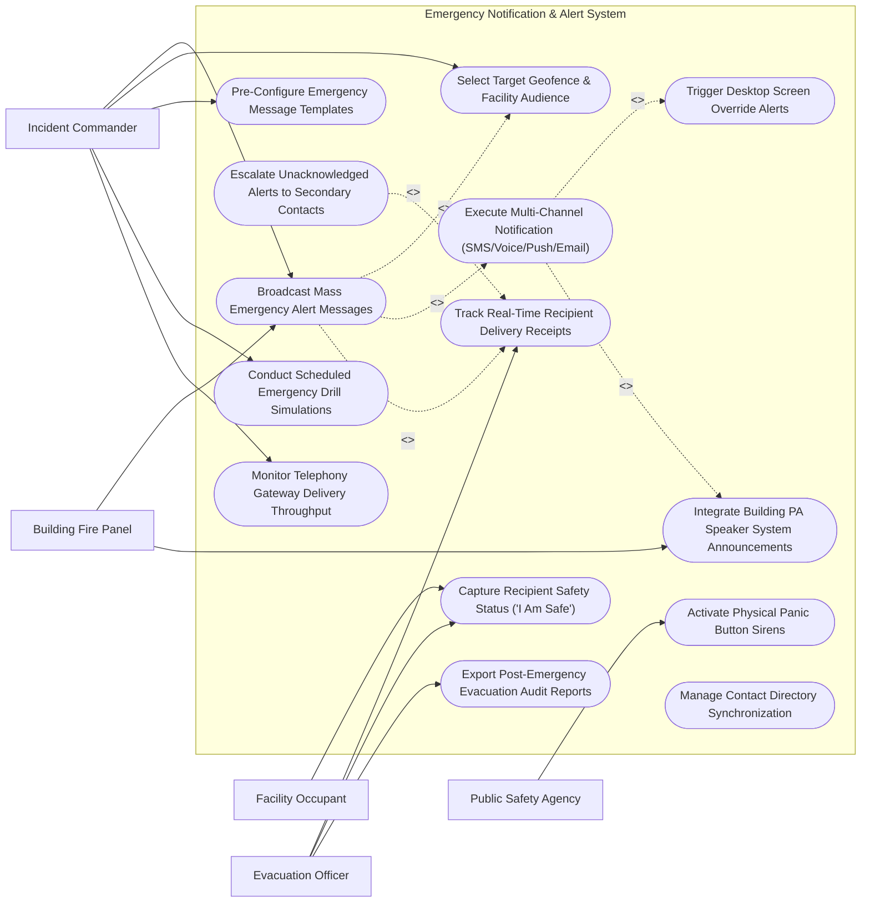

# Use Case Diagram — Emergency Notification & Alert System

## Mermaid Code

## Actor Table | Bảng Actor

| # | Actor | Actor Type | Role Description | Related Use Cases |
|---|-------|------------|------------------|-------------------|
| 1 | Incident Commander | Primary | Initiates mass emergency broadcasts, selects target geofences, configures message templates, and runs drill simulations. | UC01, UC02, UC09, UC11, UC14 |
| 2 | Facility Occupant | Primary | Receives multi-channel emergency alerts and submits safety status responses ("I Am Safe" / "Need Assistance"). | UC07 |
| 3 | Evacuation Officer | Primary | Tracks real-time delivery receipts, monitors occupant safety polling responses, and exports post-emergency audit reports. | UC06, UC07, UC13 |
| 4 | Building Fire Panel | Supporting / System | Hardware fire alarm panel triggering automated mass emergency broadcasts upon smoke/waterflow detection. | UC01, UC05 |
| 5 | Public Safety Agency | Supporting / System | Public emergency services (911 Police / Fire / EMS) receiving emergency incident briefs. | UC08 |

## Use Case Table | Bảng Use Case

| # | UC ID | Use Case Name | Primary Actor | Secondary Actor | Description | Priority |
|---|-------|---------------|---------------|-----------------|-------------|----------|
| 1 | UC01 | Broadcast Mass Emergency Alert Messages | Commander | Fire Panel | Initiates rapid mass emergency notification broadcasts across multiple communication channels simultaneously. | High |
| 2 | UC02 | Select Target Geofence & Facility Audience | Commander | None | Filters broadcast target recipients by building floor, department group, or GPS radius geofence boundary. | High |
| 3 | UC03 | Execute Multi-Channel Notification (SMS/Voice/Push/Email) | Commander | None | Dispatches messages simultaneously over SMS, text-to-speech voice calls, mobile push notifications, and emails. | High |
| 4 | UC04 | Trigger Desktop Screen Override Alerts | Commander | None | Forces a full-screen emergency takeover modal with audio alarms on all logged-in corporate desktop computers. | High |
| 5 | UC05 | Integrate Building PA Speaker System Announcements | Fire Panel | Commander | Broadcasts text-to-speech emergency announcements over facility Public Address (PA) loudspeakers and sirens. | High |
| 6 | UC06 | Track Real-Time Recipient Delivery Receipts | SafetyOfficer | Commander | Renders live delivery dashboards displaying SMS sent/delivered/failed counts and carrier throughput metrics. | High |
| 7 | UC07 | Capture Recipient Safety Status ("I Am Safe") | Occupant | SafetyOfficer | Collects 1-tap safety responses ("I Am Safe" vs "Need Assistance") and GPS locations from occupants. | High |
| 8 | UC08 | Activate Physical Panic Button Sirens | Public Safety | Commander | Triggers physical building sirens, strobe lights, and emergency door release relays. | High |
| 9 | UC09 | Pre-Configure Emergency Message Templates | Commander | None | Maintains pre-approved, standardized emergency notification templates (Active Shooter, Severe Weather, Fire). | Medium |
| 10 | UC10 | Escalate Unacknowledged Alerts to Secondary Contacts | Commander | None | Auto-dials secondary emergency contacts (family/spouse) if an occupant fails to acknowledge an alert within 10 minutes. | Medium |
| 11 | UC11 | Conduct Scheduled Emergency Drill Simulations | Commander | None | Executes simulated emergency fire/weather drills to test system delivery speeds and train staff. | Medium |
| 12 | UC12 | Manage Contact Directory Synchronization | Commander | None | Synchronizes user mobile phone numbers and email addresses daily with HRIS and Active Directory services. | Medium |
| 13 | UC13 | Export Post-Emergency Evacuation Audit Reports | SafetyOfficer | None | Generates certified evacuation reports detailing delivery timelines, occupant safety poll tallies, and missing person lists. | High |
| 14 | UC14 | Monitor Telephony Gateway Delivery Throughput | Commander | None | Tracks telephony provider SMS throughput rates (e.g., 5,000 SMS/sec) and detects carrier throttling. | Low |

## Use Case Specification | Đặc tả Use Case

---

### UC01 — Broadcast Mass Emergency Alert Messages

| Field | Detail |
|-------|--------|
| **UC ID** | UC01 |
| **Use Case Name** | Broadcast Mass Emergency Alert Messages |
| **Actor(s)** | Primary: Incident Commander   Secondary: Building Fire Panel |
| **Description** | Initiates high-priority mass emergency broadcasts simultaneously across SMS, automated voice calls, mobile push, desktop overrides, and PA loudspeakers. |
| **Precondition** | 1. Emergency situation requires mass notification.   2. Incident Commander is authenticated with mass broadcast privileges. |
| **Main Flow** | 1. Commander opens Emergency Broadcast Console and clicks "LAUNCH MASS ALERT".   2. Commander selects Pre-Configured Template `TMPL-EVAC-FIRE` ("FIRE EMERGENCY - Evacuate Building A Immediately").   3. Commander executes UC02 Select Target Geofence & Facility Audience (Selects "Building A - All Floors").   4. Commander clicks "CONFIRM & LAUNCH BROADCAST".   5. System executes UC03 Execute Multi-Channel Notification in parallel:     a. Channel 1: Dispatches 2,500 high-priority SMS messages.     b. Channel 2: Dispatches 2,500 mobile push notifications.     c. Channel 3: Triggers UC04 Desktop Screen Override Alerts on 1,200 workstations.     d. Channel 4: Triggers UC05 Integrate Building PA Speaker System Announcements over loudspeakers.   6. System starts real-time UC06 Track Real-Time Recipient Delivery Receipts monitoring. |
| **Alternative Flow** | **AF1** — Automated Fire Panel Trigger: Building Fire Panel detects active sprinkler flow in Zone 2, automatically triggering UC01 broadcast without manual click. |
| **Exception Flow** | **EX1** — SMS Carrier Throttle: System detects carrier SMS queue congestion, automatically switching to automated voice call fallback dispatches. |
| **Postcondition** | Mass emergency alert is dispatched across all channels and delivery tracking is active. |
| **Business Rule** | **BR1**: Mass emergency broadcasts must reach at least 95% of target recipients within 60 seconds of launch. |

---

### UC02 — Select Target Geofence & Facility Audience

| Field | Detail |
|-------|--------|
| **UC ID** | UC02 |
| **Use Case Name** | Select Target Geofence & Facility Audience |
| **Actor(s)** | Primary: Incident Commander   Secondary: None |
| **Description** | Dynamically filters broadcast target recipient lists by physical building floors, corporate department groups, or GPS radius geofence zones. |
| **Precondition** | 1. Recipient contact directory is synchronized with HRIS and active locations. |
| **Main Flow** | 1. Commander opens audience selection panel during alert creation.   2. System presents 3 targeting methods: [By Facility Building, By Department Group, By GPS Geofence Circle].   3. Commander selects "GPS Geofence Circle".   4. Commander draws a 1-kilometer radius circle on the interactive GIS map around Chemical Lab Plant.   5. System queries database for all users whose last known GPS position or assigned workstation falls within the circle.   6. System calculates audience count: `3,450 Target Recipients Identified`.   7. System binds target recipient list to active broadcast job. |
| **Alternative Flow** | **AF1** — Facility-Wide Broadcast: Commander selects "ALL EMPLOYEES & VISITORS - ENTERPRISE WIDE" for global crises. |
| **Exception Flow** | **EX1** — Empty Target Audience: System alerts commander if drawn geofence contains zero users and prompts for radius expansion. |
| **Postcondition** | Target recipient audience is filtered and bound to the emergency broadcast job. |
| **Business Rule** | **BR1**: Geofence audience filtering must incorporate both physical workstation locations and real-time mobile app GPS drops. |

---

### UC03 — Execute Multi-Channel Notification (SMS/Voice/Push/Email)

| Field | Detail |
|-------|--------|
| **UC ID** | UC03 |
| **Use Case Name** | Execute Multi-Channel Notification |
| **Actor(s)** | Primary: Incident Commander   Secondary: None |
| **Description** | Orchestrates simultaneous message dispatches over SMS, text-to-speech voice calls, mobile push notifications, and emails via telephony gateways. |
| **Precondition** | 1. Target audience and emergency payload are finalized.   2. Telephony API gateways (Twilio / Everbridge API) are connected. |
| **Main Flow** | 1. Multi-Channel Dispatch Engine receives broadcast payload JSON.   2. Engine splits target audience list across 4 parallel channel dispatch threads:     a. SMS Thread: Submits batch API POST request to SMS gateway (Rate: 5,000 SMS/sec).     b. Push Thread: Submits Firebase / APNS push payload to mobile apps.     c. Voice Thread: Submits text-to-speech audio script to voice call gateway.     d. Email Thread: Submits high-priority SMTP bulk email dispatch.   3. Telephony Gateways process dispatches and return real-time delivery receipts (SMS Delivered, Voice Answered, Push Delivered).   4. Engine updates central delivery metrics in database. |
| **Alternative Flow** | **AF1** — Sequential Channel Cascade: System sends Push notification first; if unacknowledged after 2 minutes, system falls back to SMS, then Voice call. |
| **Exception Flow** | **EX1** — Invalid Phone Number: Telephony gateway returns error "21211 - Invalid Number"; system flags contact record for HR update and logs delivery failure. |
| **Postcondition** | Multi-channel emergency dispatches are processed and delivery receipts are collected. |
| **Business Rule** | **BR1**: Emergency SMS dispatches must be tagged with high-priority shortcodes to bypass standard carrier queuing. |

---

### UC06 — Track Real-Time Recipient Delivery Receipts

| Field | Detail |
|-------|--------|
| **UC ID** | UC06 |
| **Use Case Name** | Track Real-Time Recipient Delivery Receipts |
| **Actor(s)** | Primary: Building Safety & Evacuation Officer   Secondary: Incident Commander |
| **Description** | Renders live delivery dashboards displaying real-time delivery progress percentages, carrier status breakdown, and delivery failure logs. |
| **Precondition** | 1. Mass emergency broadcast is launched and active. |
| **Main Flow** | 1. Evacuation Officer opens "Live Broadcast Monitor" for alert `BRD-2026-0830`.   2. System renders real-time delivery gauges:     a. Total Target Audience: 5,000 Recipients.     b. SMS Delivered: 4,820 (96.4%).     c. Mobile Push Delivered: 4,750 (95.0%).     d. Desktop Alerts Confirmed: 1,150 (95.8%).     e. Voice Calls Answered: 420 (84.0%).   3. System renders delivery speed chart (Messages Delivered per Second).   4. Officer filters delivery log by "FAILED DELIVERIES" to identify unreached occupants.   5. Officer initiates UC10 Escalate Unacknowledged Alerts for unreached list. |
| **Alternative Flow** | **AF1** — Carrier Throughput Heatmap: Renders map showing delivery speed by mobile carrier (AT&T vs Verizon). |
| **Exception Flow** | **EX1** — Widespread Telephony Outage: System detects > 20% SMS delivery failure rate across carriers, sounding alert to switch to PA Loudspeaker. |
| **Postcondition** | Real-time delivery progress metrics and failure logs are rendered on safety consoles. |
| **Business Rule** | **BR1**: Delivery dashboards must update metrics at least once every 2 seconds during active broadcasts. |

---

### UC07 — Capture Recipient Safety Status ("I Am Safe")

| Field | Detail |
|-------|--------|
| **UC ID** | UC07 |
| **Use Case Name** | Capture Recipient Safety Status ("I Am Safe") |
| **Actor(s)** | Primary: Facility Occupant   Secondary: Building Safety & Evacuation Officer |
| **Description** | Collects 1-tap safety polling responses ("I Am Safe" vs "Need Assistance") and GPS location drops from occupants to compile evacuation rosters. |
| **Precondition** | 1. Emergency alert with safety poll prompt is delivered to occupant device. |
| **Main Flow** | 1. Occupant receives emergency push notification / SMS link on smartphone: "FIRE EMERGENCY - REPORT YOUR SAFETY STATUS".   2. Occupant opens message and taps large green button **"I AM SAFE"** (or red button **"NEED ASSISTANCE"**).   3. Smartphone app captures current GPS coordinates and occupant floor location.   4. App transmits safety response payload to System.   5. System updates Occupant Safety Status in master evacuation database: `Status: SAFE`, `Location: Muster Point Alpha`, `Timestamp: 10:14:22 AM`.   6. Evacuation Officer dashboard updates real-time safety tally (`3,200 Safe / 12 Need Assistance / 238 Unaccounted`). |
| **Alternative Flow** | **AF1** — "Need Assistance" Emergency Priority: Occupant taps "NEED ASSISTANCE - Trapped in Room 402". System flags high-priority red alert on Evacuation Officer console with room location and GPS map. |
| **Exception Flow** | **EX1** — SMS 2-Way Response: Occupant replies to SMS with "SAFE" or "HELP"; SMS gateway parses text string and updates safety status. |
| **Postcondition** | Occupant safety response and GPS location are logged and updated on evacuation rosters. |
| **Business Rule** | **BR1**: Safety status responses marked "NEED ASSISTANCE" must immediately highlight on Evacuation Officer GIS maps. |
