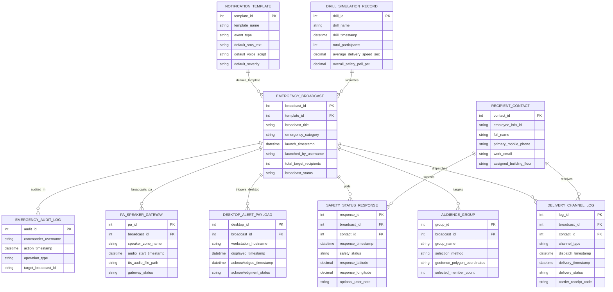

# Conceptual ERD — Emergency Notification & Alert System

## Mermaid Code

## Entity Description Table | Bảng mô tả Entity

| # | Entity Name | Vietnamese Name | Description | Key Attributes | Man Relationships |
|---|-------------|-----------------|-------------|----------------|-------------------|
| 1 | EMERGENCY_BROADCAST | Lượt Phát Thông báo Khẩn cấp | Master broadcast job record tracking event titles, categories, launch timestamps, total recipient counts, and status. | broadcast_id, broadcast_title, emergency_category, launch_timestamp, broadcast_status | Primary entity; targets AUDIENCE_GROUP; dispatches DELIVERY_CHANNEL_LOG. |
| 2 | NOTIFICATION_TEMPLATE | Mẫu Thông báo Chuẩn bị trước | Stores pre-approved emergency templates (Fire, Active Shooter, Weather), default SMS texts, voice scripts, and severities. | template_id, template_name, event_type, default_sms_text, default_voice_script | Defines EMERGENCY_BROADCAST. |
| 3 | AUDIENCE_GROUP | Nhóm Người nhận Mục tiêu | Defines broadcast target audience selection methods (Building, Department, Geofence Polygon), and member counts. | group_id, group_name, selection_method, geofence_polygon_coordinates | Targeted by EMERGENCY_BROADCAST. |
| 4 | RECIPIENT_CONTACT | Danh bạ Người nhận | Stores employee contact profiles, HRIS IDs, mobile phones, emails, assigned building floor locations, and active status. | contact_id, employee_hris_id, full_name, primary_mobile_phone, assigned_building_floor | Receives DELIVERY_CHANNEL_LOG; submits SAFETY_STATUS_RESPONSE. |
| 5 | DELIVERY_CHANNEL_LOG | Nhật ký Gửi qua Kênh (SMS/Voice) | Archives individual channel dispatches (SMS, Voice, Push, Email), timestamps, delivery statuses, and carrier receipt codes. | log_id, channel_type, dispatch_timestamp, delivery_timestamp, delivery_status | Dispatched by EMERGENCY_BROADCAST; received by RECIPIENT_CONTACT. |
| 6 | SAFETY_STATUS_RESPONSE | Báo cáo Trạng thái An toàn | Captures 1-tap safety responses ("I Am Safe" / "Need Assistance"), GPS latitude/longitude, timestamps, and user notes. | response_id, response_timestamp, safety_status, response_latitude, response_longitude | Polled by EMERGENCY_BROADCAST; submitted by RECIPIENT_CONTACT. |
| 7 | DESKTOP_ALERT_PAYLOAD | Thông báo Chiếm Màn hình PC | Tracks full-screen desktop takeover alerts displayed on workstations, display timestamps, and user acknowledgment status. | desktop_id, workstation_hostname, displayed_timestamp, acknowledgment_status | Triggered by EMERGENCY_BROADCAST. |
| 8 | PA_SPEAKER_GATEWAY | Loa Thông báo Công cộng (PA) | Manages text-to-speech audio streaming over physical building PA loudspeaker zones and line health status. | pa_id, speaker_zone_name, audio_start_timestamp, tts_audio_file_path | Broadcasted by EMERGENCY_BROADCAST. |
| 9 | DRILL_SIMULATION_RECORD | Nhật ký Diễn tập Khẩn cấp | Stores scheduled emergency drill simulation executions, delivery speeds, safety polling participation percentages, and logs. | drill_id, drill_name, drill_timestamp, total_participants, average_delivery_speed_sec | Simulates EMERGENCY_BROADCAST. |
| 10 | EMERGENCY_AUDIT_LOG | Nhật ký Kiểm toán Thông báo | Captures incident commander broadcast launches, template edits, audience overrides, and audit compliance receipts. | audit_id, commander_username, action_timestamp, operation_type, target_broadcast_id | Audits EMERGENCY_BROADCAST. |

## Relationship Description | Mô tả Quan hệ

| # | From Entity | Cardinality | To Entity | Relationship Label | Business Explanation |
|---|-------------|-------------|-----------|-------------------|----------------------|
| 1 | NOTIFICATION_TEMPLATE | one-to-many | EMERGENCY_BROADCAST | defines_template | A notification template defines pre-approved text for emergency broadcasts. |
| 2 | EMERGENCY_BROADCAST | one-to-many | AUDIENCE_GROUP | targets | An emergency broadcast targets one or more audience groups or geofences. |
| 3 | EMERGENCY_BROADCAST | one-to-many | DELIVERY_CHANNEL_LOG | dispatches | An emergency broadcast dispatches multi-channel delivery logs. |
| 4 | RECIPIENT_CONTACT | one-to-many | DELIVERY_CHANNEL_LOG | receives | A recipient contact receives delivery notifications across channels. |
| 5 | EMERGENCY_BROADCAST | one-to-many | SAFETY_STATUS_RESPONSE | polls | An emergency broadcast polls safety status responses from occupants. |
| 6 | RECIPIENT_CONTACT | one-to-many | SAFETY_STATUS_RESPONSE | submits | A recipient contact submits safety status responses. |
| 7 | EMERGENCY_BROADCAST | one-to-many | DESKTOP_ALERT_PAYLOAD | triggers_desktop | An emergency broadcast triggers desktop screen override alerts. |
| 8 | EMERGENCY_BROADCAST | one-to-many | PA_SPEAKER_GATEWAY | broadcasts_pa | An emergency broadcast streams text-to-speech audio over PA speaker systems. |
