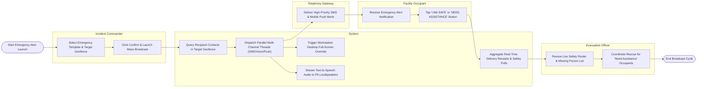

# Swimlane Diagram — Emergency Notification & Alert System

## Mermaid Code

## Flow Description | Mô tả luồng

| Lane | Actor | Role in Flow |
|------|-------|-------------|
| 1 | Incident Commander | Selects pre-approved emergency templates, defines target geofence boundaries, and launches mass broadcasts. |
| 2 | System | Queries target contacts, dispatches multi-channel threads, forces desktop screen overrides, streams PA audio, and aggregates safety polls. |
| 3 | Telephony Gateway | Processes high-priority shortcode SMS dispatches and mobile push notifications, returning carrier delivery receipts. |
| 4 | Facility Occupant | Receives multi-channel emergency notifications on devices and submits 1-tap safety polling status ("I Am Safe"). |
| 5 | Evacuation Officer | Monitors live occupant safety dashboards, identifies unaccounted occupants, and coordinates emergency rescue for "Need Assistance" flags. |
