# Action Tree — Emergency Notification & Alert System

## Mermaid Code

```mermaid
graph TD
    Root["Emergency Notification & Alert System"]

    Root --> M1["Emergency Broadcast Setup"]
    Root --> M2["Multi-Channel Dispatch Engine"]
    Root --> M3["Recipient Tracking & Safety Poll"]
    Root --> M4["Desktop & PA Hardware Integration"]
    Root --> M5["Drill Simulation & Analytics"]

    M1 --> A1["Launch Pre-Configured Emergency Template"]
    M1 --> A2["Draw Target Geofence Radius on GIS Map"]
    M1 --> A3["Select Facility Building & Floor Groups"]
    M1 --> A4["Configure Auto-Escalation Call Rules"]

    M2 --> B1["Dispatch High-Priority Shortcode SMS"]
    M2 --> B2["Send Mobile App Push Notifications"]
    M2 --> B3["Execute Text-to-Speech Automated Voice Calls"]
    M2 --> B4["Submit Bulk SMTP Emergency Emails"]

    M3 --> C1["Capture 1-Tap 'I Am Safe' Responses"]
    M3 --> C2["Highlight 'Need Assistance' GPS Locations"]
    M3 --> C3["Track Real-Time Delivery Receipts %"]
    M3 --> C4["Auto-Dial Secondary Family Contacts"]

    M4 --> D1["Force Workstation Desktop Full-Screen Override"]
    M4 --> D2["Stream TTS Audio to Building PA Speakers"]
    M4 --> D3["Ingest Fire Alarm Panel Smoke Detector Trips"]
    M4 --> D4["Activate Physical Strobe Sirens & Relays"]

    M5 --> E1["Conduct Scheduled Emergency Drill Simulations"]
    M5 --> E2["Sync HRIS & Active Directory Contacts"]
    M5 --> E3["Monitor Telephony Gateway Throughput"]
    M5 --> E4["Export Post-Evacuation Audit Report"]
```

## Module Description | Mô tả Module

| # | Module | Description | Actions |
|---|--------|-------------|---------|
| 1 | Emergency Broadcast Setup | Pre-configured emergency template launches, GIS map geofence targeting, facility building selection, and auto-escalation rules. | Launch Pre-Configured Emergency Template, Draw Target Geofence Radius on GIS Map, Select Facility Building & Floor Groups, Configure Auto-Escalation Call Rules |
| 2 | Multi-Channel Dispatch Engine | High-priority SMS dispatches, mobile push alerts, text-to-speech voice calls, and bulk SMTP email dispatches. | Dispatch High-Priority Shortcode SMS, Send Mobile App Push Notifications, Execute Text-to-Speech Automated Voice Calls, Submit Bulk SMTP Emergency Emails |
| 3 | Recipient Tracking & Safety Poll | 1-tap "I Am Safe" response collection, "Need Assistance" GPS highlighting, real-time delivery tracking %, and secondary contact auto-dials. | Capture 1-Tap 'I Am Safe' Responses, Highlight 'Need Assistance' GPS Locations, Track Real-Time Delivery Receipts %, Auto-Dial Secondary Family Contacts |
| 4 | Desktop & PA Hardware Integration | Workstation full-screen desktop overrides, PA speaker TTS audio streaming, fire panel alarm ingestion, and strobe siren releases. | Force Workstation Desktop Full-Screen Override, Stream TTS Audio to Building PA Speakers, Ingest Fire Alarm Panel Smoke Detector Trips, Activate Physical Strobe Sirens & Relays |
| 5 | Drill Simulation & Analytics | Scheduled emergency drill simulations, HRIS directory synchronization, telephony gateway throughput monitoring, and audit report exports. | Conduct Scheduled Emergency Drill Simulations, Sync HRIS & Active Directory Contacts, Monitor Telephony Gateway Throughput, Export Post-Evacuation Audit Report |
