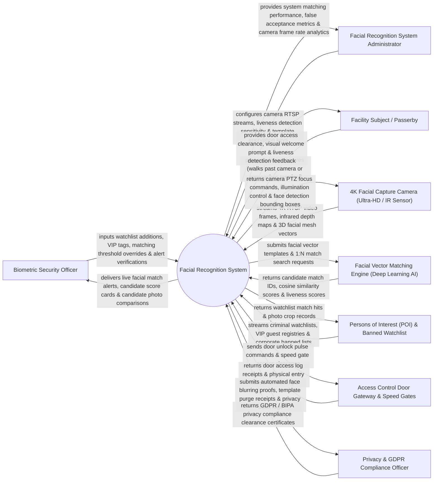

# Context Diagram — Facial Recognition System

## Mermaid Code

## Actor & Interaction Table | Bảng Actor & Tương tác

| # | Actor | Actor Type | Data Sent TO System | Data Received FROM System | Notes |
|---|-------|------------|---------------------|---------------------------|-------|
| 1 | Biometric Security Officer | Primary | Watchlist additions, VIP tags, matching threshold overrides, alert verifications. | Live facial match alerts, candidate score cards, candidate photo comparisons. | Security operator reviewing facial recognition alerts and verifying watchlist hits. |
| 2 | Facial Recognition System Administrator | Primary | Camera RTSP streams, liveness sensitivity settings, template encryption keys. | System matching performance, false acceptance metrics, camera frame rate analytics. | Technical administrator configuring AI facial vector engines and camera streams. |
| 3 | Facility Subject / Passerby | Primary | Facial features presented to camera or access terminal. | Door access clearance, visual welcome prompt, liveness detection feedback. | Employee, guest, or passerby walking through facility camera surveillance zones. |
| 4 | 4K Facial Capture Camera | Supporting | 4K RTSP video frames, infrared depth maps, 3D facial mesh vectors. | Camera PTZ focus commands, illumination control, face detection bounding boxes. | High-resolution IP camera capturing facial frames in various lighting conditions. |
| 5 | Facial Vector Matching Engine | Supporting | Candidate match IDs, cosine similarity scores (0-100%), liveness detection scores. | Facial vector templates (512-dim embedding), 1:N match search requests. | Deep learning AI engine (InsightFace / FaceNet) extracting 512-dimensional vector embeddings. |
| 6 | Persons of Interest (POI) Watchlist Database | Supporting | Criminal watchlists, VIP guest registries, corporate banned lists. | Watchlist match hits, photo crop records, match timestamps. | Database containing pre-enrolled facial vector templates of POI subjects. |
| 7 | Access Control Door Gateway & Speed Gates | Supporting | Door access log receipts, physical entry sensor timestamps, door forced alerts. | Door unlock pulse commands, speed gate access clearance, screen welcome prompts. | Electronic door controller unlocking turnstiles upon successful 1:1 facial verification. |
| 8 | Privacy & GDPR Compliance Officer | Supporting / Regulatory | Privacy compliance audit inquiries, data retention mandates, consent forms. | Automated face blurring proofs, template purge receipts, privacy audit logs. | Compliance officer verifying GDPR, BIPA, and biometric privacy law compliance. |

## System Boundary Description | Mô tả Phạm vi Hệ thống

The **Facial Recognition System** is an enterprise 4K video facial capture, 512-dimensional vector embedding extraction, 1:N Persons of Interest (POI) watchlist matching, AI liveness detection (anti-spoofing), and GDPR background face blurring platform.

**Inside System Scope:**
- Ingestion of 4K multi-camera RTSP video streams and real-time face detection bounding box alignment.
- Extraction of non-reversible 512-dimensional facial vector embeddings (FaceNet / InsightFace).
- 1:N real-time watchlist matching against millions of enrolled POI templates in under 50 milliseconds.
- AI 3D liveness detection evaluating micro-expressions, skin IR reflectance, and depth maps to block photo/mask spoof attacks.
- Real-time automated background face blurring for non-target bystanders in compliance with GDPR.

**Outside System Scope:**
- Direct physical cosmetic surgery or facial reconstruction (handled by Medical Surgeons).
- Direct manufacturing of camera silicon sensor chips (handled by Semiconductor Vendors).
- General non-biometric HR payroll processing (handled by Enterprise HR Systems).
