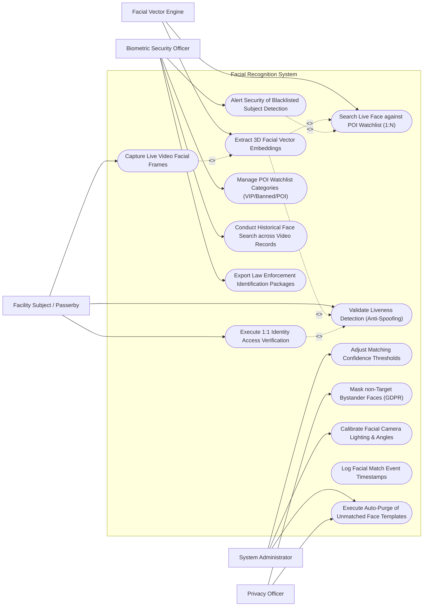

# Use Case Diagram — Facial Recognition System

## Mermaid Code

## Actor Table | Bảng Actor

| # | Actor | Actor Type | Role Description | Related Use Cases |
|---|-------|------------|------------------|-------------------|
| 1 | Biometric Security Officer | Primary | Receives live blacklisted subject alerts, manages POI watchlists, searches historical video records, and exports police briefs. | UC06, UC07, UC10, UC13 |
| 2 | System Administrator | Primary | Configures matching confidence thresholds, calibrates camera lighting angles, and manages auto-purge rules. | UC08, UC11, UC14 |
| 3 | Facility Subject / Passerby | Primary | Presents facial features to cameras for 1:1 access verification or passes through 1:N surveillance zones. | UC01, UC04, UC05 |
| 4 | Privacy Officer | Secondary | Audits GDPR background face blurring, verifies biometric consent records, and audits template purge logs. | UC09, UC14 |
| 5 | Facial Vector Engine | Supporting / System | Deep learning AI engine extracting 512-dimensional vector embeddings and performing 1:N similarity searches. | UC02, UC03 |

## Use Case Table | Bảng Use Case

| # | UC ID | Use Case Name | Primary Actor | Secondary Actor | Description | Priority |
|---|-------|---------------|---------------|-----------------|-------------|----------|
| 1 | UC01 | Capture Live Video Facial Frames | Subject | SysAdmin | Detects and crops human faces from 4K RTSP video streams using multi-task cascaded convolutional networks (MTCNN). | High |
| 2 | UC02 | Extract 3D Facial Vector Embeddings | Vector Engine | None | Converts 2D/3D facial landmarks into a non-reversible 512-dimensional numerical vector embedding. | High |
| 3 | UC03 | Search Live Face against POI Watchlist (1:N) | Vector Engine | SecurityOfficer | Executes 1:N cosine similarity vector searches across millions of enrolled POI templates in under 50 milliseconds. | High |
| 4 | UC04 | Execute 1:1 Identity Access Verification | Subject | None | Verifies a single user's face against their pre-enrolled template stored in their employee profile for door access. | High |
| 5 | UC05 | Validate Liveness Detection (Anti-Spoofing) | Subject | Vector Engine | Analyzes 3D depth, skin reflectance, micro-expressions, and IR light to block fake photos, screens, or 3D masks. | High |
| 6 | UC06 | Alert Security of Blacklisted Subject Detection | SecurityOfficer | None | Triggers instant visual popups and audible alarms when a recognized face matches a banned or criminal watchlist entry. | High |
| 7 | UC07 | Manage POI Watchlist Categories (VIP/Banned/POI) | SecurityOfficer | None | Enrolls, updates, or categorizes watchlist profiles (VIP Guests, Banned Persons, Missing Persons). | Medium |
| 8 | UC08 | Adjust Matching Confidence Thresholds | SysAdmin | None | Tunes vector match cosine similarity thresholds (e.g., Strict 92% for Access Control vs 85% for Surveillance). | Medium |
| 9 | UC09 | Mask non-Target Bystander Faces (GDPR) | PrivacyOfficer | None | Automatically applies real-time pixelation blurring to non-matched bystander faces in surveillance video streams. | High |
| 10 | UC10 | Conduct Historical Face Search across Video Records | SecurityOfficer | None | Uploads a photo of a suspect to search 30-day historical video archives for all appearance timestamps. | Medium |
| 11 | UC11 | Calibrate Facial Camera Lighting & Angles | SysAdmin | None | Adjusts camera exposure, WDR lighting compensation, and pitch/tilt angles for optimal face detection. | Medium |
| 12 | UC12 | Log Facial Match Event Timestamps | Vector Engine | SecurityOfficer | Archives match event metadata (Camera ID, Timestamp, Candidate ID, Cosine Score) in encrypted database. | High |
| 13 | UC13 | Export Law Enforcement Identification Packages | SecurityOfficer | None | Exports certified forensic identification binders containing high-res face crops, vector match scores, and timestamps. | Medium |
| 14 | UC14 | Execute Auto-Purge of Unmatched Face Templates | SysAdmin | PrivacyOfficer | Automatically deletes raw video crops and temporary vector embeddings of unmatched bystanders after 24 hours. | High |

## Use Case Specification | Đặc tả Use Case

---

### UC01 — Capture Live Video Facial Frames

| Field | Detail |
|-------|--------|
| **UC ID** | UC01 |
| **Use Case Name** | Capture Live Video Facial Frames |
| **Actor(s)** | Primary: Facility Subject / Passerby   Secondary: System Administrator |
| **Description** | Ingests 4K RTSP video streams from IP cameras, executing real-time face detection (MTCNN / YOLO-Face) to crop and align human faces. |
| **Precondition** | 1. 4K camera RTSP video stream is connected.   2. Face detection neural network model is loaded. |
| **Main Flow** | 1. Passerby walks through building lobby covered by 4K camera `CAM-FACIAL-01`.   2. Face Detection Engine parses 30 FPS video stream.   3. Engine detects human face bounding box `[X: 420, Y: 180, W: 150, H: 180]`.   4. Engine detects 5 facial landmark points (Left Eye, Right Eye, Nose Tip, Left Mouth Corner, Right Mouth Corner).   5. Engine applies affine transformation to align eyes horizontally and crops normalized 112x112 pixel face image.   6. Engine checks face image quality (Blurriness score, Inter-pupillary distance >= 60 pixels, Pose angle pitch/yaw <= 30°).   7. Engine passes aligned face crop to UC02 Extract 3D Facial Vector Embeddings. |
| **Alternative Flow** | **AF1** — Multi-Face Batch Capture: Camera detects 8 faces simultaneously in a crowded lobby and crops all 8 faces in parallel batches. |
| **Exception Flow** | **EX1** — Extreme Pose / Heavy Blurry Face: Engine drops face frame with pitch > 45° or heavy motion blur and waits for next clear video frame. |
| **Postcondition** | Aligned, quality-verified facial image crop is captured and ready for vector extraction. |
| **Business Rule** | **BR1**: Face detection and alignment must complete within 15 milliseconds per video frame. |

---

### UC02 — Extract 3D Facial Vector Embeddings

| Field | Detail |
|-------|--------|
| **UC ID** | UC02 |
| **Use Case Name** | Extract 3D Facial Vector Embeddings |
| **Actor(s)** | Primary: Facial Vector Engine   Secondary: None |
| **Description** | Processes aligned face crops using deep learning neural networks (InsightFace / ArcFace) to generate a non-reversible 512-dimensional floating-point vector embedding. |
| **Precondition** | 1. Aligned 112x112 facial crop is received.   2. Deep neural network model (ArcFace ResNet-100) is loaded in GPU memory. |
| **Main Flow** | 1. Vector Engine feeds face crop tensor into ArcFace deep neural network.   2. Neural network extracts facial feature representations across 100 convolutional layers.   3. Engine normalizes output features into a 512-dimensional unit vector embedding: `V = [0.0421, -0.1842, 0.9912, ..., 0.0041]`.   4. System verifies vector mathematical integrity (L2 norm = 1.0).   5. System passes 512-dim vector embedding to UC03 Search Live Face against POI Watchlist (1:N) and UC05 Validate Liveness Detection. |
| **Alternative Flow** | **AF1** — Light Mobile Model: For edge access control terminals, system uses lightweight MobileFaceNet producing a 128-dimensional vector embedding. |
| **Exception Flow** | **EX1** — Non-Reversible Security Check: System verifies raw facial image pixel data cannot be mathematically reconstructed from vector embedding. |
| **Postcondition** | Non-reversible 512-dimensional facial vector embedding is generated. |
| **Business Rule** | **BR1**: Raw facial image pixels must never be stored directly; only non-reversible vector embeddings shall be stored in master databases. |

---

### UC03 — Search Live Face against POI Watchlist (1:N)

| Field | Detail |
|-------|--------|
| **UC ID** | UC03 |
| **Use Case Name** | Search Live Face against POI Watchlist (1:N) |
| **Actor(s)** | Primary: Facial Vector Engine   Secondary: Biometric Security Officer |
| **Description** | Performs a high-speed 1:N vector similarity search (Cosine Similarity / Euclidean Distance) comparing live face vectors against enrolled watchlist databases. |
| **Precondition** | 1. 512-dimensional vector embedding is generated.   2. Enrolled POI Watchlist vector index (Faiss / Milvus GPU index) is active. |
| **Main Flow** | 1. Vector Engine submits query vector `V_live` to Milvus GPU Vector Database index.   2. Vector index executes parallel cosine similarity dot-product calculations across 500,000 enrolled POI vectors.   3. Engine retrieves top candidate match: Candidate ID `POI-8841` with Cosine Similarity Score `0.9412` (94.12% match).   4. Engine checks matching confidence threshold (Surveillance Threshold = 85.0%).   5. Since 94.12% >= 85.0%, engine confirms **WATCHLIST MATCH HIT**.   6. Engine retrieves enrolled candidate metadata (Name: "John Doe", Watchlist: "Corporate Banned List").   7. Engine triggers UC06 Alert Security of Blacklisted Subject Detection. |
| **Alternative Flow** | **AF1** — VIP Guest Match: Candidate matches "VIP Executive List" (Score 91%); system sends discrete green arrival prompt to reception desk. |
| **Exception Flow** | **EX1** — No Match Found: Top candidate score is 42.1% (Below 85% threshold); system logs "NO MATCH", discards vector, and executes UC09 Mask Bystander. |
| **Postcondition** | 1:N vector search is completed, and matching candidate hit or no-match is determined. |
| **Business Rule** | **BR1**: 1:N vector matching across 500,000 enrolled templates must complete in less than 30 milliseconds. |

---

### UC05 — Validate Liveness Detection (Anti-Spoofing)

| Field | Detail |
|-------|--------|
| **UC ID** | UC05 |
| **Use Case Name** | Validate Liveness Detection (Anti-Spoofing) |
| **Actor(s)** | Primary: Facility Subject / Passerby   Secondary: Facial Vector Engine |
| **Description** | Analyzes multi-spectral infrared (IR) depth maps, micro-surface reflections, and 3D facial mesh geometry to detect presentation attack spoofs (photos, screens, 3D silicone masks). |
| **Precondition** | 1. Dual-lens RGB-IR camera stream is active. |
| **Main Flow** | 1. Subject approaches access control terminal.   2. AI Liveness Engine captures dual RGB frame and Infrared (IR) surface reflection frame.   3. Engine evaluates 3D Depth Map: Verifies nose protrudes 25mm forward from eye plane (rejecting flat 2D paper photo or iPad screen).   4. Engine evaluates Skin IR Reflectance: Verifies sub-dermal light absorption spectrum of living human skin (rejecting plastic/silicone masks).   5. Engine calculates Liveness Score: **REAL HUMAN (Score 99.4%)**.   6. Engine permits 1:1 or 1:N facial matching to proceed. |
| **Alternative Flow** | **AF1** — Active Challenge Liveness: System prompts subject to blink or turn head slightly to verify active dynamic movement. |
| **Exception Flow** | **EX1** — Presentation Attack Detected (Spoof): Subject presents a printed color photo. Liveness Engine detects flat 2D depth score (0.1%), blocks transaction, displays "LIVENESS FAILED - PRESENTATION ATTACK BLOCKED", and alerts security. |
| **Postcondition** | Subject is verified as a live human or presentation attack spoof is blocked. |
| **Business Rule** | **BR1**: Biometric access control doors shall require mandatory 3D liveness verification to prevent photo spoofing. |

---

### UC06 — Alert Security of Blacklisted Subject Detection

| Field | Detail |
|-------|--------|
| **UC ID** | UC06 |
| **Use Case Name** | Alert Security of Blacklisted Subject Detection |
| **Actor(s)** | Primary: Biometric Security Officer   Secondary: None |
| **Description** | Triggers visual red popups, audible alarms, and side-by-side photo comparisons on security workstations when a recognized face matches a banned watchlist entry. |
| **Precondition** | 1. 1:N vector search confirms a match hit exceeding the confidence threshold against a Banned/Criminal Watchlist. |
| **Main Flow** | 1. System receives Watchlist Match Hit (`POI-8841`, Score 94.12%, Banned Category).   2. System sounds console audible chime and pops up high-priority red alert window on Security Officer workstation.   3. Alert window displays:     a. Live Camera Feed Snippet & Captured Face Crop.     b. Enrolled POI Reference Photo.     c. Side-by-Side Photo Comparison with Cosine Similarity Score (94.12%).     d. Candidate Details (Name, Banned Reason, Danger Level).     e. Camera Location Map ("Building A Main Lobby").   4. Officer reviews side-by-side photo, clicks "CONFIRM MATCH HIT", and dispatches floor guard.   5. System logs officer confirmation timestamp and archives match package. |
| **Alternative Flow** | **AF1** — Officer Rejects Match (False Positive): Officer reviews photo, determines candidate is a twin/lookalike, clicks "REJECT MATCH - FALSE POSITIVE", and system dismisses alert. |
| **Exception Flow** | **EX1** — Unattended Console Escalation: If alert is unconfirmed after 30 seconds, system automatically dispatches alert to mobile security supervisor. |
| **Postcondition** | Security officer is alerted, match is verified, and response guard is dispatched. |
| **Business Rule** | **BR1**: Watchlist match alerts must render side-by-side candidate photo comparisons to enable instant officer visual verification. |
