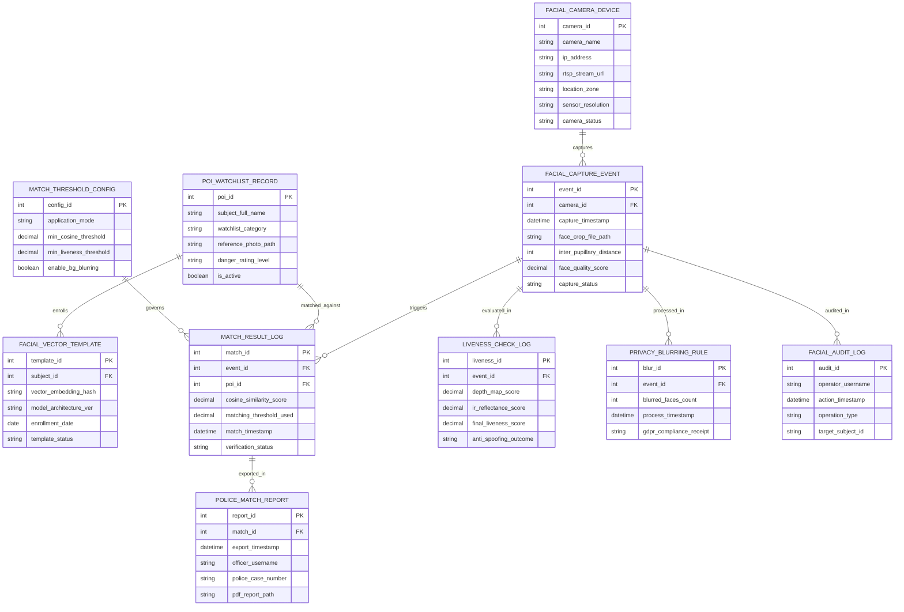

# Conceptual ERD — Facial Recognition System

## Mermaid Code

## Entity Description Table | Bảng mô tả Entity

| # | Entity Name | Vietnamese Name | Description | Key Attributes | Main Relationships |
|---|-------------|-----------------|-------------|----------------|-------------------|
| 1 | FACIAL_CAPTURE_EVENT | Sự kiện Bắt Hình Khuôn mặt | Master capture record storing 4K video crop paths, quality scores, eye distance metrics, and timestamps. | event_id, capture_timestamp, face_crop_file_path, face_quality_score, capture_status | Primary entity; captured by FACIAL_CAMERA_DEVICE; triggers MATCH_RESULT_LOG. |
| 2 | FACIAL_VECTOR_TEMPLATE | Mẫu Vector Khuôn mặt (512-Dim) | Stores non-reversible 512-dimensional facial vector embeddings, model architectures, and enrollment dates. | template_id, vector_embedding_hash, model_architecture_ver, enrollment_date | Enrolled for POI_WATCHLIST_RECORD. |
| 3 | POI_WATCHLIST_RECORD | Hồ sơ Danh sách Theo dõi (POI) | Maintains watchlist profiles (VIP, Banned, Criminal), reference photos, danger levels, and active status. | poi_id, subject_full_name, watchlist_category, reference_photo_path, is_active | Enrolls FACIAL_VECTOR_TEMPLATE; matched against MATCH_RESULT_LOG. |
| 4 | FACIAL_CAMERA_DEVICE | Camera Bắt Hình Khuôn mặt 4K | Stores 4K camera IP addresses, RTSP stream URLs, zone locations, sensor resolutions, and camera health status. | camera_id, camera_name, ip_address, rtsp_stream_url, location_zone, camera_status | Captures FACIAL_CAPTURE_EVENT. |
| 5 | MATCH_RESULT_LOG | Nhật ký Kết quả Đối sánh Vector | Archives 1:N vector similarity search results, cosine similarity scores (0-100%), threshold values, and officer verifications. | match_id, cosine_similarity_score, matching_threshold_used, match_timestamp, verification_status | Belongs to FACIAL_CAPTURE_EVENT and POI_WATCHLIST_RECORD; exported in POLICE_MATCH_REPORT. |
| 6 | LIVENESS_CHECK_LOG | Nhật ký Kiểm tra Liveness (Anti-Spoof) | Stores AI 3D depth map scores, skin IR reflectance metrics, and anti-spoofing outcomes (Pass/Spoof). | liveness_id, depth_map_score, ir_reflectance_score, final_liveness_score, anti_spoofing_outcome | Belongs to FACIAL_CAPTURE_EVENT. |
| 7 | MATCH_THRESHOLD_CONFIG | Cấu hình Ngưỡng Cosine Match | Configures application matching thresholds (e.g., Access Control 92% vs Surveillance 85%) and background blurring rules. | config_id, application_mode, min_cosine_threshold, min_liveness_threshold | Governs MATCH_RESULT_LOG. |
| 8 | PRIVACY_BLURRING_RULE | Nhật ký Làm mờ Nền (GDPR) | Tracks real-time pixelation blurring of non-matched bystander faces in surveillance streams and GDPR receipts. | blur_id, blurred_faces_count, process_timestamp, gdpr_compliance_receipt | Processed for FACIAL_CAPTURE_EVENT. |
| 9 | POLICE_MATCH_REPORT | Báo cáo Trích xuất Cảnh sát | Stores exported forensic match packages, police case numbers, exporting officer usernames, and PDF file paths. | report_id, export_timestamp, officer_username, police_case_number, pdf_report_path | Exported from MATCH_RESULT_LOG. |
| 10 | FACIAL_AUDIT_LOG | Nhật ký Kiểm toán Sinh trắc học | Captures officer match verifications, watchlist edits, threshold changes, and template deletion logs. | audit_id, operator_username, action_timestamp, operation_type, target_subject_id | Audits FACIAL_CAPTURE_EVENT. |

## Relationship Description | Mô tả Quan hệ

| # | From Entity | Cardinality | To Entity | Relationship Label | Business Explanation |
|---|-------------|-------------|-----------|-------------------|----------------------|
| 1 | FACIAL_CAMERA_DEVICE | one-to-many | FACIAL_CAPTURE_EVENT | captures | A facial camera device captures multiple video face events. |
| 2 | FACIAL_CAPTURE_EVENT | one-to-many | MATCH_RESULT_LOG | triggers | A facial capture event triggers 1:N vector match searches. |
| 3 | FACIAL_CAPTURE_EVENT | one-to-one | LIVENESS_CHECK_LOG | evaluated_in | A facial capture event is evaluated in anti-spoofing liveness logs. |
| 4 | FACIAL_CAPTURE_EVENT | one-to-one | PRIVACY_BLURRING_RULE | processed_in | A facial capture event is processed for GDPR background face blurring. |
| 5 | POI_WATCHLIST_RECORD | one-to-many | FACIAL_VECTOR_TEMPLATE | enrolls | A POI watchlist record enrolls one or more facial vector templates. |
| 6 | POI_WATCHLIST_RECORD | one-to-many | MATCH_RESULT_LOG | matched_against | A POI watchlist record is matched against in similarity searches. |
| 7 | MATCH_RESULT_LOG | one-to-many | POLICE_MATCH_REPORT | exported_in | A verified match result log is exported in police identification reports. |
| 8 | MATCH_THRESHOLD_CONFIG | one-to-many | MATCH_RESULT_LOG | governs | A threshold configuration governs vector match scoring rules. |
