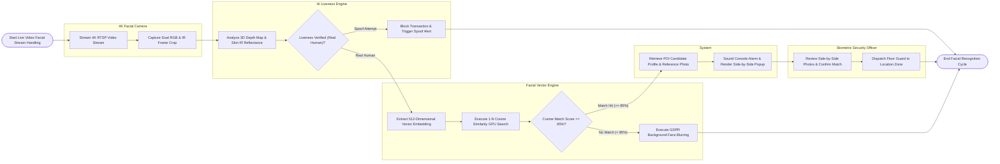

# Swimlane Diagram — Facial Recognition System

## Mermaid Code

## Flow Description | Mô tả luồng

| Lane | Actor | Role in Flow |
|------|-------|-------------|
| 1 | 4K Facial Camera | Ingests live 4K RTSP video streams and captures dual RGB and Infrared (IR) face frame crops. |
| 2 | AI Liveness Engine | Analyzes 3D depth geometry and sub-dermal skin IR reflectance, blocking photo or mask presentation spoof attacks. |
| 3 | Facial Vector Engine | Extracts non-reversible 512-dimensional vector embeddings, executes 1:N GPU similarity searches, and applies GDPR face blurring for non-matches. |
| 4 | System | Retrieves POI candidate profile metadata, sounds console alarms, and renders side-by-side photo comparison modals. |
| 5 | Biometric Security Officer | Reviews side-by-side candidate photos, verifies biometric match hits, and dispatches floor guards to the camera zone. |
