# Action Tree — Facial Recognition System

## Mermaid Code

```mermaid
graph TD
    Root["Facial Recognition System"]

    Root --> M1["Live Stream Capture & Alignment"]
    Root --> M2["Vector Extraction & Embedding"]
    Root --> M3["1:N Watchlist Matching"]
    Root --> M4["Liveness & Anti-Spoofing"]
    Root --> M5["Privacy & GDPR Compliance"]

    M1 --> A1["Ingest 4K RTSP Video Streams"]
    M1 --> A2["Detect Bounding Box via MTCNN"]
    M1 --> A3["Align 5 Facial Landmarks (Eyes/Nose/Mouth)"]
    M1 --> A4["Check Inter-Pupillary Quality Score"]

    M2 --> B1["Extract 512-Dim Vector via ArcFace"]
    M2 --> B2["Normalize L2 Vector Length"]
    M2 --> B3["Ensure Non-Reversible Vector Hashing"]
    M2 --> B4["Calibrate Edge MobileFaceNet Models"]

    M3 --> C1["Execute 1:N Cosine Similarity GPU Search"]
    M3 --> C2["Match against POI Banned Watchlist"]
    M3 --> C3["Trigger Red Alert Modal on Officer Console"]
    M3 --> C4["Render Side-by-Side Photo Comparison"]

    M4 --> D1["Analyze 3D Depth Map Geometry"]
    M4 --> D2["Verify Sub-Dermal Skin IR Reflectance"]
    M4 --> D3["Detect Micro-Expression Movement"]
    M4 --> D4["Block Presentation Photo & Mask Attacks"]

    M5 --> E1["Apply Real-Time Bystander Face Blurring"]
    M5 --> E2["Execute Auto-Purge of 24-Hour Embeddings"]
    M5 --> E3["Search Historical 30-Day Video Records"]
    M5 --> E4["Export Law Enforcement Forensic Report"]
```

## Module Description | Mô tả Module

| # | Module | Description | Actions |
|---|--------|-------------|---------|
| 1 | Live Stream Capture & Alignment | 4K RTSP video ingestion, MTCNN face detection, 5-point facial landmark alignment, and eye-distance quality checks. | Ingest 4K RTSP Video Streams, Detect Bounding Box via MTCNN, Align 5 Facial Landmarks (Eyes/Nose/Mouth), Check Inter-Pupillary Quality Score |
| 2 | Vector Extraction & Embedding | 512-dimensional vector embedding extraction via ArcFace, L2 normalization, non-reversible security checks, and edge model tuning. | Extract 512-Dim Vector via ArcFace, Normalize L2 Vector Length, Ensure Non-Reversible Vector Hashing, Calibrate Edge MobileFaceNet Models |
| 3 | 1:N Watchlist Matching | 1:N Milvus GPU cosine similarity searches, POI watchlist matching, officer red alert popups, and side-by-side photo comparisons. | Execute 1:N Cosine Similarity GPU Search, Match against POI Banned Watchlist, Trigger Red Alert Modal on Officer Console, Render Side-by-Side Photo Comparison |
| 4 | Liveness & Anti-Spoofing | AI 3D depth map analysis, sub-dermal skin IR reflectance checks, micro-expression verification, and photo/mask attack blocking. | Analyze 3D Depth Map Geometry, Verify Sub-Dermal Skin IR Reflectance, Detect Micro-Expression Movement, Block Presentation Photo & Mask Attacks |
| 5 | Privacy & GDPR Compliance | Real-time background face blurring (GDPR), 24-hour unmatched template auto-purging, historical video searches, and police report exports. | Apply Real-Time Bystander Face Blurring, Execute Auto-Purge of 24-Hour Embeddings, Search Historical 30-Day Video Records, Export Law Enforcement Forensic Report |
