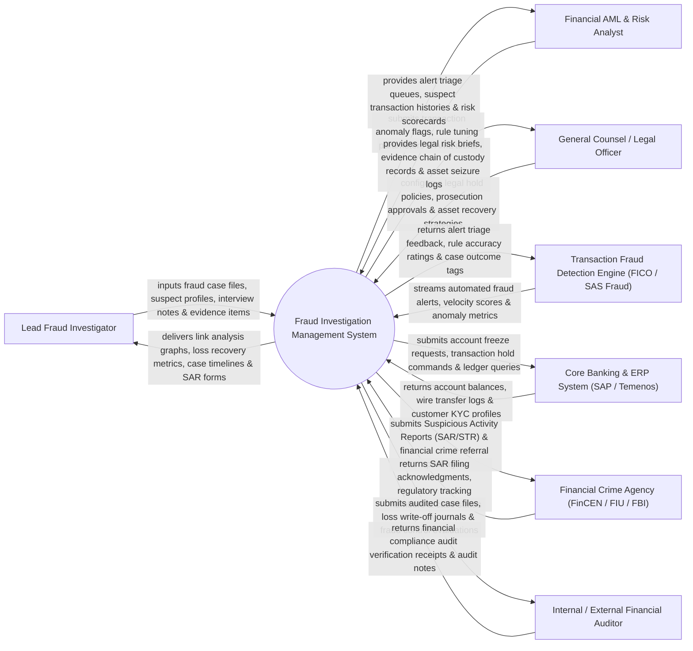

# Context Diagram — Fraud Investigation Management System

## Mermaid Code

## Actor & Interaction Table | Bảng Actor & Tương tác

| # | Actor | Actor Type | Data Sent TO System | Data Received FROM System | Notes |
|---|-------|------------|---------------------|---------------------------|-------|
| 1 | Lead Fraud Investigator | Primary | Fraud case files, suspect profiles, interview notes, digital evidence items. | Link analysis graphs, loss recovery metrics, case timelines, SAR forms. | Senior investigator managing corporate financial fraud and embezzlement cases. |
| 2 | Financial AML & Risk Analyst | Primary | Transaction anomaly flags, rule tuning parameters, Anti-Money Laundering alerts. | Alert triage queues, suspect transaction histories, user risk scorecards. | Specialist triaging automated fraud alerts and suspicious transaction activity. |
| 3 | General Counsel / Legal Officer | Primary | Legal hold policies, prosecution approvals, asset recovery strategies, subpoenas. | Legal risk briefs, evidence chain of custody records, asset seizure logs. | Executive legal counsel managing criminal prosecutions and civil asset recoveries. |
| 4 | Transaction Fraud Engine | Supporting | Automated fraud alerts, transaction velocity scores, geolocation anomaly metrics. | Alert triage feedback, rule accuracy ratings, case outcome tags. | Machine learning fraud engine (FICO, SAS, Feedzai) flagging suspicious payments. |
| 5 | Core Banking & ERP System | Supporting | Account balances, wire transfer logs, customer KYC profiles, payment audit trails. | Account freeze requests, transaction hold commands, ledger audit queries. | Core financial system executing ledger transactions and account holds. |
| 6 | Financial Crime Agency | Supporting / Regulatory | SAR filing acknowledgments, regulatory tracking numbers, law enforcement subpoenas. | Suspicious Activity Reports (SAR/STR), financial crime referral packages, evidence. | Federal financial intelligence unit (FinCEN, FIU, FBI) receiving SAR filings. |
| 7 | Internal / External Financial Auditor | Supporting / Regulatory | Financial compliance audit inquiries, inspection receipts, audit notes. | Audited case files, loss write-off journals, fraud control evaluation reports. | Auditor evaluating financial loss provisioning and fraud prevention controls. |

## System Boundary Description | Mô tả Phạm vi Hệ thống

The **Fraud Investigation Management System** is an enterprise financial fraud intake, link analysis graph visualization, digital evidence chain of custody, regulatory Suspicious Activity Report (SAR/STR) filing, and asset recovery platform.

**Inside System Scope:**
- Ingestion and triage of suspicious fraud alerts from transaction monitoring engines and whistleblowers.
- Interactive link analysis mapping relationships between suspects, bank accounts, shell companies, and IPs.
- Digital evidence management preserving strict Chain of Custody timestamps and SHA-256 hashes.
- Automated generation and e-filing of regulatory Suspicious Activity Reports (SAR / STR / BSA).
- Core banking account freeze execution, legal hold tracking, and asset recovery workflows.

**Outside System Scope:**
- Direct physical arrest of suspect individuals (handled by Law Enforcement Agencies).
- Direct manual processing of routine non-fraudulent customer deposits (handled by Bank Tellers).
- General credit card issuing hardware production (handled by Card Manufacturers).
