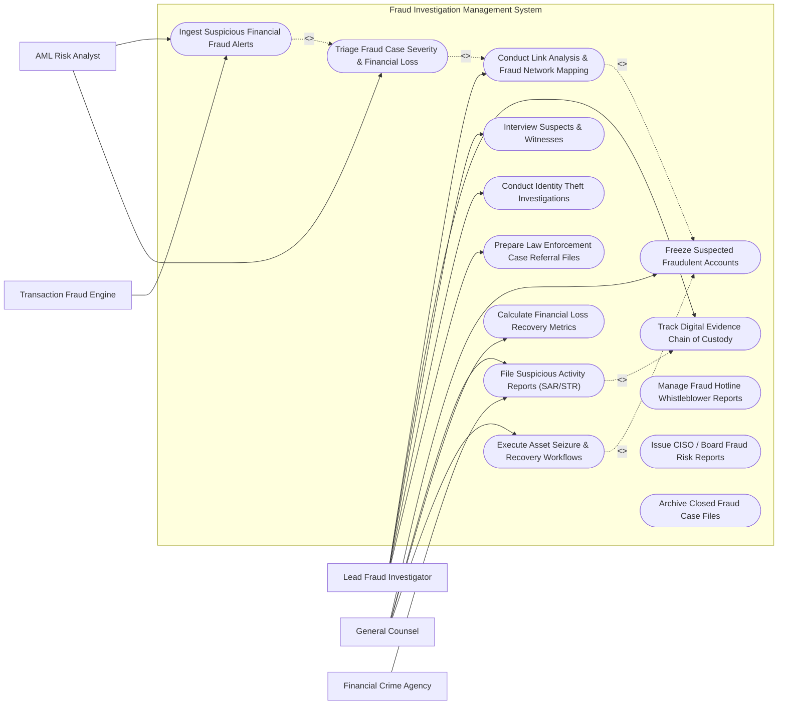

# Use Case Diagram — Fraud Investigation Management System

## Mermaid Code

## Actor Table | Bảng Actor

| # | Actor | Actor Type | Role Description | Related Use Cases |
|---|-------|------------|------------------|-------------------|
| 1 | Lead Fraud Investigator | Primary | Conducts fraud investigations, performs link analysis, manages evidence chain of custody, and interviews suspects. | UC03, UC05, UC07, UC10, UC12 |
| 2 | AML Risk Analyst | Primary | Triages incoming financial fraud alerts, evaluates transaction velocity anomalies, and quantifies loss risk. | UC01, UC02 |
| 3 | General Counsel | Primary | Authorizes account freezes, oversees asset recovery, approves regulatory SAR filings, and manages legal holds. | UC04, UC06, UC08, UC11 |
| 4 | Financial Crime Agency | Supporting / Regulatory | Federal financial intelligence unit (FinCEN, FIU, FBI) receiving electronic SAR filings and case referrals. | UC06 |
| 5 | Transaction Fraud Engine | Supporting / System | Machine learning fraud detection platform streaming suspicious transaction alerts. | UC01 |

## Use Case Table | Bảng Use Case

| # | UC ID | Use Case Name | Primary Actor | Secondary Actor | Description | Priority |
|---|-------|---------------|---------------|-----------------|-------------|----------|
| 1 | UC01 | Ingest Suspicious Financial Fraud Alerts | AML Analyst | Fraud Engine | Ingests real-time fraud alert payloads (wire fraud, card fraud, account takeover) from transaction monitoring engines. | High |
| 2 | UC02 | Triage Fraud Case Severity & Financial Loss | AML Analyst | Investigator | Evaluates alert transaction amounts, customer risk scores, and opens formal Fraud Case Files (`FRD-CASE`). | High |
| 3 | UC03 | Conduct Link Analysis & Fraud Network Mapping | Investigator | None | Visualizes multi-entity relationship graphs connecting suspect bank accounts, shell companies, shared IPs, and wire paths. | High |
| 4 | UC04 | Freeze Suspected Fraudulent Accounts | General Counsel | Core Banking | Issues immediate API hold commands to core banking systems to freeze suspect accounts and block outgoing wire transfers. | High |
| 5 | UC05 | Track Digital Evidence Chain of Custody | Investigator | None | Archives digital evidence items (bank statements, IP logs, email transcripts) with SHA-256 hashes and legal transfer logs. | High |
| 6 | UC06 | File Suspicious Activity Reports (SAR/STR) | General Counsel | FinCEN | Generates and e-files regulatory BSA Suspicious Activity Reports (SAR/STR) with financial intelligence authorities. | High |
| 7 | UC07 | Interview Suspects & Witnesses | Investigator | None | Logs interview transcripts, audio recordings, witness statements, and admission notes within the case file. | Medium |
| 8 | UC08 | Calculate Financial Loss Recovery Metrics | General Counsel | None | Tracks gross fraud exposure, frozen funds, recovered assets, and net unrecoverable financial losses. | High |
| 9 | UC09 | Manage Fraud Hotline Whistleblower Reports | Investigator | None | Ingests anonymous employee whistleblower tips, encrypting submitter identity details to protect sources. | Medium |
| 10 | UC10 | Conduct Identity Theft Investigations | Investigator | None | Investigates synthetic identity fraud, stolen SSN applications, and fraudulent account opening attempts. | Medium |
| 11 | UC11 | Execute Asset Seizure & Recovery Workflows | General Counsel | None | Coordinates legal attachment orders, bank clawback requests, and civil litigation for asset recovery. | High |
| 12 | UC12 | Prepare Law Enforcement Case Referral Files | Investigator | FinCEN | Compiles evidentiary referral binders formatted for law enforcement prosecution (FBI / Local Police). | Medium |
| 13 | UC13 | Issue CISO / Board Fraud Risk Reports | General Counsel | AML Analyst | Renders executive dashboards displaying fraud loss trends, operational failure points, and SAR filing metrics. | Medium |
| 14 | UC14 | Archive Closed Fraud Case Files | Investigator | None | Permanently seals closed case records following prosecution or recovery, enforcing regulatory retention rules. | Low |

## Use Case Specification | Đặc tả Use Case

---

### UC01 — Ingest Suspicious Financial Fraud Alerts

| Field | Detail |
|-------|--------|
| **UC ID** | UC01 |
| **Use Case Name** | Ingest Suspicious Financial Fraud Alerts |
| **Actor(s)** | Primary: AML Risk Analyst   Secondary: Transaction Fraud Engine |
| **Description** | Ingests automated financial transaction fraud alerts, velocity anomalies, and account takeover signals into the central investigation queue. |
| **Precondition** | 1. Transaction Fraud Engine API connector is active.   2. Core banking alert feed is streaming. |
| **Main Flow** | 1. Fraud Engine detects suspicious $250,000 international wire transfer to a high-risk offshore account.   2. Fraud Engine posts alert payload (Alert ID, Account Number, Amount, Customer ID, Anomaly Score 92/100) to Ingestion API.   3. System parses alert payload and queries Core Banking CMDB for Customer KYC Profile and 90-day transaction history.   4. System checks if account has active fraud cases.   5. System places alert into AML Analyst Alert Triage Queue.   6. System passes alert details to UC02 Triage Fraud Case Severity. |
| **Alternative Flow** | **AF1** — Whistleblower Tip Ingestion: Ingests anonymous tip submitted via corporate fraud hotline web portal. |
| **Exception Flow** | **EX1** — Duplicate Alert Grouping: If 10 identical card fraud alerts trigger for the same account within 1 hour, system consolidates alerts into a single Master Alert. |
| **Postcondition** | Suspicious transaction alert is parsed, enriched with customer KYC context, and queued for triage. |
| **Business Rule** | **BR1**: High-value transaction fraud alerts (> $100,000) must trigger real-time analyst notifications within 30 seconds. |

---

### UC02 — Triage Fraud Case Severity & Financial Loss

| Field | Detail |
|-------|--------|
| **UC ID** | UC02 |
| **Use Case Name** | Triage Fraud Case Severity & Financial Loss |
| **Actor(s)** | Primary: AML Risk Analyst   Secondary: Lead Fraud Investigator |
| **Description** | Evaluates flagged transaction alerts, calculates potential financial loss exposure, and escalates verified fraud signals into formal Fraud Case Files. |
| **Precondition** | 1. Fraud alert is queued in Triage Workspace. |
| **Main Flow** | 1. AML Analyst opens target alert `ALT-2026-8812` ($250,000 wire transfer).   2. System renders unified triage view: Customer Wire History, Device Fingerprint, IP Geolocation (Wire requested from foreign IP), and Wire Beneficiary.   3. Analyst verifies beneficiary account is a newly created shell company.   4. Analyst confirms transaction is an unauthorized Business Email Compromise (BEC) wire fraud attempt.   5. Analyst clicks "Escalate to Formal Fraud Case".   6. System creates Fraud Case File `FRD-2026-0826`, sets initial status to "UNDER INVESTIGATION", and prompts for UC04 Freeze Suspected Fraudulent Accounts. |
| **Alternative Flow** | **AF1** — False Positive Dismissal: Analyst verifies customer initiated wire for legitimate real estate purchase, marks alert "FALSE POSITIVE", and closes ticket. |
| **Exception Flow** | **EX1** — Triage SLA Breach: If alert > $100k remains untriaged after 2 hours, system automatically escalates ticket to Lead Investigator. |
| **Postcondition** | Verified fraud alert is escalated to a formal Fraud Case File with assigned severity rating. |
| **Business Rule** | **BR1**: All confirmed fraud cases involving potential losses over $50,000 require mandatory formal case file creation. |

---

### UC03 — Conduct Link Analysis & Fraud Network Mapping

| Field | Detail |
|-------|--------|
| **UC ID** | UC03 |
| **Use Case Name** | Conduct Link Analysis & Fraud Network Mapping |
| **Actor(s)** | Primary: Lead Fraud Investigator   Secondary: None |
| **Description** | Generates interactive multi-entity relationship graphs connecting suspect bank accounts, shell companies, shared IP addresses, and wire paths. |
| **Precondition** | 1. Fraud Case File `FRD-2026-0826` is active. |
| **Main Flow** | 1. Investigator opens Link Analysis workspace for case `FRD-2026-0826`.   2. Investigator inputs primary suspect account `ACC-994112`.   3. System queries transaction database, extracting shared entity nodes (Common Beneficiaries, Shared Login IPs, Shared Phone Numbers, Matching Wire Amounts).   4. System renders interactive graph visualization displaying nodes (Accounts, IPs, Companies) and directed edges (Wire Transfers, Shared Attributes).   5. Graph reveals suspect account transferred funds to 3 secondary shell company accounts (`SHELL-A`, `SHELL-B`, `SHELL-C`) controlled by the same foreign IP address.   6. Investigator tags identified nodes as "SUSPECT FRAUD NETWORK" and exports graph image to case file. |
| **Alternative Flow** | **AF1** — Cross-Case Entity Matching: System detects suspect IP address was previously flagged in a separate fraud case 6 months ago, linking the two cases. |
| **Exception Flow** | **EX1** — Graph Node Overflow: If query returns > 1,000 nodes, system prompts investigator to apply transaction filter thresholds (> $5,000 only). |
| **Postcondition** | Fraud network relationship graph is generated, analyzed, and linked to case file. |
| **Business Rule** | **BR1**: Link analysis queries must evaluate multi-hop account relationships up to 4 degrees of separation. |

---

### UC04 — Freeze Suspected Fraudulent Accounts

| Field | Detail |
|-------|--------|
| **UC ID** | UC04 |
| **Use Case Name** | Freeze Suspected Fraudulent Accounts |
| **Actor(s)** | Primary: General Counsel   Secondary: Core Banking System |
| **Description** | Triggers automated API hold commands to core banking platforms to immediately freeze suspect accounts and block outgoing wire transfers. |
| **Precondition** | 1. Fraud case confirms active unauthorized wire transfer or ongoing embezzlement.   2. General Counsel or authorized Lead Investigator issues freeze order. |
| **Main Flow** | 1. Investigator clicks "Request Immediate Account Freeze" on suspect account `ACC-994112`.   2. System routes request to General Counsel for one-click legal authorization.   3. General Counsel approves freeze order.   4. System issues HTTPS REST API POST command to Core Banking System (`POST /v1/accounts/ACC-994112/freeze`).   5. Core Banking System locks account status to "FROZEN - LEGAL HOLD", revokes online banking credentials, and aborts pending wire transfers.   6. Core Banking returns "ACCOUNT FROZEN SUCCESSFUL" receipt with frozen balance ($210,000).   7. System logs Account Freeze Record in case file and updates loss recovery metrics. |
| **Alternative Flow** | **AF1** — Partial Transaction Hold: System places a temporary 24-hour administrative hold on a specific wire transfer without freezing entire account. |
| **Exception Flow** | **EX1** — Core Banking API Failure: If API fails, system sends urgent automated SMS alert to Core Banking Operations Desk for manual terminal freeze. |
| **Postcondition** | Suspect bank account is frozen in core banking, preventing loss of funds. |
| **Business Rule** | **BR1**: Account freeze API commands must execute in less than 5 seconds to prevent fraudulent fund exfiltration. |

---

### UC06 — File Suspicious Activity Reports (SAR/STR)

| Field | Detail |
|-------|--------|
| **UC ID** | UC06 |
| **Use Case Name** | File Suspicious Activity Reports (SAR/STR) |
| **Actor(s)** | Primary: General Counsel   Secondary: Financial Crime Agency (FinCEN) |
| **Description** | Generates, validates, and electronically transmits regulatory BSA Suspicious Activity Reports (SAR/STR) to federal financial intelligence authorities. |
| **Precondition** | 1. Fraud case meets regulatory SAR filing threshold (e.g., suspected financial crime >= $5,000).   2. Case investigation is complete or reached 30-day filing deadline. |
| **Main Flow** | 1. General Counsel opens case `FRD-2026-0826` and clicks "Generate Regulatory SAR Form".   2. System auto-populates official FinCEN SAR XML form fields:     a. Filing Institution Details & BSA ID.     b. Suspect Information (Name, DOB, SSN/TIN, Address, Account Number).     c. Suspicious Activity Category (Wire Fraud / Business Email Compromise).     d. Dollar Amount Involved ($250,000).     e. Technical Narrative (Auto-compiled from case timeline, IP logs, and link analysis notes).   3. General Counsel reviews, edits narrative, and signs digital authorization.   4. System validates SAR XML schema against FinCEN E-Filing specification.   5. System transmits encrypted SAR XML package to FinCEN Secure E-Filing System.   6. FinCEN returns BSA Tracking Confirmation Number (e.g., `BSA-SAR-2026-991823`).   7. System updates case status to "SAR FILED" and locks filing record for legal compliance. |
| **Alternative Flow** | **AF1** — Supplemental SAR Filing: Counsel files a Follow-Up/Supplemental SAR 90 days later upon discovering additional fraud victims. |
| **Exception Flow** | **EX1** — SAR Schema Validation Failure: System highlights missing mandatory suspect SSN field and prompts counsel for correction prior to submission. |
| **Postcondition** | Regulatory SAR is validated, signed, electronically filed with FinCEN, and archived. |
| **Business Rule** | **BR1**: Mandatory SARs must be electronically filed within 30 calendar days of initial suspicious activity detection. |
