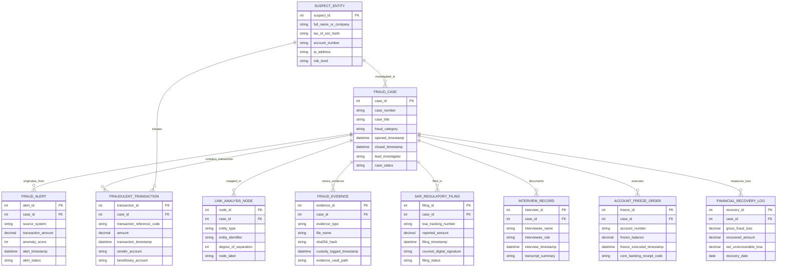

# Conceptual ERD — Fraud Investigation Management System

## Mermaid Code

## Entity Description Table | Bảng mô tả Entity

| # | Entity Name | Vietnamese Name | Description | Key Attributes | Main Relationships |
|---|-------------|-----------------|-------------|----------------|-------------------|
| 1 | FRAUD_CASE | Hồ sơ Vụ việc Gian lận | Master fraud investigation case record tracking case numbers, categories, investigators, open/closed dates, and status. | case_id, case_number, case_title, fraud_category, lead_investigator, case_status | Primary entity; originates from FRAUD_ALERT; files SAR_REGULATORY_FILING. |
| 2 | FRAUD_ALERT | Cảnh báo Gian lận Đầu vào | Stores automated transaction fraud alerts, velocity scores, anomaly scores, and intake status. | alert_id, source_system, transaction_amount, anomaly_score, alert_status | Originates FRAUD_CASE. |
| 3 | SUSPECT_ENTITY | Đối tượng Nghi vấn (Suspect) | Archives suspect individuals, shell companies, hashed SSNs/TINs, bank accounts, and risk levels. | suspect_id, full_name_or_company, tax_id_ssn_hash, account_number, risk_level | Investigated in FRAUD_CASE; initiates FRAUDULENT_TRANSACTION. |
| 4 | FRAUDULENT_TRANSACTION | Giao dịch Gian lận | Tracks individual fraudulent wire transfers, payment reference codes, transaction amounts, and beneficiary accounts. | transaction_id, transaction_reference_code, amount, sender_account, beneficiary_account | Contained in FRAUD_CASE; initiated by SUSPECT_ENTITY. |
| 5 | LINK_ANALYSIS_NODE | Nút Đồ thị Mối quan hệ (Graph) | Stores multi-entity relationship graph nodes (Accounts, IPs, Companies, Phone Numbers) and degrees of separation. | node_id, entity_type, entity_identifier, degree_of_separation, node_label | Mapped in FRAUD_CASE. |
| 6 | FRAUD_EVIDENCE | Trích xuất Bằng chứng Kỹ thuật số | Archives digital evidence items (bank statements, IP logs, email transcripts), SHA-256 hashes, and chain of custody logs. | evidence_id, evidence_type, file_name, sha256_hash, custody_logged_timestamp | Stored in FRAUD_CASE. |
| 7 | SAR_REGULATORY_FILING | Báo cáo Giao dịch Đáng ngờ (SAR) | Stores regulatory FinCEN SAR/STR filings, BSA tracking numbers, reported amounts, digital signatures, and status. | filing_id, bsa_tracking_number, reported_amount, filing_timestamp, filing_status | Filed in FRAUD_CASE. |
| 8 | INTERVIEW_RECORD | Biên bản Phỏng vấn Đối tượng | Archives witness and suspect interview transcripts, audio recording paths, interviewers, and summary notes. | interview_id, interviewee_name, interviewee_role, interview_timestamp, transcript_summary | Documented in FRAUD_CASE. |
| 9 | ACCOUNT_FREEZE_ORDER | Lệnh Phong tỏa Tài khoản | Archives core banking account freeze execution commands, frozen balance amounts, and core banking receipt codes. | freeze_id, account_number, frozen_balance, freeze_executed_timestamp, core_banking_receipt_code | Executed in FRAUD_CASE. |
| 10 | FINANCIAL_RECOVERY_LOG | Nhật ký Thu hồi Tài sản | Tracks gross financial losses, frozen funds recovered, bank clawbacks, and net unrecoverable losses. | recovery_id, gross_fraud_loss, recovered_amount, net_unrecoverable_loss, recovery_date | Measured in FRAUD_CASE. |

## Relationship Description | Mô tả Quan hệ

| # | From Entity | Cardinality | To Entity | Relationship Label | Business Explanation |
|---|-------------|-------------|-----------|-------------------|----------------------|
| 1 | FRAUD_ALERT | one-to-one | FRAUD_CASE | originates_from | A confirmed fraud alert originates a formal fraud case file. |
| 2 | FRAUD_CASE | one-to-many | FRAUDULENT_TRANSACTION | contains_transaction | A fraud case contains one or more fraudulent transaction records. |
| 3 | FRAUD_CASE | one-to-many | LINK_ANALYSIS_NODE | mapped_in | A fraud case maps entity nodes in an interactive link analysis graph. |
| 4 | FRAUD_CASE | one-to-many | FRAUD_EVIDENCE | stores_evidence | A fraud case stores digital evidence items with chain of custody hashes. |
| 5 | FRAUD_CASE | one-to-many | SAR_REGULATORY_FILING | filed_in | A fraud case produces regulatory Suspicious Activity Reports (SAR/STR). |
| 6 | FRAUD_CASE | one-to-many | ACCOUNT_FREEZE_ORDER | executes | A fraud case executes core banking account freeze orders. |
| 7 | FRAUD_CASE | one-to-many | FINANCIAL_RECOVERY_LOG | measures_loss | A fraud case measures gross fraud exposure and financial recoveries. |
| 8 | SUSPECT_ENTITY | many-to-many | FRAUD_CASE | investigated_in | A suspect entity is investigated across one or more fraud cases. |
