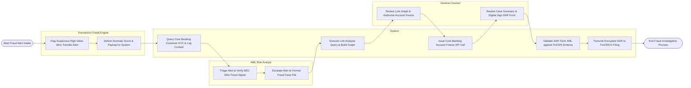

# Swimlane Diagram — Fraud Investigation Management System

## Mermaid Code

## Flow Description | Mô tả luồng

| Lane | Actor | Role in Flow |
|------|-------|-------------|
| 1 | Transaction Fraud Engine | Detects suspicious high-value wire transfers, calculates anomaly scores, and posts alert payloads. |
| 2 | AML Risk Analyst | Triages incoming alerts, verifies wire fraud signatures against customer KYC context, and escalates to formal case files. |
| 3 | System | Queries core banking logs, renders interactive link analysis graphs, executes account freeze APIs, validates SAR XML schemas, and transmits filings. |
| 4 | General Counsel | Reviews entity relationship graphs, signs account freeze authorization orders, and digitally signs regulatory FinCEN SAR filings. |
