# Action Tree — Fraud Investigation Management System

## Mermaid Code

```mermaid
graph TD
    Root["Fraud Investigation Management System"]

    Root --> M1["Fraud Intake & Triage"]
    Root --> M2["Case Management & Link Analysis"]
    Root --> M3["Account Freeze & Containment"]
    Root --> M4["Regulatory Filing (SAR)"]
    Root --> M5["Asset Recovery & Prosecution"]

    M1 --> A1["Ingest Transaction Monitoring Fraud Alerts"]
    M1 --> A2["Ingest Anonymous Whistleblower Tips"]
    M1 --> A3["Enrich Alert with Core Banking KYC Data"]
    M1 --> A4["Triage High-Value $100k Fraud Signals"]

    M2 --> B1["Render Interactive Multi-Entity Link Graph"]
    M2 --> B2["Identify Shell Companies & Shared IPs"]
    M2 --> B3["Log Interview Transcripts & Witness Notes"]
    M2 --> B4["Store Evidence Files with SHA-256 Hashes"]

    M3 --> C1["Request General Counsel Account Freeze"]
    M3 --> C2["Execute Core Banking Account Hold API"]
    M3 --> C3["Revoke Online Banking Customer Access"]
    M3 --> C4["Log Core Banking Freeze Receipt Code"]

    M4 --> D1["Auto-Populate FinCEN SAR XML Form"]
    M4 --> D2["Validate SAR Schema against BSA Rules"]
    M4 --> D3["Apply General Counsel Digital Signature"]
    M4 --> D4["Transmit Encrypted Package to FinCEN"]

    M5 --> E1["Track Gross Fraud Loss Exposure"]
    M5 --> E2["Execute Interbank Fund Clawback Orders"]
    M5 --> E3["Prepare Law Enforcement FBI Referral Binders"]
    M5 --> E4["Archive Closed Case Files with Retention Tags"]
```

## Module Description | Mô tả Module

| # | Module | Description | Actions |
|---|--------|-------------|---------|
| 1 | Fraud Intake & Triage | Transaction fraud alert ingestion, anonymous whistleblower hotline intake, KYC enrichment, and $100k+ alert triage. | Ingest Transaction Monitoring Fraud Alerts, Ingest Anonymous Whistleblower Tips, Enrich Alert with Core Banking KYC Data, Triage High-Value $100k Fraud Signals |
| 2 | Case Management & Link Analysis | Multi-entity relationship graph rendering, shell company mapping, interview transcript logging, and SHA-256 evidence hashing. | Render Interactive Multi-Entity Link Graph, Identify Shell Companies & Shared IPs, Log Interview Transcripts & Witness Notes, Store Evidence Files with SHA-256 Hashes |
| 3 | Account Freeze & Containment | Counsel freeze approvals, core banking API account hold execution, online credential revocation, and freeze receipts. | Request General Counsel Account Freeze, Execute Core Banking Account Hold API, Revoke Online Banking Customer Access, Log Core Banking Freeze Receipt Code |
| 4 | Regulatory Filing (SAR) | FinCEN SAR XML auto-population, BSA schema validation, digital counsel signatures, and secure FinCEN e-filing. | Auto-Populate FinCEN SAR XML Form, Validate SAR Schema against BSA Rules, Apply General Counsel Digital Signature, Transmit Encrypted Package to FinCEN |
| 5 | Asset Recovery & Prosecution | Gross loss tracking, interbank clawbacks, FBI law enforcement referral binders, and closed case file retention archiving. | Track Gross Fraud Loss Exposure, Execute Interbank Fund Clawback Orders, Prepare Law Enforcement FBI Referral Binders, Archive Closed Case Files with Retention Tags |
