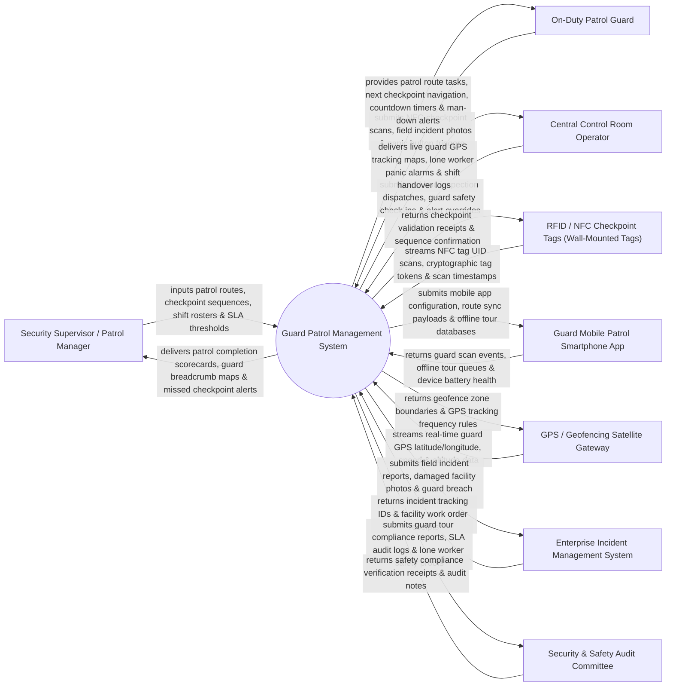

# Context Diagram — Guard Patrol Management System

## Mermaid Code

## Actor & Interaction Table | Bảng Actor & Tương tác

| # | Actor | Actor Type | Data Sent TO System | Data Received FROM System | Notes |
|---|-------|------------|---------------------|---------------------------|-------|
| 1 | Security Supervisor / Patrol Manager | Primary | Patrol routes, checkpoint sequences, shift rosters, SLA thresholds. | Patrol completion scorecards, guard breadcrumb maps, missed checkpoint alerts. | Security manager designing patrol tours, monitoring rosters, and auditing performance. |
| 2 | On-Duty Patrol Guard | Primary | NFC checkpoint scans, field incident photos, panic button triggers, safety status. | Patrol route tasks, next checkpoint navigation, countdown timers, man-down alerts. | Field guard conducting physical security patrols using mobile app. |
| 3 | Central Control Room Operator | Primary | Ad-hoc inspection dispatches, guard safety check-ins, alert overrides. | Live guard GPS tracking maps, lone worker panic alarms, shift handover logs. | Operator monitoring live guard locations and responding to lone worker panic alerts. |
| 4 | RFID / NFC Checkpoint Tags | Supporting | NFC tag UID scans, cryptographic tag tokens, scan timestamps. | Checkpoint validation receipts, sequence confirmation, tag health status. | Physical NFC/RFID tags mounted at strategic facility locations (e.g., Server Room, Stairwell). |
| 5 | Guard Mobile Patrol Smartphone App | Supporting | Guard scan events, offline tour queues, device battery health, accelerometer data. | Mobile app configuration, route sync payloads, offline tour databases. | Android/iOS mobile application used by guards to execute patrol tours. |
| 6 | GPS / Geofencing Satellite Gateway | Supporting | Real-time guard GPS latitude/longitude, speed, altitude, satellite fix quality. | Geofence zone boundaries, GPS tracking frequency rules, battery saver modes. | Satellite GPS subsystem providing real-time guard location breadcrumb trails. |
| 7 | Enterprise Incident Management System | Supporting | Incident tracking IDs, facility work order receipts, repair updates. | Field incident reports, damaged facility photos, guard breach observations. | Enterprise ticketing system receiving physical hazard and maintenance reports. |
| 8 | Security & Safety Audit Committee | Supporting / Regulatory | Safety compliance audit inquiries, inspection mandates. | Guard tour compliance reports, SLA audit logs, lone worker safety proofs. | Safety committee auditing guard patrol coverage and OSHA lone worker compliance. |

## System Boundary Description | Mô tả Phạm vi Hệ thống

The **Guard Patrol Management System** is an enterprise NFC checkpoint tour verification, real-time GPS breadcrumb tracking, Lone Worker Man-Down panic response, and shift roster management platform.

**Inside System Scope:**
- Configuration of patrol routes, physical NFC/RFID checkpoint sequences, and time SLA windows.
- Mobile smartphone app execution of NFC checkpoint scans with offline storage and automatic sync.
- Real-time GPS location tracking and geofence boundary monitoring for on-duty guards.
- Lone Worker safety monitoring (man-down tilt detection, no-motion timers, emergency panic button).
- Automated reporting of missed checkpoint SLA violations and guard tour completion analytics.

**Outside System Scope:**
- Direct physical mounting of NFC tags on concrete walls (handled by Maintenance Technicians).
- Direct cellular network tower radio frequency management (handled by Telecom Carriers).
- Direct physical guard uniform tailoring or equipment procurement (handled by Logistics).
