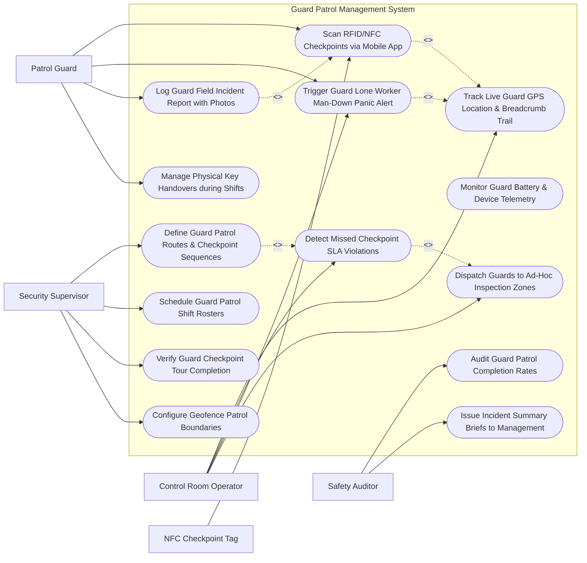

# Use Case Diagram — Guard Patrol Management System

## Mermaid Code

## Actor Table | Bảng Actor

| # | Actor | Actor Type | Role Description | Related Use Cases |
|---|-------|------------|------------------|-------------------|
| 1 | Security Supervisor | Primary | Configures patrol routes, checkpoint sequences, shift rosters, geofence boundaries, and audits tour completion. | UC01, UC07, UC09, UC14 |
| 2 | Patrol Guard | Primary | Scans NFC checkpoints via mobile app, triggers lone worker panic alerts, logs field incidents, and manages keys. | UC02, UC05, UC06, UC11 |
| 3 | Control Room Operator | Primary | Monitors live guard GPS breadcrumb trails, responds to missed checkpoint SLA alerts, and handles man-down panic alarms. | UC03, UC04, UC05, UC10 |
| 4 | Safety Auditor | Secondary | Audits guard patrol completion rates, lone worker safety compliance, and issues management briefs. | UC12, UC13 |
| 5 | NFC Checkpoint Tag | Supporting / System | Physical wall-mounted NFC/RFID tag scanned by guard smartphone to record checkpoint verification. | UC02 |

## Use Case Table | Bảng Use Case

| # | UC ID | Use Case Name | Primary Actor | Secondary Actor | Description | Priority |
|---|-------|---------------|---------------|-----------------|-------------|----------|
| 1 | UC01 | Define Guard Patrol Routes & Checkpoint Sequences | Supervisor | Operator | Configures patrol tour routes, mandatory checkpoint sequences, and time SLA windows (e.g., "Scan Tag 3 within 15 mins"). | High |
| 2 | UC02 | Scan RFID/NFC Checkpoints via Mobile App | Guard | NFC Tag | Uses smartphone NFC reader to tap wall-mounted tags, logging cryptographic UID, GPS coordinate, and timestamp. | High |
| 3 | UC03 | Track Live Guard GPS Location & Breadcrumb Trail | Operator | Guard | Displays real-time GPS breadcrumb movement trails for all active guards on an interactive GIS map. | High |
| 4 | UC04 | Detect Missed Checkpoint SLA Violations | Operator | Supervisor | Automatically triggers alerts if a guard fails to scan a mandatory checkpoint within the designated SLA time window. | High |
| 5 | UC05 | Trigger Guard Lone Worker Man-Down Panic Alert | Guard | Operator | Triggers instant emergency panic alerts via mobile red button OR automatic accelerometer tilt/no-motion detection. | High |
| 6 | UC06 | Log Guard Field Incident Report with Photos | Guard | Supervisor | Allows guards to capture photos, voice notes, and text reports of damaged locks, open doors, or hazards during patrols. | High |
| 7 | UC07 | Schedule Guard Patrol Shift Rosters | Supervisor | None | Schedules 24/7 guard shift rosters, assigns guards to patrol zones, and tracks shift check-ins/check-outs. | Medium |
| 8 | UC08 | Monitor Guard Battery & Device Telemetry | Operator | None | Tracks guard mobile phone battery levels, GPS signal strength, and offline sync queue status. | Medium |
| 9 | UC09 | Verify Guard Checkpoint Tour Completion | Supervisor | None | Evaluates completed guard tours against defined routes, scoring tour completion rates (e.g., 95% Checkpoints Scanned). | High |
| 10 | UC10 | Dispatch Guards to Ad-Hoc Inspection Zones | Operator | Guard | Dispatches a specific guard to perform an un-scheduled ad-hoc safety inspection in response to an alarm. | Medium |
| 11 | UC11 | Manage Physical Key Handovers during Shifts | Guard | None | Logs shift key handovers between guards, recording key ring serial numbers and guard signatures. | Medium |
| 12 | UC12 | Audit Guard Patrol Completion Rates | Safety Auditor | Supervisor | Generates historical compliance reports detailing patrol SLA performance, missed tags, and response times. | Medium |
| 13 | UC13 | Issue Incident Summary Briefs to Management | Safety Auditor | None | Publishes executive briefs summarizing physical facility hazards, guard responses, and security vulnerabilities found during tours. | Low |
| 14 | UC14 | Configure Geofence Patrol Boundaries | Supervisor | None | Sets virtual GPS geofence boundaries around facility perimeters, triggering alerts if a guard strays outside the zone. | Medium |

## Use Case Specification | Đặc tả Use Case

---

### UC01 — Define Guard Patrol Routes & Checkpoint Sequences

| Field | Detail |
|-------|--------|
| **UC ID** | UC01 |
| **Use Case Name** | Define Guard Patrol Routes & Checkpoint Sequences |
| **Actor(s)** | Primary: Security Supervisor   Secondary: Control Room Operator |
| **Description** | Establishes patrol tour routes, physical NFC checkpoint sequences, mandatory inspection instructions, and checkpoint SLA time windows. |
| **Precondition** | 1. NFC checkpoint tags are physically mounted and registered in database. |
| **Main Flow** | 1. Supervisor opens "Patrol Route Configuration" module.   2. Supervisor creates new Patrol Route (e.g., "Night Shift Perimeter & Server Room Tour").   3. Supervisor adds physical NFC Checkpoints in sequence:     a. Checkpoint 1: `TAG-MAIN-GATE` (SLA: 00:00 mins).     b. Checkpoint 2: `TAG-WEST-FENCE` (SLA: 10:00 mins).     c. Checkpoint 3: `TAG-SERVER-ROOM` (SLA: 20:00 mins - Instruction: "Verify HVAC temp & Lock State").     d. Checkpoint 4: `TAG-EAST-GATE` (SLA: 30:00 mins).   4. Supervisor sets mandatory scan order (Strict Sequential vs Flexible Order).   5. Supervisor assigns route schedule (Every 2 hours during 22:00 - 06:00 shift).   6. System saves route configuration and syncs payload to guard mobile apps. |
| **Alternative Flow** | **AF1** — Random Checkpoint Sequence: System randomizes checkpoint order for each shift to prevent predictable patrol patterns. |
| **Exception Flow** | **EX1** — Unassigned NFC Tag: System blocks route save if selected NFC tag is marked "DEACTIVATED" or "MAINTENANCE". |
| **Postcondition** | Patrol route, checkpoint sequence, and SLA windows are defined and active. |
| **Business Rule** | **BR1**: Patrol routes must specify maximum SLA time windows between mandatory checkpoints. |

---

### UC02 — Scan RFID/NFC Checkpoints via Mobile App

| Field | Detail |
|-------|--------|
| **UC ID** | UC02 |
| **Use Case Name** | Scan RFID/NFC Checkpoints via Mobile App |
| **Actor(s)** | Primary: Patrol Guard   Secondary: NFC Checkpoint Tag |
| **Description** | Reads wall-mounted NFC tags via mobile app, verifying cryptographic UID, GPS location, and timestamp to confirm physical guard presence. |
| **Precondition** | 1. Guard has active mobile patrol app open.   2. Guard is physically located at the checkpoint tag. |
| **Main Flow** | 1. Guard approaches wall-mounted tag `TAG-SERVER-ROOM` and taps mobile phone against tag.   2. Mobile app NFC reader reads tag UID and cryptographic token payload.   3. Mobile app captures current GPS latitude/longitude and smartphone timestamp.   4. App validates tag UID against active tour sequence.   5. App displays green checkmark: "CHECKPOINT 3 VERIFIED - Server Room".   6. App displays specific inspection prompt: "Inspect Server Room Door Lock & Record HVAC Temp".   7. App transmits scan payload to System (or queues locally if offline).   8. System clears SLA countdown timer for Checkpoint 3 and advances tour to Checkpoint 4. |
| **Alternative Flow** | **AF1** — Offline Scan Storage: Guard is in underground basement with zero cellular service. Mobile app stores encrypted scan locally and auto-syncs upon reconnecting to Wi-Fi/LTE. |
| **Exception Flow** | **EX1** — GPS Mismatch (Spoof Tag Alert): App reads correct NFC tag UID but GPS shows guard is 5 km away; app flags "SUSPECT LOCATION SPOOF" and alerts supervisor. |
| **Postcondition** | Checkpoint scan is validated, logged, and tour advances to next sequence. |
| **Business Rule** | **BR1**: NFC tag scans must validate both cryptographic tag UIDs and real-time smartphone GPS coordinates. |

---

### UC03 — Track Live Guard GPS Location & Breadcrumb Trail

| Field | Detail |
|-------|--------|
| **UC ID** | UC03 |
| **Use Case Name** | Track Live Guard GPS Location & Breadcrumb Trail |
| **Actor(s)** | Primary: Control Room Operator   Secondary: Patrol Guard |
| **Description** | Renders real-time GPS position markers and breadcrumb movement trails for all active on-duty guards on an interactive GIS map. |
| **Precondition** | 1. Guards are logged into mobile app with GPS enabled. |
| **Main Flow** | 1. Operator opens "Live Guard Tracking GIS Dashboard".   2. System displays facility map overlaid with active guard icons (e.g., Guard Icon "Officer Davis").   3. Mobile app streams GPS updates every 15 seconds.   4. System updates Guard Icon position on map and draws color-coded breadcrumb trail indicating movement path.   5. Operator clicks Guard Icon; system displays Guard Name, Active Route Name, Battery %, Last Scanned Checkpoint, and Current Speed.   6. System evaluates GPS coordinates against geofence boundaries. |
| **Alternative Flow** | **AF1** — Indoor BLE Beacon Tracking: In areas without satellite GPS (indoor high-rises), system uses Bluetooth Low Energy (BLE) beacon positioning. |
| **Exception Flow** | **EX1** — GPS Signal Lost: If guard GPS signal drops for > 5 minutes, system changes guard icon status to "GPS LOST" and alerts operator. |
| **Postcondition** | Real-time guard GPS locations and breadcrumb movement trails are rendered on the control console. |
| **Business Rule** | **BR1**: Live guard GPS location updates shall stream to the control room at a minimum frequency of once every 15 seconds during active tours. |

---

### UC04 — Detect Missed Checkpoint SLA Violations

| Field | Detail |
|-------|--------|
| **UC ID** | UC04 |
| **Use Case Name** | Detect Missed Checkpoint SLA Violations |
| **Actor(s)** | Primary: Control Room Operator   Secondary: Security Supervisor |
| **Description** | Automatically triggers SLA breach alerts when a guard fails to scan a mandatory checkpoint within the designated route time window. |
| **Precondition** | 1. Active patrol tour is running with defined SLA countdown timers. |
| **Main Flow** | 1. Guard Officer Davis is executing "Perimeter Tour" (Checkpoint 3 SLA: 20:00 mins).   2. SLA countdown timer reaches 00:00 mins without receiving NFC scan for Checkpoint 3.   3. System detects **MISSED CHECKPOINT SLA VIOLATION**.   4. System triggers audible console alert and displays red alert popup on Operator console: "MISSED CHECKPOINT - Officer Davis (Zone 3 - West Fence)".   5. System sends push notification to Supervisor smartphone.   6. Operator reviews live guard GPS breadcrumb trail; sees guard stopped near Zone 2.   7. Operator clicks "Radio Check Guard" and initiates voice call or ad-hoc dispatch. |
| **Alternative Flow** | **AF1** — Auto-Escalate to Man-Down Check: If missed checkpoint is accompanied by zero GPS movement for 10 minutes, system auto-triggers UC05 Lone Worker Panic Alert. |
| **Exception Flow** | **EX1** — Approved Tour Pause: Supervisor approves 15-minute tour pause for guard meal break; system pauses SLA timers. |
| **Postcondition** | Missed checkpoint SLA violation is detected, logged, and alerted to operators and supervisors. |
| **Business Rule** | **BR1**: Missed checkpoint SLA violations must alert control room operators within 10 seconds of timer expiration. |

---

### UC05 — Trigger Guard Lone Worker Man-Down Panic Alert

| Field | Detail |
|-------|--------|
| **UC ID** | UC05 |
| **Use Case Name** | Trigger Guard Lone Worker Man-Down Panic Alert |
| **Actor(s)** | Primary: Patrol Guard   Secondary: Control Room Operator |
| **Description** | Triggers immediate emergency panic alarms via mobile app red button OR automated accelerometer tilt/no-motion detection when a guard is incapacitated. |
| **Precondition** | 1. Guard mobile app has Lone Worker Man-Down monitoring active. |
| **Main Flow** | 1. Guard is attacked or suffers a medical emergency in a remote stairwell.   2. Guard smartphone falls to the floor and remains tilted at 90° with zero motion for 60 seconds.   3. Mobile app accelerometer detects "MAN-DOWN TILT & NO-MOTION EVENT".   4. Mobile app vibrates and plays 15-second pre-alarm countdown: "Man-Down Detected - Press Cancel if Safe".   5. Guard is incapacitated and cannot press cancel.   6. Pre-alarm timer expires. App triggers **EMERGENCY LONE WORKER PANIC ALARM**.   7. App activates high-volume siren on phone speaker and streams real-time GPS coordinates to System.   8. System sounds high-priority emergency horn in Control Room, flashes red screen overlay, and pops up exact GPS location and guard details. |
| **Alternative Flow** | **AF1** — Manual SOS Red Button: Guard holds red SOS button on app for 3 seconds, triggering instant panic alarm without pre-alarm delay. |
| **Exception Flow** | **EX1** — Pre-Alarm Cancelled (False Alarm): Guard accidentally dropped phone, hears pre-alarm countdown, and presses "CANCEL - FALSE ALARM". |
| **Postcondition** | Emergency lone worker panic alert is triggered, GPS coordinates are broadcast, and immediate rescue dispatch is initiated. |
| **Business Rule** | **BR1**: Lone worker panic alarms shall override all silent modes and immediately alert control room operators. |
