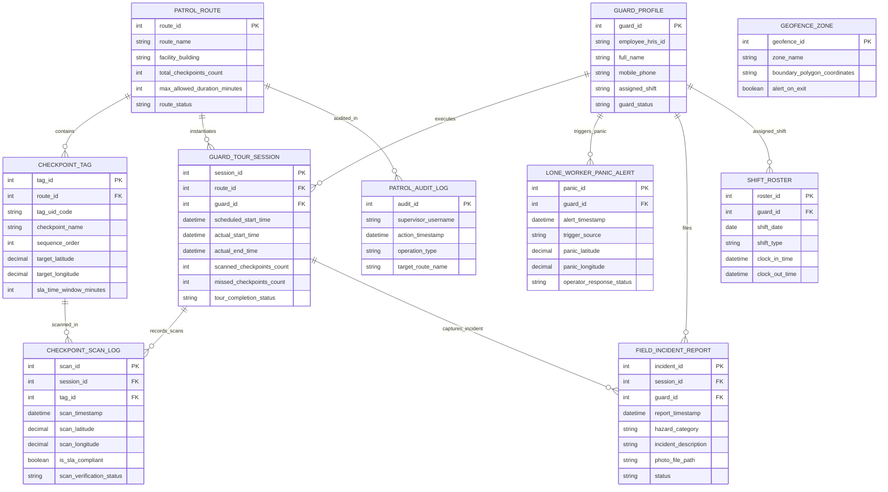

# Conceptual ERD — Guard Patrol Management System

## Mermaid Code

## Entity Description Table | Bảng mô tả Entity

| # | Entity Name | Vietnamese Name | Description | Key Attributes | Main Relationships |
|---|-------------|-----------------|-------------|----------------|-------------------|
| 1 | PATROL_ROUTE | Tuyến đường Tần tra | Master route record defining patrol names, target buildings, checkpoint counts, and max allowed duration. | route_id, route_name, facility_building, total_checkpoints_count, route_status | Primary entity; contains CHECKPOINT_TAG; instantiates GUARD_TOUR_SESSION. |
| 2 | CHECKPOINT_TAG | Thẻ Điểm kiểm tra (NFC/RFID) | Stores physical NFC tag UIDs, checkpoint names, sequence numbers, target GPS coordinates, and SLA windows. | tag_id, tag_uid_code, checkpoint_name, sequence_order, target_latitude, target_longitude, sla_time_window_minutes | Belongs to PATROL_ROUTE; scanned in CHECKPOINT_SCAN_LOG. |
| 3 | GUARD_TOUR_SESSION | Phiên Tần tra của Bảo vệ | Tracks specific patrol tour executions, scheduled/actual start/end times, scanned/missed counts, and completion status. | session_id, scheduled_start_time, actual_start_time, scanned_checkpoints_count, missed_checkpoints_count, tour_completion_status | Instantiated from PATROL_ROUTE; executed by GUARD_PROFILE; records CHECKPOINT_SCAN_LOG. |
| 4 | CHECKPOINT_SCAN_LOG | Nhật ký Quét Thẻ NFC | Archives validated NFC scans, scan timestamps, smartphone GPS coordinates, SLA compliance flags, and verification status. | scan_id, scan_timestamp, scan_latitude, scan_longitude, is_sla_compliant, scan_verification_status | Belongs to GUARD_TOUR_SESSION and CHECKPOINT_TAG. |
| 5 | GUARD_PROFILE | Hồ sơ Nhân viên Bảo vệ | Stores guard employee IDs, full names, mobile phones, assigned shifts, and status. | guard_id, employee_hris_id, full_name, mobile_phone, assigned_shift, guard_status | Executes GUARD_TOUR_SESSION; triggers LONE_WORKER_PANIC_ALERT; files FIELD_INCIDENT_REPORT. |
| 6 | LONE_WORKER_PANIC_ALERT | Canh báo Cấp cứu Lone Worker | Archives guard emergency panic alarms, trigger sources (Manual SOS Button vs Accelerometer Man-Down), GPS locations, and operator responses. | panic_id, alert_timestamp, trigger_source, panic_latitude, panic_longitude, operator_response_status | Triggered by GUARD_PROFILE. |
| 7 | FIELD_INCIDENT_REPORT | Báo cáo Sự cố Hiện trường | Stores field hazard reports, damage descriptions, photos captured during patrols, and status. | incident_id, report_timestamp, hazard_category, incident_description, photo_file_path, status | Filed by GUARD_PROFILE; captured in GUARD_TOUR_SESSION. |
| 8 | SHIFT_ROSTER | Lịch Ca trực Bảo vệ | Manages 24/7 guard shift rosters, shift types (Day/Night/Swing), clock-in/out timestamps, and attendance. | roster_id, shift_date, shift_type, clock_in_time, clock_out_time | Assigned to GUARD_PROFILE. |
| 9 | GEOFENCE_ZONE | Vùng Hàng rào Địa lý (GPS) | Defines virtual GPS geofence polygon coordinates around facility boundaries for guard location tracking. | geofence_id, zone_name, boundary_polygon_coordinates, alert_on_exit | Monitors guard locations. |
| 10 | PATROL_AUDIT_LOG | Nhật ký Kiểm toán Tần tra | Captures supervisor route edits, SLA threshold modifications, alert overrides, and audit log receipts. | audit_id, supervisor_username, action_timestamp, operation_type, target_route_name | Audits PATROL_ROUTE. |

## Relationship Description | Mô tả Quan hệ

| # | From Entity | Cardinality | To Entity | Relationship Label | Business Explanation |
|---|-------------|-------------|-----------|-------------------|----------------------|
| 1 | PATROL_ROUTE | one-to-many | CHECKPOINT_TAG | contains | A patrol route contains multiple ordered NFC checkpoint tags. |
| 2 | PATROL_ROUTE | one-to-many | GUARD_TOUR_SESSION | instantiates | A patrol route instantiates multiple guard tour session executions. |
| 3 | GUARD_PROFILE | one-to-many | GUARD_TOUR_SESSION | executes | A guard profile executes multiple assigned tour sessions. |
| 4 | GUARD_TOUR_SESSION | one-to-many | CHECKPOINT_SCAN_LOG | records_scans | A guard tour session records multiple checkpoint scan logs. |
| 5 | CHECKPOINT_TAG | one-to-many | CHECKPOINT_SCAN_LOG | scanned_in | A physical checkpoint tag is scanned in multiple checkpoint scan logs. |
| 6 | GUARD_PROFILE | one-to-many | LONE_WORKER_PANIC_ALERT | triggers_panic | A guard profile can trigger emergency lone worker panic alerts. |
| 7 | GUARD_PROFILE | one-to-many | FIELD_INCIDENT_REPORT | files | A guard profile files field incident reports during tours. |
| 8 | GUARD_PROFILE | one-to-many | SHIFT_ROSTER | assigned_shift | A guard profile is assigned to shift rosters. |
