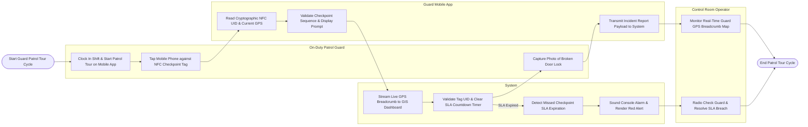

# Swimlane Diagram — Guard Patrol Management System

## Mermaid Code

## Flow Description | Mô tả luồng

| Lane | Actor | Role in Flow |
|------|-------|-------------|
| 1 | On-Duty Patrol Guard | Clocks in shift on mobile app, taps smartphone against physical NFC tags, captures field incident photos, and conducts patrols. |
| 2 | Guard Mobile App | Reads cryptographic NFC tag UIDs, validates checkpoint sequence, displays inspection prompts, captures GPS coordinates, and streams data. |
| 3 | System | Streams real-time guard GPS breadcrumb trails to control dashboards, clears SLA timers upon tag scans, and triggers alerts for missed checkpoints. |
| 4 | Control Room Operator | Monitors live guard tracking maps, responds to missed checkpoint SLA alerts, and conducts radio safety checks. |
