# Action Tree — Guard Patrol Management System

## Mermaid Code

```mermaid
graph TD
    Root["Guard Patrol Management System"]

    Root --> M1["Route & Checkpoint Setup"]
    Root --> M2["Mobile Patrol & NFC Scanning"]
    Root --> M3["GPS Tracking & Geofencing"]
    Root --> M4["Lone Worker & Panic Response"]
    Root --> M5["Shift Roster & Tour Auditing"]

    M1 --> A1["Define Mandatory Checkpoint Sequences"]
    M1 --> A2["Set Checkpoint SLA Time Windows"]
    M1 --> A3["Register NFC Tag Cryptographic UIDs"]
    M1 --> A4["Randomize Shift Route Sequences"]

    M2 --> B1["Read Wall-Mounted NFC Tag via Mobile App"]
    M2 --> B2["Validate Checkpoint Order & Display Tasks"]
    M2 --> B3["Store Encrypted Scans in Offline Queue"]
    M2 --> B4["Log Field Hazard Report with Photos"]

    M3 --> C1["Stream Real-Time Guard GPS Coordinates"]
    M3 --> C2["Render Breadcrumb Trail on GIS Dashboard"]
    M3 --> C3["Configure GPS Geofence Patrol Boundaries"]
    M3 --> C4["Alert Operator on GPS Location Loss"]

    M4 --> D1["Detect Accelerometer Man-Down Tilt"]
    M4 --> D2["Execute 15-Sec Pre-Alarm Vibration"]
    M4 --> D3["Trigger Manual Red SOS Panic Button"]
    M4 --> D4["Broadcast Guard GPS to Control Room"]

    M5 --> E1["Detect Missed Checkpoint SLA Violations"]
    M5 --> E2["Schedule 24/7 Guard Shift Rosters"]
    M5 --> E3["Manage Shift Physical Key Handovers"]
    M5 --> E4["Calculate Tour Completion Percentage %"]
```

## Module Description | Mô tả Module

| # | Module | Description | Actions |
|---|--------|-------------|---------|
| 1 | Route & Checkpoint Setup | Mandatory checkpoint sequence setup, SLA window configuration, NFC tag UID registration, and route randomization. | Define Mandatory Checkpoint Sequences, Set Checkpoint SLA Time Windows, Register NFC Tag Cryptographic UIDs, Randomize Shift Route Sequences |
| 2 | Mobile Patrol & NFC Scanning | Mobile NFC tag reading, sequence validation, offline scan queuing, and field hazard photo reporting. | Read Wall-Mounted NFC Tag via Mobile App, Validate Checkpoint Order & Display Tasks, Store Encrypted Scans in Offline Queue, Log Field Hazard Report with Photos |
| 3 | GPS Tracking & Geofencing | Real-time GPS location streaming, GIS breadcrumb rendering, geofence boundary configuration, and GPS signal loss alerts. | Stream Real-Time Guard GPS Coordinates, Render Breadcrumb Trail on GIS Dashboard, Configure GPS Geofence Patrol Boundaries, Alert Operator on GPS Location Loss |
| 4 | Lone Worker & Panic Response | Accelerometer man-down tilt detection, pre-alarm vibration countdowns, manual SOS panic buttons, and GPS broadcasting. | Detect Accelerometer Man-Down Tilt, Execute 15-Sec Pre-Alarm Vibration, Trigger Manual Red SOS Panic Button, Broadcast Guard GPS to Control Room |
| 5 | Shift Roster & Tour Auditing | Missed checkpoint SLA violation alerts, 24/7 shift roster scheduling, physical key handovers, and tour completion rate scoring. | Detect Missed Checkpoint SLA Violations, Schedule 24/7 Guard Shift Rosters, Manage Shift Physical Key Handovers, Calculate Tour Completion Percentage % |
