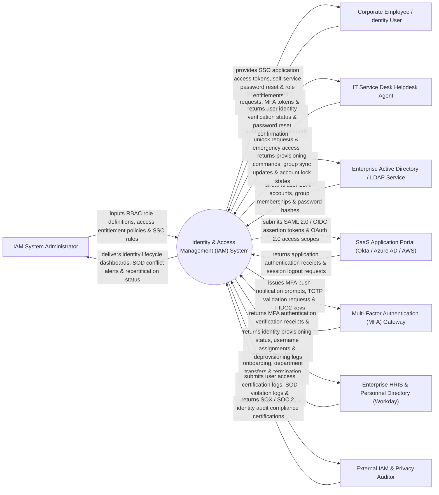

# Context Diagram — Identity & Access Management (IAM) System

## Mermaid Code

## Actor & Interaction Table | Bảng Actor & Tương tác

| # | Actor | Actor Type | Data Sent TO System | Data Received FROM System | Notes |
|---|-------|------------|---------------------|---------------------------|-------|
| 1 | IAM System Administrator | Primary | RBAC role definitions, access entitlement policies, SSO rules, separation of duties (SOD) matrix. | Identity lifecycle dashboards, SOD conflict alerts, recertification status, system logs. | Administrator managing identity governance, role definitions, and access entitlement policies. |
| 2 | Corporate Employee / Identity User | Primary | SSO login requests, MFA tokens, self-service password reset entries, access requests. | SSO application access tokens, password reset confirmation, role entitlement status. | Corporate staff member logging into enterprise applications via Single Sign-On (SSO). |
| 3 | IT Service Desk Helpdesk Agent | Primary | Manual account unlock requests, emergency access overrides, password reset requests. | User identity verification status, temporary password reset confirmation receipts. | Service desk agent handling user identity lockouts and password assistance. |
| 4 | Enterprise Active Directory / LDAP Service | Supporting | User LDAP accounts, Active Directory group memberships, password hashes. | Provisioning commands, Active Directory group sync updates, account lock states. | Central On-Premises or Cloud Directory Service managing core directory accounts. |
| 5 | SaaS Application Portal | Supporting | Application authentication receipts, OAuth authorization codes, session logout requests. | SAML 2.0 assertions, OpenID Connect (OIDC) identity tokens, OAuth access scopes. | Enterprise SaaS applications (Salesforce, Workday, AWS, Office 365) integrated via SSO. |
| 6 | Multi-Factor Authentication (MFA) Gateway | Supporting | MFA authentication verification receipts, biometric pass tokens, FIDO2 webauthn responses. | MFA push notification prompts, TOTP time-based validation requests, SMS OTP requests. | External MFA provider (Duo Security, Okta Verify, YubiKey) enforcing step-up MFA. |
| 7 | Enterprise HRIS & Personnel Directory | Supporting | New hire onboarding records, department transfers, job title changes, termination triggers. | Identity provisioning status, corporate username assignments, deprovisioning logs. | Core HR platform (Workday / SAP SuccessFactors) serving as identity Source of Truth. |
| 8 | External IAM & Privacy Auditor | Supporting / Regulatory | SOX / SOC 2 compliance audit inquiries, access control mandates, audit reviews. | User access certification logs, SOD violation logs, authentication audit trails. | Compliance auditor inspecting identity governance for SOX, HIPAA, and SOC 2 requirements. |

## System Boundary Description | Mô tả Phạm vi Hệ thống

The **Identity & Access Management (IAM) System** is an enterprise identity governance, Single Sign-On (SSO), Multi-Factor Authentication (MFA), Role-Based Access Control (RBAC), and user lifecycle provisioning platform.

**Inside System Scope:**
- Centralized user identity lifecycle management (Joiner, Mover, Leaver automation from HRIS).
- Single Sign-On (SSO) authentication engine supporting SAML 2.0, OpenID Connect (OIDC), and OAuth 2.0.
- Adaptive risk-based Multi-Factor Authentication (MFA) enforcement (FIDO2, TOTP, Push Notifications).
- Role-Based Access Control (RBAC) and Attribute-Based Access Control (ABAC) entitlement provisioning.
- Identity access recertification campaigns and Separation of Duties (SOD) conflict detection.

**Outside System Scope:**
- Direct physical door cardholder badge printing (handled by Access Control Management System).
- Direct hosting of physical SaaS server data centers (handled by Cloud Providers like AWS/Azure).
- Direct employee salary payroll calculation (handled by Enterprise HRIS & Payroll).
