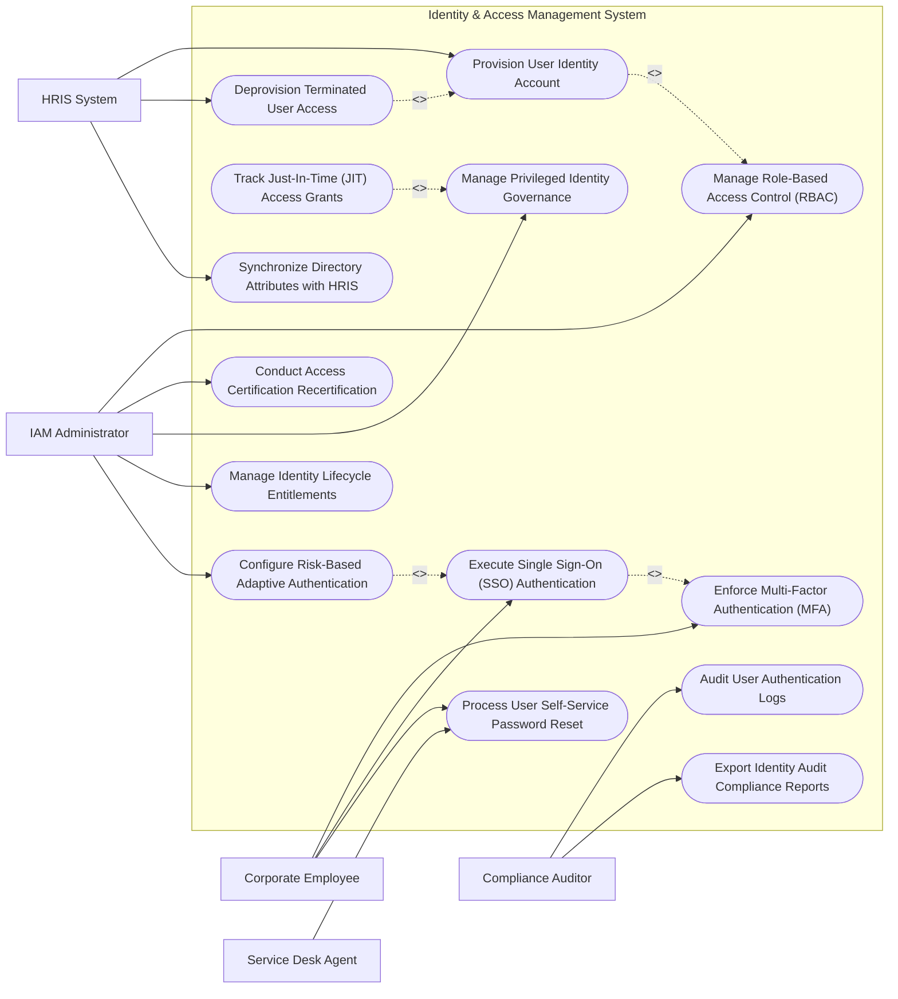

# Use Case Diagram — Identity & Access Management (IAM) System

## Mermaid Code

## Actor Table | Bảng Actor

| # | Actor | Actor Type | Role Description | Related Use Cases |
|---|-------|------------|------------------|-------------------|
| 1 | IAM Administrator | Primary | Manages RBAC role structures, entitlement policies, identity recertification campaigns, and adaptive authentication rules. | UC02, UC07, UC08, UC12, UC13 |
| 2 | Corporate Employee | Primary | Authenticates via SSO, completes MFA challenges, and performs self-service password resets. | UC03, UC04, UC05 |
| 3 | Service Desk Agent | Primary | Assists users with identity lockouts, credential resets, and emergency access requests. | UC05 |
| 4 | Compliance Auditor | Secondary | Inspects authentication audit logs, SOD conflict reports, access certification histories, and SOX compliance filings. | UC10, UC14 |
| 5 | HRIS System | Supporting / System | Core HR system triggering automated account provisioning for new hires and instant deprovisioning for terminations. | UC01, UC06, UC11 |

## Use Case Table | Bảng Use Case

| # | UC ID | Use Case Name | Primary Actor | Secondary Actor | Description | Priority |
|---|-------|---------------|---------------|-----------------|-------------|----------|
| 1 | UC01 | Provision User Identity Account | HRIS System | IAM Admin | Automatically provisions new employee directory accounts, email mailboxes, and default application roles. | High |
| 2 | UC02 | Manage Role-Based Access Control (RBAC) | IAM Admin | None | Defines corporate job roles, permission sets, and automatic entitlement mappings. | High |
| 3 | UC03 | Enforce Multi-Factor Authentication (MFA) | Corporate Employee | MFA Gateway | Challenges users for secondary authentication (TOTP, Push, FIDO2 YubiKey) during login. | High |
| 4 | UC04 | Execute Single Sign-On (SSO) Authentication | Corporate Employee | SaaS App | Authenticates user once and issues SAML 2.0 / OIDC tokens for seamless access to all enterprise SaaS apps. | High |
| 5 | UC05 | Process User Self-Service Password Reset | Corporate Employee | Helpdesk Agent | Allows users to securely reset forgotten domain passwords via SMS/MFA verification without calling helpdesk. | High |
| 6 | UC06 | Deprovision Terminated User Access | HRIS System | IAM Admin | Instantly revokes all active SSO sessions, disables directory accounts, and removes entitlements upon employee departure. | High |
| 7 | UC07 | Conduct Access Certification Recertification | IAM Admin | None | Runs manager recertification campaigns where supervisors periodically review and approve subordinate access rights. | High |
| 8 | UC08 | Manage Privileged Identity Governance | IAM Admin | None | Governs elevated administrator accounts, enforcing strict approval workflows and session logging. | High |
| 9 | UC09 | Track Just-In-Time (JIT) Access Grants | IAM Admin | Corporate Employee | Provisions temporary elevated access privileges for a limited time window (e.g., 4 hours) then auto-revokes. | Medium |
| 10 | UC10 | Audit User Authentication Logs | Compliance Auditor | None | Logs every authentication attempt, IP location, device fingerprint, success/failure status, and MFA method. | High |
| 11 | UC11 | Synchronize Directory Attributes with HRIS | HRIS System | None | Synchronizes employee title changes, department transfers, and manager updates with LDAP/Active Directory. | High |
| 12 | UC12 | Manage Identity Lifecycle Entitlements | IAM Admin | None | Manages fine-grained application entitlements (e.g., Salesforce Admin vs Salesforce Read-Only). | Medium |
| 13 | UC13 | Configure Risk-Based Adaptive Authentication | IAM Admin | None | Evaluates login risk score (new country IP, impossible travel, unknown device) and dynamically prompts for step-up MFA. | Medium |
| 14 | UC14 | Export Identity Audit Compliance Reports | Compliance Auditor | IAM Admin | Generates certified SOX 404 and SOC 2 Type II identity audit reports detailing active users and entitlement changes. | High |

## Use Case Specification | Đặc tả Use Case

---

### UC01 — Provision User Identity Account

| Field | Detail |
|-------|--------|
| **UC ID** | UC01 |
| **Use Case Name** | Provision User Identity Account |
| **Actor(s)** | Primary: HRIS System   Secondary: IAM Administrator |
| **Description** | Automatically creates corporate directory accounts, provisions email mailboxes, and assigns birthright role entitlements upon receiving a new hire event from HRIS. |
| **Precondition** | 1. HRIS System posts a new hire onboarding record.   2. Birthright RBAC rules for job role are configured. |
| **Main Flow** | 1. HRIS System transmits new employee JSON payload to IAM provisioning API (Name, Department, Start Date, Manager ID, Job Title).   2. System generates unique corporate username (e.g., `jdoe@company.com`) and employee ID.   3. System creates Active Directory / LDAP user account and provisions Google Workspace / Office 365 mailbox.   4. System evaluates birthright RBAC role rules and assigns default application entitlements (e.g., Slack, HR Portal, Jira).   5. System sends secure initial onboarding credential link to employee personal email.   6. System logs identity creation event and updates HRIS sync receipt. |
| **Alternative Flow** | **AF1** — Contractor Account Provisioning: Contractor account is created with fixed expiration date (e.g., 90 days) requiring manager extension. |
| **Exception Flow** | **EX1** — Username Conflict: If generated username already exists, system appends numerical suffix (`jdoe2@company.com`) and updates record. |
| **Postcondition** | User identity account is provisioned in active directory and birthright applications are accessible. |
| **Business Rule** | **BR1**: New hire accounts shall be provisioned 24 hours prior to the employee official start date. |

---

### UC04 — Execute Single Sign-On (SSO) Authentication

| Field | Detail |
|-------|--------|
| **UC ID** | UC04 |
| **Use Case Name** | Execute Single Sign-On (SSO) Authentication |
| **Actor(s)** | Primary: Corporate Employee   Secondary: SaaS Application Portal |
| **Description** | Authenticates employee once against central Identity Provider (IdP) and issues SAML 2.0 assertions or OpenID Connect tokens for seamless application access. |
| **Precondition** | 1. Employee identity account is active.   2. Target SaaS application (e.g., Salesforce) is integrated with IdP via SAML 2.0. |
| **Main Flow** | 1. Employee navigates to Salesforce web portal and clicks "Sign in with Corporate SSO".   2. Salesforce redirects browser to IAM IdP Single Sign-On URL with SAML AuthNRequest payload.   3. IAM IdP prompts user for primary domain credentials (Username & Password).   4. User inputs valid credentials.   5. System evaluates adaptive risk rules and triggers UC03 Enforce MFA if required.   6. Upon successful authentication, IdP generates cryptographically signed SAML 2.0 Assertion payload containing user email and role attributes.   7. IdP redirects browser back to Salesforce ACS (Assertion Consumer Service) URL.   8. Salesforce validates SAML signature and logs employee into dashboard. |
| **Alternative Flow** | **AF1** — IdP-Initiated SSO: Employee logs into central Okta/Azure User Portal and clicks Salesforce app icon to launch SSO directly. |
| **Exception Flow** | **EX1** — Expired SSO Certificate: If SAML signing certificate is expired, application rejects assertion and system alerts IAM Admin. |
| **Postcondition** | Employee is authenticated and granted secure access to target application. |
| **Business Rule** | **BR1**: SAML 2.0 assertion tokens must be signed using SHA-256 cryptographic keys and expire after 8 hours. |

---

### UC06 — Deprovision Terminated User Access

| Field | Detail |
|-------|--------|
| **UC ID** | UC06 |
| **Use Case Name** | Deprovision Terminated User Access |
| **Actor(s)** | Primary: HRIS System   Secondary: IAM Administrator |
| **Description** | Instantly revokes all active SSO sessions, disables directory accounts, and deprovisions application entitlements when an employee is terminated. |
| **Precondition** | 1. HRIS System posts an involuntary or voluntary employee termination event. |
| **Main Flow** | 1. HRIS System sends high-priority "EMPLOYEE TERMINATED" event payload to IAM System API.   2. System immediately sets target user identity status to "DISABLED".   3. System revokes all active OAuth 2.0 refresh tokens, invalidates active SAML SSO sessions, and clears session cookies.   4. System issues API calls to Active Directory, Azure AD, Office 365, Salesforce, and AWS to disable user accounts.   5. System removes user from all security groups and access entitlement lists.   6. System generates Deprovisioning Audit Receipt and emails summary to HR and Security Operations. |
| **Alternative Flow** | **AF1** — Manager Data Delegation: System automatically transfers departing employee mailbox and OneDrive files to designated manager. |
| **Exception Flow** | **EX1** — Incomplete API Deprovisioning: If a 3rd-party SaaS app API fails to respond, system queues manual ticket to IT Service Desk for manual account removal within 2 hours. |
| **Postcondition** | All digital access privileges for the terminated employee are permanently revoked across all systems. |
| **Business Rule** | **BR1**: Involuntary employee termination deprovisioning must execute within 5 minutes of HRIS event payload receipt. |

---

### UC07 — Conduct Access Certification Recertification

| Field | Detail |
|-------|--------|
| **UC ID** | UC07 |
| **Use Case Name** | Conduct Access Certification Recertification |
| **Actor(s)** | Primary: IAM Administrator   Secondary: None |
| **Description** | Automates periodic (quarterly/annual) manager access review campaigns where supervisors audit and certify subordinate access permissions. |
| **Precondition** | 1. Recertification campaign (e.g., "Q3 Financial Systems Access Audit") is scheduled. |
| **Main Flow** | 1. IAM Administrator launches new Access Recertification Campaign.   2. System compiles list of active users, assigned roles, and application entitlements.   3. System routes customized recertification review tasks to each department manager.   4. Manager receives notification and logs into Access Certification Portal.   5. Manager reviews each subordinate employee entitlements list and selects "Approve Keep Access" OR "Revoke Access".   6. Manager signs certification submission.   7. System automatically revokes all manager-flagged unneeded entitlements and updates user accounts.   8. System compiles Access Certification Campaign Audit Report for SOX auditors. |
| **Alternative Flow** | **AF1** — Overdue Manager Escalation: If manager fails to complete review within 14 days, system escalates task to Department VP. |
| **Exception Flow** | **EX1** — Uncertified Access Auto-Revoke: System automatically revokes uncertified access entitlements if campaign closes without manager response. |
| **Postcondition** | User access entitlements are audited, unneeded permissions are revoked, and SOX audit report is generated. |
| **Business Rule** | **BR1**: Quarterly recertification campaigns must achieve 100% review completion to satisfy SOX 404 audit compliance. |

---

### UC08 — Manage Privileged Identity Governance

| Field | Detail |
|-------|--------|
| **UC ID** | UC08 |
| **Use Case Name** | Manage Privileged Identity Governance |
| **Actor(s)** | Primary: IAM Administrator   Secondary: None |
| **Description** | Governs administrative privileged accounts (Domain Admins, AWS Root, Database Admins), enforcing strict request approvals and time-bound access. |
| **Precondition** | 1. Privileged account roles are defined in Privileged Identity Management (PIM) module. |
| **Main Flow** | 1. IT Engineer requires Domain Admin access to perform server maintenance.   2. Engineer opens PIM portal and submits "Privileged Access Activation Request" specifying justification ticket number and requested duration (e.g., 2 hours).   3. System checks Separation of Duties (SOD) rules and routes request to IAM Administrator for approval.   4. Administrator approves request.   5. System activates Domain Admin entitlement, initiates session recording, and sets a 2-hour countdown timer.   6. Upon timer expiration (or manual check-in), system automatically deactivates privileged role and logs full audit trail. |
| **Alternative Flow** | **AF1** — Auto-Approved Emergency Break-Glass: Emergency break-glass admin activation auto-approves but triggers immediate SMS alert to CISO. |
| **Exception Flow** | **EX1** — SOD Conflict Detected: If requested privileged role conflicts with engineer active duties (e.g., Developer + Production Deployer), system blocks request. |
| **Postcondition** | Privileged access is granted temporarily with full audit logging and auto-revoked upon expiration. |
| **Business Rule** | **BR1**: Permanent standing privileged admin accounts are prohibited; all privileged access must be Just-In-Time (JIT) time-bound. |
