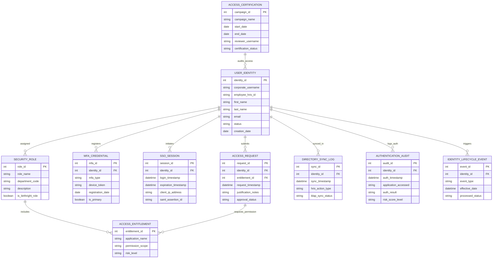

# Conceptual ERD — Identity & Access Management (IAM) System

## Mermaid Code

## Entity Description Table | Bảng mô tả Entity

| # | Entity Name | Vietnamese Name | Description | Key Attributes | Main Relationships |
|---|-------------|-----------------|-------------|----------------|-------------------|
| 1 | USER_IDENTITY | Danh tính Nguời dùng | Master user identity table storing corporate usernames, employee HRIS IDs, status, and email addresses. | identity_id, corporate_username, employee_hris_id, status | Primary entity; assigned SECURITY_ROLE, registers MFA_CREDENTIAL. |
| 2 | SECURITY_ROLE | Vai trò An ninh (RBAC) | Stores RBAC role definitions, department mappings, and birthright role flags. | role_id, role_name, department_code, is_birthright_role | Assigned to USER_IDENTITY; includes ACCESS_ENTITLEMENT. |
| 3 | ACCESS_ENTITLEMENT | Quyền Truy cập Chi tiết | Stores fine-grained application entitlements, permission scopes, and risk levels (e.g., AWS Admin). | entitlement_id, application_name, permission_scope, risk_level | Included in SECURITY_ROLE; requested in ACCESS_REQUEST. |
| 4 | MFA_CREDENTIAL | Phao Xác thực MFA | Tracks registered MFA devices (FIDO2 keys, TOTP seeds, phone numbers) for user accounts. | mfa_id, mfa_type, device_token, is_primary | Registered by USER_IDENTITY. |
| 5 | SSO_SESSION | Phiên Đăng nhập Đơn (SSO) | Logs active SSO sessions, login timestamps, client IP addresses, and SAML assertion IDs. | session_id, login_timestamp, saml_assertion_id, client_ip_address | Initiated by USER_IDENTITY. |
| 6 | ACCESS_REQUEST | Yêu cầu Cấp Quyền | Stores self-service entitlement access requests, justification notes, and manager approval statuses. | request_id, request_timestamp, justification_notes, approval_status | Submitted by USER_IDENTITY; requests ACCESS_ENTITLEMENT. |
| 7 | ACCESS_CERTIFICATION | Đợt Tái xác nhận Quyền | Tracks periodic access review campaigns, review start/end dates, reviewers, and compliance status. | campaign_id, campaign_name, start_date, certification_status | Audits access of USER_IDENTITY. |
| 8 | DIRECTORY_SYNC_LOG | Nhật ký Đồng bộ Thư mục | Logs automated directory provisioning transactions synchronized between HRIS and LDAP/Active Directory. | sync_id, sync_timestamp, hris_action_type, ldap_sync_status | Synced for USER_IDENTITY. |
| 9 | AUTHENTICATION_AUDIT | Nhật ký Kiểm toán Xác thực | Captures all SSO login attempts, application targets, authentication outcomes, and adaptive risk scores. | audit_id, auth_timestamp, application_accessed, auth_result | Logs authentication for USER_IDENTITY. |
| 10 | IDENTITY_LIFECYCLE_EVENT | Sự kiện Vòng đời Danh tính | Tracks Joiner (onboarding), Mover (transfer), and Leaver (termination) events triggered by HRIS. | event_id, event_type, effective_date, processed_status | Triggered by USER_IDENTITY. |

## Relationship Description | Mô tả Quan hệ

| # | From Entity | Cardinality | To Entity | Relationship Label | Business Explanation |
|---|-------------|-------------|-----------|-------------------|----------------------|
| 1 | USER_IDENTITY | many-to-many | SECURITY_ROLE | assigned | A user identity is assigned one or more security roles (RBAC). |
| 2 | SECURITY_ROLE | many-to-many | ACCESS_ENTITLEMENT | includes | A security role includes multiple application access entitlements. |
| 3 | USER_IDENTITY | one-to-many | MFA_CREDENTIAL | registers | A user identity registers one or more MFA devices. |
| 4 | USER_IDENTITY | one-to-many | SSO_SESSION | initiates | A user identity initiates active SSO login sessions. |
| 5 | USER_IDENTITY | one-to-many | ACCESS_REQUEST | submits | A user identity submits requests for additional access entitlements. |
| 6 | ACCESS_REQUEST | one-to-one | ACCESS_ENTITLEMENT | requests_permission | An access request targets a specific application access entitlement. |
| 7 | ACCESS_CERTIFICATION | many-to-many | USER_IDENTITY | audits_access | An access certification campaign audits user identity access permissions. |
| 8 | USER_IDENTITY | one-to-many | AUTHENTICATION_AUDIT | logs_auth | A user identity records authentication attempts in audit logs. |
