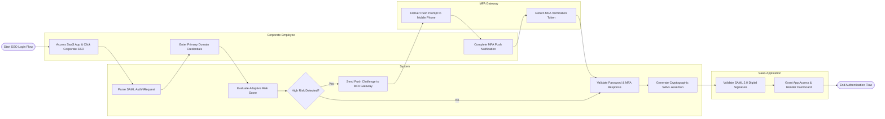

# Swimlane Diagram — Identity & Access Management (IAM) System

## Mermaid Code

## Flow Description | Mô tả luồng

| Lane | Actor | Role in Flow |
|------|-------|-------------|
| 1 | Corporate Employee | Initiates login at target SaaS app, enters primary corporate domain credentials, and approves step-up MFA push prompts. |
| 2 | System | Parses incoming SAML AuthNRequest payloads, evaluates adaptive login risk scores, validates domain passwords, and generates signed SAML 2.0 assertions. |
| 3 | MFA Gateway | External MFA provider delivering push notification prompts to employee mobile devices and returning verified authentication tokens. |
| 4 | SaaS Application | Validates incoming SAML assertion signatures, provisions local session cookies, and renders application dashboards. |
