# Action Tree — Identity & Access Management (IAM) System

## Mermaid Code

```mermaid
graph TD
    Root["Identity & Access Management System"]

    Root --> M1["Identity Lifecycle Management"]
    Root --> M2["Authentication & Single Sign-On"]
    Root --> M3["Access Control & RBAC"]
    Root --> M4["Access Governance & Certification"]
    Root --> M5["Audit & Reporting"]

    M1 --> A1["Provision New Hire Account"]
    M1 --> A2["Sync Department Transfers from HRIS"]
    M1 --> A3["Execute Instant Account Deprovisioning"]
    M1 --> A4["Manage Contractor Account Expiration"]

    M2 --> B1["Issue SAML 2.0 / OIDC Assertions"]
    M2 --> B2["Enforce Adaptive Step-Up MFA"]
    M2 --> B3["Process Self-Service Password Reset"]
    M2 --> B4["Revoke Active OAuth Refresh Tokens"]

    M3 --> C1["Define Security Role Permissions"]
    M3 --> C2["Assign Birthright Entitlements"]
    M3 --> C3["Request Just-In-Time PIM Access"]
    M3 --> C4["Enforce Separation of Duties (SOD)"]

    M4 --> D1["Launch Access Recertification Campaign"]
    M4 --> D2["Review Subordinate Manager Approvals"]
    M4 --> D3["Auto-Revoke Uncertified Entitlements"]
    M4 --> D4["Manage Privileged Account Access"]

    M5 --> E1["Search Authentication Audit Logs"]
    M5 --> E2["Export SOX 404 Compliance Matrix"]
    M5 --> E3["Log HRIS Directory Sync Receipts"]
    M5 --> E4["Generate Identity Risk Scorecard"]
```

## Module Description | Mô tả Module

| # | Module | Description | Actions |
|---|--------|-------------|---------|
| 1 | Identity Lifecycle Management | Joiner/Mover/Leaver automation, HRIS account provisioning, department transfer sync, and contractor expiration. | Provision New Hire Account, Sync Department Transfers from HRIS, Execute Instant Account Deprovisioning, Manage Contractor Account Expiration |
| 2 | Authentication & Single Sign-On | SAML 2.0 / OIDC SSO token issuance, adaptive risk-based MFA, self-service password resets, and token revocation. | Issue SAML 2.0 / OIDC Assertions, Enforce Adaptive Step-Up MFA, Process Self-Service Password Reset, Revoke Active OAuth Refresh Tokens |
| 3 | Access Control & RBAC | Role-based access control definitions, birthright entitlements, Just-In-Time (JIT) privileged access, and SOD enforcement. | Define Security Role Permissions, Assign Birthright Entitlements, Request Just-In-Time PIM Access, Enforce Separation of Duties (SOD) |
| 4 | Access Governance & Certification | Manager recertification review campaigns, uncertified permission auto-revocation, and Privileged Identity Management (PIM). | Launch Access Recertification Campaign, Review Subordinate Manager Approvals, Auto-Revoke Uncertified Entitlements, Manage Privileged Account Access |
| 5 | Audit & Reporting | Authentication log search, SOX 404 / SOC 2 compliance reporting, HRIS directory sync receipts, and identity risk metrics. | Search Authentication Audit Logs, Export SOX 404 Compliance Matrix, Log HRIS Directory Sync Receipts, Generate Identity Risk Scorecard |
