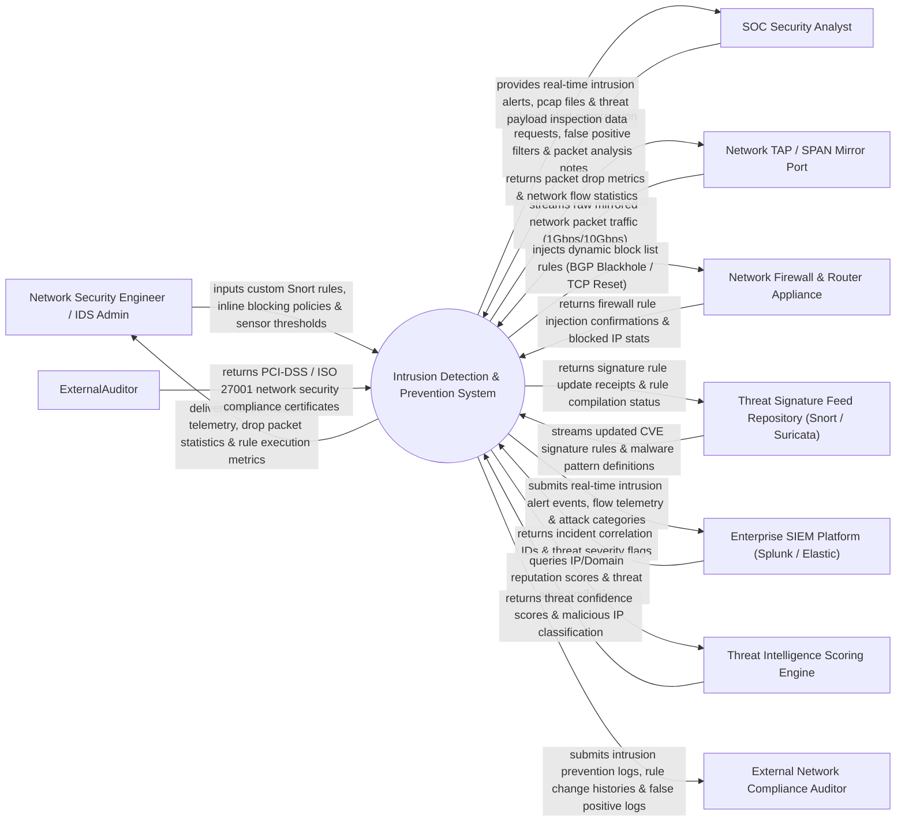

# Context Diagram — Intrusion Detection & Prevention System

## Mermaid Code

## Actor & Interaction Table | Bảng Actor & Tương tác

| # | Actor | Actor Type | Data Sent TO System | Data Received FROM System | Notes |
|---|-------|------------|---------------------|---------------------------|-------|
| 1 | Network Security Engineer / IDS Admin | Primary | Custom Snort rules, inline blocking policies, sensor thresholds, inspection parameters. | Sensor health telemetry, drop packet statistics, rule execution metrics, HA status. | Security engineer configuring IDS/IPS signature rules, inline sensors, and bypass rules. |
| 2 | SOC Security Analyst | Primary | Alert suppression requests, false positive filters, packet analysis notes, investigation tags. | Real-time intrusion alerts, pcap packet files, threat payload inspection data, attack categories. | Analyst investigating network intrusion alerts, analyzing raw packet captures (PCAP). |
| 3 | Network TAP / SPAN Mirror Port | Supporting | Raw mirrored network packet traffic (1Gbps/10Gbps Ethernet streams). | Packet drop metrics, network flow statistics, sensor packet buffer status. | Hardware network TAP or SPAN port mirroring live network traffic into IDS sensors. |
| 4 | Network Firewall & Router Appliance | Supporting | Firewall rule injection confirmations, blocked IP stats, BGP route updates. | Dynamic block list rules, TCP Reset injection packets, BGP blackhole routes. | Enterprise perimeter firewall (Palo Alto, Fortinet, Cisco) enforcing active IPS blocks. |
| 5 | Threat Signature Feed Repository | Supporting | Updated CVE signature rules, Snort/Suricata rulesets, malware pattern definitions. | Signature rule update receipts, rule compilation status, signature load confirmation. | External signature feed provider (Emerging Threats, Talos) delivering rule updates. |
| 6 | Enterprise SIEM Platform | Supporting | Incident correlation IDs, threat severity flags, alert suppression rules. | Real-time intrusion alert events, flow telemetry, attack categories, sensor alerts. | Centralized SIEM platform ingesting network intrusion alerts for SOC correlation. |
| 7 | Threat Intelligence Scoring Engine | Supporting | Threat confidence scores, malicious IP classification, threat actor attribution. | IP/Domain reputation queries, file hash lookup requests, threat context queries. | Intelligence engine evaluating malicious IP reputation and C2 server signatures. |
| 8 | External Network Compliance Auditor | Supporting / Regulatory | PCI-DSS / ISO 27001 compliance audit findings, network inspection mandates. | Intrusion prevention logs, rule change histories, false positive logs, sensor audits. | Compliance auditor verifying mandatory network intrusion detection rules (PCI-DSS 11.4). |

## System Boundary Description | Mô tả Phạm vi Hệ thống

The **Intrusion Detection & Prevention System** is an enterprise network traffic inspection, deep packet inspection (DPI), Snort/Suricata signature matching, anomaly-based behavioral detection, and active IPS packet blocking platform.

**Inside System Scope:**
- Deep Packet Inspection (DPI) of live TCP/UDP/ICMP network traffic streams.
- Signature-based pattern matching utilizing Snort and Suricata rulesets.
- Behavioral anomaly detection identifying DDoS floods, port scans, and unusual protocol usage.
- Active Intrusion Prevention System (IPS) automated packet dropping and TCP Reset packet injection.
- Dynamic firewall rule injection and PCAP packet capture generation for forensic analysis.

**Outside System Scope:**
- Direct physical repair of network fiber-optic transceivers (handled by Hardware Vendors).
- Direct host-level endpoint malware containment (handled by Endpoint Detection & Response - EDR).
- General internal corporate website DNS hosting (handled by Enterprise DNS Systems).
