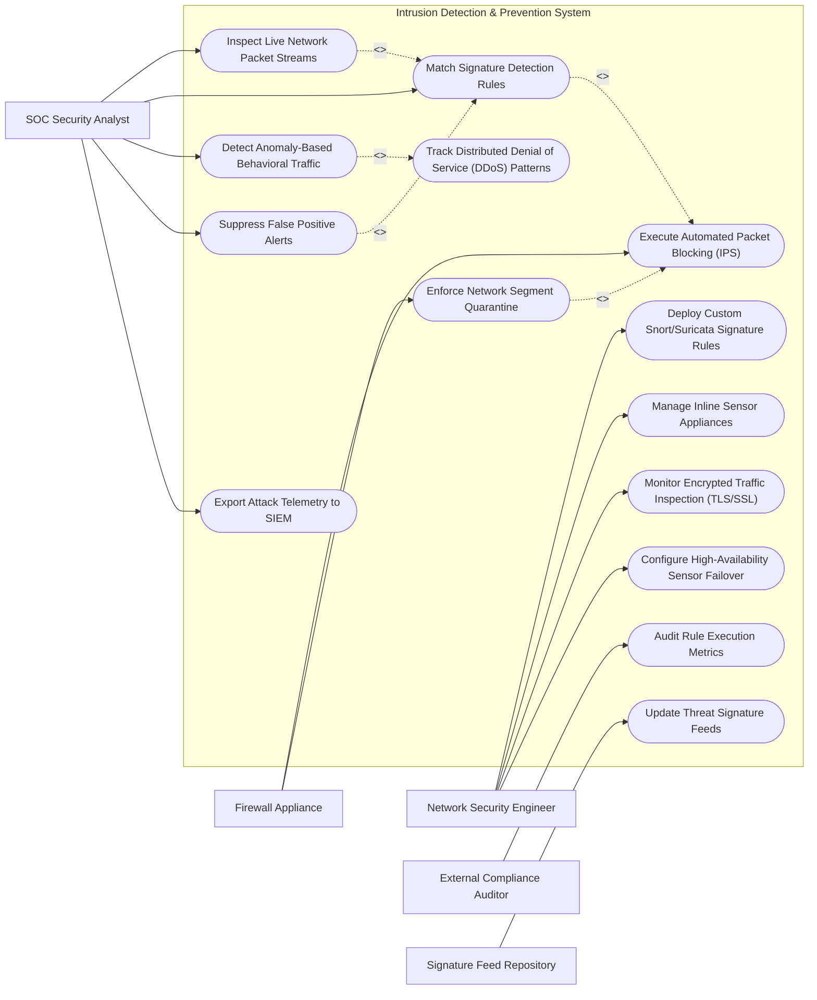

# Use Case Diagram — Intrusion Detection & Prevention System

## Mermaid Code

## Actor Table | Bảng Actor

| # | Actor | Actor Type | Role Description | Related Use Cases |
|---|-------|------------|------------------|-------------------|
| 1 | Network Security Engineer | Primary | Manages IPS sensors, writes custom Snort rules, configures TLS inspection, and sets up high-availability failover. | UC05, UC07, UC09, UC14 |
| 2 | SOC Security Analyst | Primary | Monitors live traffic alerts, investigates signature matches, creates false positive suppressions, and exports SIEM telemetry. | UC01, UC02, UC04, UC08, UC10 |
| 3 | External Compliance Auditor | Secondary | Inspects rule execution logs, network segment isolation policies, and PCI-DSS 11.4 compliance reports. | UC12 |
| 4 | Signature Feed Repository | Supporting / System | External service (Emerging Threats / Talos) delivering updated CVE signatures and rule definitions. | UC06 |
| 5 | Firewall Appliance | Supporting / System | Enforces active IPS packet drop rules, TCP Reset injection, and network segment quarantine commands. | UC03, UC11 |

## Use Case Table | Bảng Use Case

| # | UC ID | Use Case Name | Primary Actor | Secondary Actor | Description | Priority |
|---|-------|---------------|---------------|-----------------|-------------|----------|
| 1 | UC01 | Inspect Live Network Packet Streams | SOC Analyst | None | Performs real-time Deep Packet Inspection (DPI) on live 1Gbps/10Gbps mirrored network traffic. | High |
| 2 | UC02 | Match Signature Detection Rules | SOC Analyst | Signature Repo | Compares packet headers and payloads against Snort/Suricata signature database to detect exploit attempts. | High |
| 3 | UC03 | Execute Automated Packet Blocking (IPS) | Firewall | NSEngineer | Operates in inline IPS mode to automatically drop malicious network packets and inject TCP Reset packets. | High |
| 4 | UC04 | Detect Anomaly-Based Behavioral Traffic | SOC Analyst | None | Analyzes baseline traffic volume and flags port scans, SYN floods, or anomalous protocol behavior. | High |
| 5 | UC05 | Deploy Custom Snort/Suricata Signature Rules | NSEngineer | None | Writes and compiles custom signature rules to block zero-day vulnerabilities or targeted organization exploits. | High |
| 6 | UC06 | Update Threat Signature Feeds | Signature Repo | NSEngineer | Downloads, compiles, and deploys daily threat signature updates without interrupting sensor packet processing. | High |
| 7 | UC07 | Manage Inline Sensor Appliances | NSEngineer | None | Monitors hardware sensor CPU/memory usage, network interface link status, and hardware bypass switch state. | Medium |
| 8 | UC08 | Suppress False Positive Alerts | SOC Analyst | None | Configures alert suppression rules to filter out benign network traffic triggering false positive alerts. | Medium |
| 9 | UC09 | Monitor Encrypted Traffic Inspection (TLS/SSL) | NSEngineer | None | Decrypts and inspects TLS 1.3 encrypted payloads using SSL interception certificates to detect hidden malware. | High |
| 10 | UC10 | Export Attack Telemetry to SIEM | SOC Analyst | SIEM System | Streams real-time intrusion alert events and network flow metadata (NetFlow/IPFIX) to SIEM. | High |
| 11 | UC11 | Enforce Network Segment Quarantine | Firewall | NSEngineer | Commands perimeter firewall to automatically quarantine an internal VLAN segment under active propagation. | Medium |
| 12 | UC12 | Audit Rule Execution Metrics | Auditor | NSEngineer | Reports rule trigger counts, packet processing latency, dropped packet counts, and compliance logs. | Medium |
| 13 | UC13 | Track Distributed Denial of Service (DDoS) Patterns | SOC Analyst | None | Detects volumetric SYN/UDP flood attacks and triggers automated BGP blackhole routing or Rate-Limiting rules. | High |
| 14 | UC14 | Configure High-Availability Sensor Failover | NSEngineer | None | Configures active/passive sensor clusters with hardware optical bypass switches to prevent single points of failure. | Medium |

## Use Case Specification | Đặc tả Use Case

---

### UC01 — Inspect Live Network Packet Streams

| Field | Detail |
|-------|--------|
| **UC ID** | UC01 |
| **Use Case Name** | Inspect Live Network Packet Streams |
| **Actor(s)** | Primary: SOC Security Analyst   Secondary: None |
| **Description** | Ingests mirrored network traffic via SPAN/TAP ports and executes real-time Deep Packet Inspection (DPI) on layer 3-7 protocol headers and payloads. |
| **Precondition** | 1. Network TAP or SPAN port is connected to IPS sensor network interfaces.   2. IPS sensor is online and listening in promiscuous mode. |
| **Main Flow** | 1. System ingests raw Ethernet frames from 10Gbps SPAN network interface.   2. Zero-copy ring buffer allocates incoming packet buffers.   3. Protocol parser decodes Ethernet, IP, TCP/UDP headers, and application protocols (HTTP, DNS, SMB, TLS).   4. System normalizes packet payload (de-chunking HTTP, decoding base64/URL encoding).   5. System passes normalized packet stream to Signature Matching Engine and Anomaly Engine.   6. System updates real-time throughput metrics (Gigabits/sec, Packets/sec, Dropped Packet count). |
| **Alternative Flow** | **AF1** — Encrypted TLS Stream Inspection: If packet is encrypted, system routes stream to SSL Decryption Engine before payload inspection. |
| **Exception Flow** | **EX1** — Packet Buffer Overflow: If traffic spikes beyond sensor capacity, system drops packets, logs "RING BUFFER OVERFLOW ALERT", and triggers bypass switch. |
| **Postcondition** | Network packets are parsed, normalized, and inspected for malicious signatures. |
| **Business Rule** | **BR1**: Packet inspection processing latency shall not add more than 50 microseconds of delay per packet. |

---

### UC02 — Match Signature Detection Rules

| Field | Detail |
|-------|--------|
| **UC ID** | UC02 |
| **Use Case Name** | Match Signature Detection Rules |
| **Actor(s)** | Primary: SOC Security Analyst   Secondary: Signature Feed Repository |
| **Description** | Compares normalized packet headers and content payloads against compiled Snort/Suricata signature rules to detect known exploits. |
| **Precondition** | 1. Active signature ruleset (e.g., 50,000+ Snort rules) is compiled in sensor memory. |
| **Main Flow** | 1. Signature Matching Engine evaluates packet header tuple (Source IP, Source Port, Dest IP, Dest Port, Protocol).   2. Engine executes fast pattern match algorithm (Aho-Corasick) against payload content strings.   3. Engine identifies a match for rule `SID:2024101` (e.g., "ET EXPLOIT Apache Log4j RCE Attempt").   4. Engine extracts attack metadata (CVE-2021-44228, Severity: Critical, Classification: Attempted Administrator Privilege Gain).   5. Engine triggers alert generation, captures 64KB raw PCAP packet buffer, and passes alert to IPS Action Module.   6. System displays intrusion alert on SOC console and logs event in database. |
| **Alternative Flow** | **AF1** — Out-of-State Packet Handling: Engine detects TCP out-of-order packet and reassembles stream before signature evaluation. |
| **Exception Flow** | **EX1** — Corrupt Signature Syntax: If a newly loaded rule contains syntax errors, engine skips invalid rule, logs compilation error, and continues matching valid rules. |
| **Postcondition** | Signature match is detected, PCAP packet capture is stored, and alert is generated. |
| **Business Rule** | **BR1**: Signature evaluation must match incoming packet streams at wire speed (10Gbps line rate). |

---

### UC03 — Execute Automated Packet Blocking (IPS)

| Field | Detail |
|-------|--------|
| **UC ID** | UC03 |
| **Use Case Name** | Execute Automated Packet Blocking (IPS) |
| **Actor(s)** | Primary: Firewall Appliance   Secondary: Network Security Engineer |
| **Description** | Operates in active inline mode to drop malicious packets, terminate TCP connections via RST injection, and inject dynamic firewall block rules. |
| **Precondition** | 1. Sensor is deployed in INLINE IPS mode (or integrated with active Firewall API).   2. Rule action is set to `DROP` or `REJECT`. |
| **Main Flow** | 1. Signature Match Engine flags a critical exploit packet on rule configured with action `DROP`.   2. IPS Engine drops the malicious packet inline, preventing it from reaching internal destination network interface.   3. IPS Engine generates TCP Reset (RST) packets sent to both source attacker IP and destination server to instantly terminate TCP connection.   4. System issues API call to Perimeter Firewall adding source IP address `203.0.113.88` to Dynamic Block List for 24 hours.   5. Firewall acknowledges block rule injection.   6. System logs "IPS PACKET DROPPED & IP BLOCKED" event. |
| **Alternative Flow** | **AF1** — IDS Mode (Detect Only): If sensor operates in passive IDS mode, system generates alert without dropping packet and alerts analyst for manual blocking. |
| **Exception Flow** | **EX1** — White-Listed Source IP: If target source IP is an internal critical core router, system blocks rule drop to prevent self-inflicted denial of service. |
| **Postcondition** | Malicious packet is dropped, TCP session is terminated, and attacker IP is blocked at firewall. |
| **Business Rule** | **BR1**: Automated IPS packet drop execution must occur inline without interrupting benign parallel traffic flows. |

---

### UC05 — Deploy Custom Snort/Suricata Signature Rules

| Field | Detail |
|-------|--------|
| **UC ID** | UC05 |
| **Use Case Name** | Deploy Custom Snort/Suricata Signature Rules |
| **Actor(s)** | Primary: Network Security Engineer   Secondary: None |
| **Description** | Enables engineers to write, test, compile, and push custom signature rules to block newly discovered zero-day threats or proprietary malware. |
| **Precondition** | 1. Engineer has Rule Administrator authorization. |
| **Main Flow** | 1. Engineer opens "Custom Signature Rule Editor".   2. Engineer writes Snort rule syntax:     `drop tcp $EXTERNAL_NET any -> $HOME_NET 8080 (msg:"CUSTOM Zero-Day Exploit Attempt"; content:"|7c 02 FE 3A|"; sid:1000001; rev:1;)`   3. Engineer clicks "Validate & Test Rule".   4. System validates rule syntax, checks SID uniqueness, and tests rule against historical PCAP sample files.   5. System reports test results (0 syntax errors, 3 PCAP test matches).   6. Engineer clicks "Publish & Deploy to Sensors".   7. System compiles rule into binary tree format and pushes update to active sensor cluster within 5 seconds. |
| **Alternative Flow** | **AF1** — Rule Expiration Date: Engineer configures temporary custom rule to automatically deactivate after 7 days. |
| **Exception Flow** | **EX1** — Rule Performance Warning: System detects custom rule contains inefficient PCRE regex causing CPU spikes, blocking deployment until optimized. |
| **Postcondition** | Custom signature rule is compiled, tested, and active across sensor network. |
| **Business Rule** | **BR1**: Custom signature rules must be validated against PCAP test suites prior to production sensor deployment. |

---

### UC08 — Suppress False Positive Alerts

| Field | Detail |
|-------|--------|
| **UC ID** | UC08 |
| **Use Case Name** | Suppress False Positive Alerts |
| **Actor(s)** | Primary: SOC Security Analyst   Secondary: None |
| **Description** | Configures alert suppression and threshold filters to silence benign alerts caused by legitimate internal software applications. |
| **Precondition** | 1. High alert volume triggered by legitimate internal application (e.g., internal vulnerability scanner). |
| **Main Flow** | 1. Analyst inspects recurring intrusion alert in SOC queue.   2. Analyst reviews PCAP payload and verifies traffic originates from approved internal vulnerability scanner IP.   3. Analyst selects "Create Suppression Exception Rule".   4. System prompts for suppression scope (Suppress Rule SID `201109` for Source IP `10.50.1.100` ONLY).   5. Analyst inputs ticket justification ("Internal Vuln Scanner Exclusion") and submits rule.   6. System updates sensor suppression table.   7. Sensor stops generating alerts for the specified tuple while continuing to inspect other IP sources for that rule. |
| **Alternative Flow** | **AF1** — Threshold Rate Suppress: Analyst sets threshold rule: "Limit alert generation for SID 3001 to 1 alert per 5 minutes per host". |
| **Exception Flow** | **EX1** — Blanket Suppress Warning: System blocks analyst from attempting global suppression of Critical CVE signatures across all IPs (`$ANY -> $ANY`). |
| **Postcondition** | False positive alert is suppressed without degrading overall network security posture. |
| **Business Rule** | **BR1**: Suppression rules must be scoped to specific Source/Destination IP tuples to prevent blinding sensors to real attacks. |
