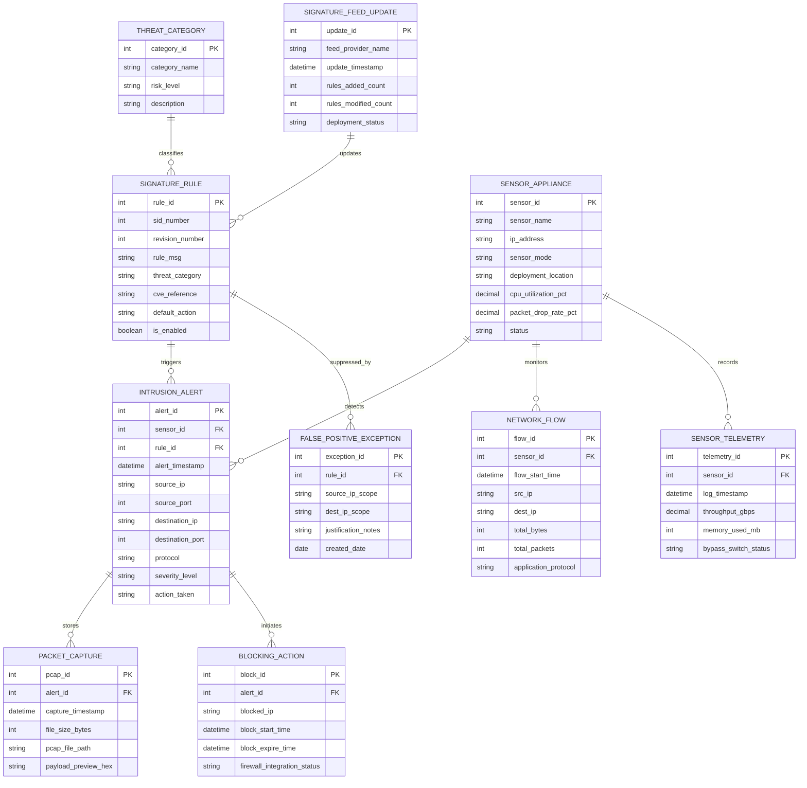

# Conceptual ERD — Intrusion Detection & Prevention System

## Mermaid Code

## Entity Description Table | Bảng mô tả Entity

| # | Entity Name | Vietnamese Name | Description | Key Attributes | Main Relationships |
|---|-------------|-----------------|-------------|----------------|-------------------|
| 1 | INTRUSION_ALERT | Cảnh báo Xâm nhập Mạng | Master alert record capturing source/dest IPs, ports, protocol, severity rating, and IPS action taken. | alert_id, alert_timestamp, source_ip, destination_ip, action_taken | Belongs to SENSOR_APPLIANCE and SIGNATURE_RULE; stores PACKET_CAPTURE. |
| 2 | SIGNATURE_RULE | Quy tắc Nhận dạng (Signature Rule) | Stores Snort/Suricata signature definitions, SID numbers, CVE references, categories, and actions. | rule_id, sid_number, rule_msg, cve_reference, default_action | Triggers INTRUSION_ALERT; suppressed by FALSE_POSITIVE_EXCEPTION. |
| 3 | SENSOR_APPLIANCE | Thiết bị Cảm biến IPS (Sensor) | Hardware or virtual IPS sensor nodes, IP addresses, deployment mode (Inline vs Passive), and status. | sensor_id, sensor_name, ip_address, sensor_mode, status | Detects INTRUSION_ALERT; monitors NETWORK_FLOW. |
| 4 | PACKET_CAPTURE | File Bắt Gói tin (PCAP) | Archives raw pcap packet buffers, hex payload previews, and file paths associated with intrusion alerts. | pcap_id, capture_timestamp, pcap_file_path, payload_preview_hex | Belongs to INTRUSION_ALERT. |
| 5 | NETWORK_FLOW | Luồng Dữ liệu Mạng (NetFlow) | Stores NetFlow/IPFIX summary records, total packet/byte counts, and application protocols parsed. | flow_id, flow_start_time, src_ip, dest_ip, total_bytes | Monitored by SENSOR_APPLIANCE. |
| 6 | THREAT_CATEGORY | Phân loại Mối đe dọa | Classifies signature rules into threat categories (Exploit Attempt, Web Application Attack, Trojan). | category_id, category_name, risk_level | Classifies SIGNATURE_RULE. |
| 7 | BLOCKING_ACTION | Hành động Chặn IPS & Firewall | Logs active packet drops, TCP Reset injections, dynamic firewall IP block rules, and expiration times. | block_id, blocked_ip, block_start_time, firewall_integration_status | Initiated by INTRUSION_ALERT. |
| 8 | FALSE_POSITIVE_EXCEPTION | Ngoại lệ Suppression Alert | Stores alert suppression filters, IP scopes, and analyst justification notes to mute false positive alerts. | exception_id, source_ip_scope, dest_ip_scope, justification_notes | Suppresses SIGNATURE_RULE. |
| 9 | SIGNATURE_FEED_UPDATE | Cập nhật Signature Định kỳ | Tracks daily threat signature feed downloads, rule addition counts, compilation logs, and deployment status. | update_id, feed_provider_name, update_timestamp, rules_added_count | Updates SIGNATURE_RULE. |
| 10 | SENSOR_TELEMETRY | Nhật ký Vận hành Sensor | Logs sensor CPU/memory usage, network throughput (Gbps), packet ring buffer stats, and bypass switch state. | telemetry_id, throughput_gbps, memory_used_mb, bypass_switch_status | Recorded by SENSOR_APPLIANCE. |

## Relationship Description | Mô tả Quan hệ

| # | From Entity | Cardinality | To Entity | Relationship Label | Business Explanation |
|---|-------------|-------------|-----------|-------------------|----------------------|
| 1 | SENSOR_APPLIANCE | one-to-many | INTRUSION_ALERT | detects | An IPS sensor appliance detects multiple intrusion alerts. |
| 2 | SIGNATURE_RULE | one-to-many | INTRUSION_ALERT | triggers | A signature rule triggers multiple intrusion alert instances. |
| 3 | INTRUSION_ALERT | one-to-many | PACKET_CAPTURE | stores | An intrusion alert stores raw PCAP packet captures. |
| 4 | INTRUSION_ALERT | one-to-many | BLOCKING_ACTION | initiates | An inline intrusion alert initiates automated IPS packet blocking actions. |
| 5 | SENSOR_APPLIANCE | one-to-many | NETWORK_FLOW | monitors | An IPS sensor monitors live network flow records. |
| 6 | THREAT_CATEGORY | one-to-many | SIGNATURE_RULE | classifies | A threat category classifies multiple signature rules. |
| 7 | SIGNATURE_RULE | one-to-many | FALSE_POSITIVE_EXCEPTION | suppressed_by | A signature rule can be suppressed by false positive exception filters. |
| 8 | SIGNATURE_FEED_UPDATE | one-to-many | SIGNATURE_RULE | updates | A threat feed update adds or updates multiple signature rules. |
