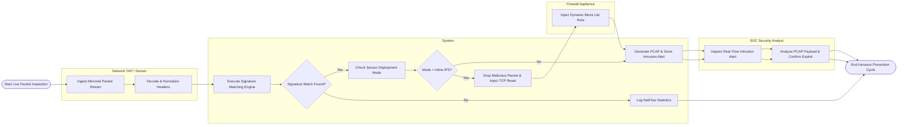

# Swimlane Diagram — Intrusion Detection & Prevention System

## Mermaid Code

## Flow Description | Mô tả luồng

| Lane | Actor | Role in Flow |
|------|-------|-------------|
| 1 | Network TAP / Sensor | Ingests raw mirrored network packet streams, parses Ethernet/IP/TCP headers, and normalizes payloads. |
| 2 | System | Evaluates Snort/Suricata rules, checks sensor deployment mode (Inline vs Passive), drops inline packets, sends TCP Resets, and logs PCAP alerts. |
| 3 | Firewall Appliance | Receives automated API commands from IPS engine to dynamically block attacker IP addresses at the perimeter. |
| 4 | SOC Security Analyst | Reviews real-time intrusion alerts on SOC dashboard, analyzes captured PCAP hex payloads, and verifies exploit attempts. |
