# Action Tree — Intrusion Detection & Prevention System

## Mermaid Code

```mermaid
graph TD
    Root["Intrusion Detection & Prevention System"]

    Root --> M1["Traffic Inspection & Sniffing"]
    Root --> M2["Signature Engine & Rules"]
    Root --> M3["Active Prevention & Blocking"]
    Root --> M4["Sensor & Hardware Management"]
    Root --> M5["Analytics & SIEM Export"]

    M1 --> A1["Ingest Mirrored Packet Streams"]
    M1 --> A2["Decode Layer 3-7 Protocol Headers"]
    M1 --> A3["Inspect Encrypted TLS Payloads"]
    M1 --> A4["Capture Raw PCAP File Buffers"]

    M2 --> B1["Compile Snort/Suricata Rulesets"]
    M2 --> B2["Write Custom Signature Rules"]
    M2 --> B3["Download Daily Threat Feed Updates"]
    M2 --> B4["Configure False Positive Suppression"]

    M3 --> C1["Drop Inline Malicious Packets"]
    M3 --> C2["Inject TCP Reset Connection Terminations"]
    M3 --> C3["Inject Dynamic Firewall Block Rules"]
    M3 --> C4["Enforce Network Segment Isolation"]

    M4 --> D1["Monitor Sensor CPU & Ring Buffer"]
    M4 --> D2["Toggle Optical Hardware Bypass Switch"]
    M4 --> D3["Configure High-Availability Failover"]
    M4 --> D4["Update Sensor Firmware Patches"]

    M5 --> E1["Stream Intrusion Alerts to SIEM"]
    M5 --> E2["Export NetFlow / IPFIX Telemetry"]
    M5 --> E3["Detect Anomaly SYN & Port Scans"]
    M5 --> E4["Generate PCI-DSS Compliance Reports"]
```

## Module Description | Mô tả Module

| # | Module | Description | Actions |
|---|--------|-------------|---------|
| 1 | Traffic Inspection & Sniffing | Deep Packet Inspection (DPI) of live packet streams, protocol decoding, TLS decryption, and PCAP buffer capture. | Ingest Mirrored Packet Streams, Decode Layer 3-7 Protocol Headers, Inspect Encrypted TLS Payloads, Capture Raw PCAP File Buffers |
| 2 | Signature Engine & Rules | Snort/Suricata ruleset compilation, custom rule authoring, daily threat feed updates, and false positive suppression. | Compile Snort/Suricata Rulesets, Write Custom Signature Rules, Download Daily Threat Feed Updates, Configure False Positive Suppression |
| 3 | Active Prevention & Blocking | Inline IPS packet dropping, TCP Reset connection termination, dynamic firewall IP block injection, and segment isolation. | Drop Inline Malicious Packets, Inject TCP Reset Connection Terminations, Inject Dynamic Firewall Block Rules, Enforce Network Segment Isolation |
| 4 | Sensor & Hardware Management | Sensor CPU/memory telemetry, optical hardware bypass switch control, high-availability cluster failover, and firmware updates. | Monitor Sensor CPU & Ring Buffer, Toggle Optical Hardware Bypass Switch, Configure High-Availability Failover, Update Sensor Firmware Patches |
| 5 | Analytics & SIEM Export | Real-time SIEM alert streaming, NetFlow telemetry export, behavioral anomaly detection, and PCI-DSS compliance auditing. | Stream Intrusion Alerts to SIEM, Export NetFlow / IPFIX Telemetry, Detect Anomaly SYN & Port Scans, Generate PCI-DSS Compliance Reports |
