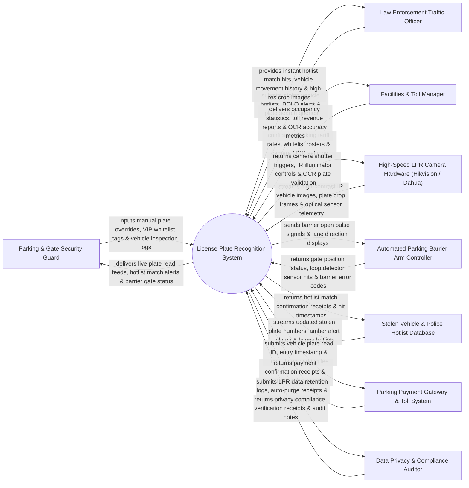

# Context Diagram — License Plate Recognition System

## Mermaid Code

## Actor & Interaction Table | Bảng Actor & Tương tác

| # | Actor | Actor Type | Data Sent TO System | Data Received FROM System | Notes |
|---|-------|------------|---------------------|---------------------------|-------|
| 1 | Parking & Gate Security Guard | Primary | Manual plate overrides, VIP whitelist tags, vehicle inspection notes. | Live plate read feeds, hotlist match alerts, barrier gate status. | Front desk guard monitoring parking entry gates and inspecting flagged vehicles. |
| 2 | Law Enforcement Traffic Officer | Primary | Stolen vehicle hotlists, Be-On-The-Look-Out (BOLO) alerts, plate search queries. | Instant hotlist match hits, vehicle movement history, high-res crop images. | Police officer receiving alerts when stolen vehicles trigger LPR cameras. |
| 3 | Facilities & Toll Manager | Primary | Parking tariff rates, whitelist rosters, camera OCR sensitivity settings. | Occupancy statistics, toll revenue reports, OCR accuracy metrics. | Manager configuring parking gate rules and monitoring facility vehicle traffic. |
| 4 | High-Speed LPR Camera Hardware | Supporting | High-contrast IR vehicle images, plate crop frames, optical sensor telemetry. | Camera shutter triggers, IR illuminator controls, OCR plate validation. | Specialized LPR camera hardware capturing vehicle plates at speeds up to 150 km/h. |
| 5 | Automated Parking Barrier Arm Controller | Supporting | Gate position status (Open/Closed), loop detector sensor hits, error codes. | Barrier open pulse signals, lane direction displays, barrier lock commands. | Physical barrier gate arm controlling vehicle access to parking lots or toll lanes. |
| 6 | Stolen Vehicle & Police Hotlist Database | Supporting | Updated stolen plate numbers, amber alert plates, felony hotlists. | Hotlist match confirmation receipts, hit timestamps, camera GPS coordinates. | External police database syncing stolen vehicle plate numbers. |
| 7 | Parking Payment Gateway & Toll System | Supporting | Payment confirmation receipts, ticketless exit clearance, subscriber tags. | Vehicle plate read ID, entry timestamp, calculated parking fee. | Payment gateway facilitating ticketless parking payments via plate number. |
| 8 | Data Privacy & Compliance Auditor | Supporting / Regulatory | Privacy compliance audit inquiries, data retention mandates. | LPR data retention logs, auto-purge receipts, privacy blurring proofs. | Independent auditor verifying LPR data auto-purge rules (GDPR / Driver Privacy Protection). |

## System Boundary Description | Mô tả Phạm vi Hệ thống

The **License Plate Recognition System** is an enterprise optical character recognition (OCR) vehicle tracking, automated barrier gate integration, police stolen vehicle hotlist matching, and ticketless parking payment platform.

**Inside System Scope:**
- Ingestion of high-contrast infrared (IR) vehicle plate image frames from specialized LPR cameras.
- High-accuracy Optical Character Recognition (OCR) converting plate images into alphanumeric text strings.
- Real-time matching of recognized plate numbers against Whitelists (Employees/VIPs) and Blacklists/Hotlists (Stolen Vehicles).
- Automated pulse signals to barrier gates for authorized vehicle entry/exit.
- Automated data retention enforcement and privacy auto-purging of unmatched plate reads.

**Outside System Scope:**
- Direct physical repaving of asphalt parking lanes (handled by Civil Contractors).
- Direct mechanical repair of broken barrier gate motors (handled by Gate Technicians).
- General vehicle traffic signal light control (handled by Municipal Traffic Systems).
