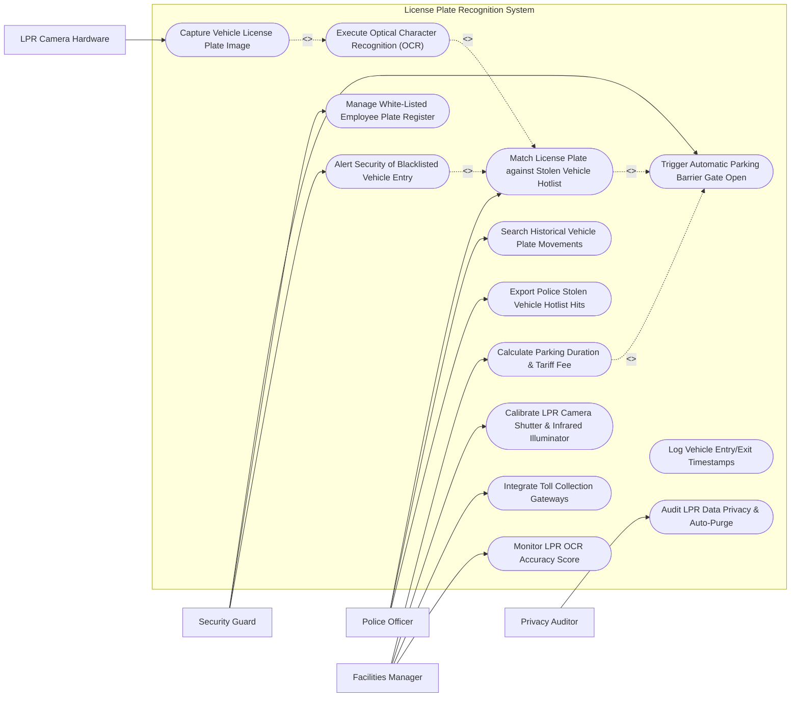

# Use Case Diagram — License Plate Recognition System

## Mermaid Code

## Actor Table | Bảng Actor

| # | Actor | Actor Type | Role Description | Related Use Cases |
|---|-------|------------|------------------|-------------------|
| 1 | Security Guard | Primary | Monitors parking entrance gates, receives blacklisted vehicle alerts, and executes manual gate overrides. | UC04, UC06, UC07 |
| 2 | Police Officer | Primary | Receives real-time stolen vehicle hotlist hits, searches vehicle movement history, and exports police reports. | UC03, UC08, UC13 |
| 3 | Facilities Manager | Primary | Manages parking tariffs, monitors camera OCR accuracy, calibrates IR camera shutters, and manages toll gateways. | UC05, UC09, UC10, UC11 |
| 4 | Privacy Auditor | Secondary | Audits LPR data retention rules, verifies automatic purging of non-matched vehicle plate reads (GDPR). | UC14 |
| 5 | LPR Camera Hardware | Supporting / System | High-speed IR optical camera capturing high-contrast vehicle plate image frames. | UC01 |

## Use Case Table | Bảng Use Case

| # | UC ID | Use Case Name | Primary Actor | Secondary Actor | Description | Priority |
|---|-------|---------------|---------------|-----------------|-------------|----------|
| 1 | UC01 | Capture Vehicle License Plate Image | LPR Camera | Guard | Captures high-contrast infrared (IR) image frames of front and rear vehicle license plates as vehicle trips loop sensor. | High |
| 2 | UC02 | Execute Optical Character Recognition (OCR) | LPR Camera | None | Extracts plate text characters using deep learning OCR models, returning normalized alphanumeric plate strings. | High |
| 3 | UC03 | Match License Plate against Stolen Vehicle Hotlist | Officer | Guard | Compares recognized plate string against police stolen vehicle databases (NCIC / Local Police Hotlist). | High |
| 4 | UC04 | Trigger Automatic Parking Barrier Gate Open | Guard | LPR Camera | Transmits an open pulse signal to the physical barrier gate arm upon verifying a whitelisted plate number. | High |
| 5 | UC05 | Calculate Parking Duration & Tariff Fee | Manager | None | Matches vehicle exit timestamp against entry timestamp to compute exact parking duration and tariff fee. | High |
| 6 | UC06 | Manage White-Listed Employee Plate Register | Guard | Manager | Maintains registered employee and VIP vehicle plate numbers for automated barrier gate entry. | Medium |
| 7 | UC07 | Alert Security of Blacklisted Vehicle Entry | Guard | Officer | Triggers high-priority audible and visual alerts on security consoles when a blacklisted or banned vehicle enters. | High |
| 8 | UC08 | Search Historical Vehicle Plate Movements | Officer | Guard | Queries historical LPR database to reconstruct vehicle movement timestamps across multiple camera locations. | Medium |
| 9 | UC09 | Calibrate LPR Camera Shutter & Infrared Illuminator | Manager | LPR Camera | Adjusts camera shutter speed (1/1000s) and IR illuminator intensity to ensure clear reads day and night. | Medium |
| 10 | UC10 | Integrate Toll Collection Gateways | Manager | None | Transmits plate read transactions to electronic toll collection gateways (E-Pass / EZPass) for toll billing. | Medium |
| 11 | UC11 | Monitor LPR OCR Accuracy Score | Manager | None | Calculates overall system OCR read accuracy percentage (Target: >= 98.5%) and tracks unreadable plate counts. | Medium |
| 12 | UC12 | Log Vehicle Entry/Exit Timestamps | LPR Camera | Guard | Archives vehicle plate string, high-res crop photo, entrance lane ID, and precise timestamp. | High |
| 13 | UC13 | Export Police Stolen Vehicle Hotlist Hits | Officer | None | Generates certified evidentiary reports containing stolen vehicle plate match crop images, GPS coordinates, and timestamps. | Medium |
| 14 | UC14 | Audit LPR Data Privacy & Auto-Purge | Privacy Auditor | Manager | Executes automatic permanent deletion of non-violating vehicle plate reads older than retention limits (e.g., 30 days). | High |

## Use Case Specification | Đặc tả Use Case

---

### UC01 — Capture Vehicle License Plate Image

| Field | Detail |
|-------|--------|
| **UC ID** | UC01 |
| **Use Case Name** | Capture Vehicle License Plate Image |
| **Actor(s)** | Primary: LPR Camera Hardware   Secondary: Security Guard |
| **Description** | Detects vehicle arrival via inductive ground loop sensors and captures high-contrast infrared (IR) image frames of front and rear license plates. |
| **Precondition** | 1. LPR camera is online and calibrated.   2. Ground loop detector sensor is operational. |
| **Main Flow** | 1. Vehicle approaches entry gate and trips inductive ground loop sensor `LOOP-LANE-01`.   2. Ground loop controller sends trigger pulse to LPR Camera `CAM-LPR-01`.   3. LPR Camera flashes pulsed Infrared (IR) illuminator (850nm wavelength).   4. Camera shutter executes high-speed capture (1/2000s) of vehicle front plate.   5. Camera captures 3 high-contrast monochrome frames.   6. Camera hardware selects highest-clarity frame crop (minimum 150 pixels plate width).   7. Camera streams image crop payload to UC02 Execute Optical Character Recognition (OCR). |
| **Alternative Flow** | **AF1** — Motion Detection Trigger: Camera uses software video motion detection (VMD) to trigger capture if ground loop sensor is missing. |
| **Exception Flow** | **EX1** — Obscured / Missing Plate: If vehicle lacks a license plate, camera flags "NO PLATE DETECTED" and alerts gate guard. |
| **Postcondition** | High-contrast vehicle license plate image crop is captured and forwarded for OCR processing. |
| **Business Rule** | **BR1**: Image capture must occur within 50 milliseconds of ground loop sensor activation. |

---

### UC02 — Execute Optical Character Recognition (OCR)

| Field | Detail |
|-------|--------|
| **UC ID** | UC02 |
| **Use Case Name** | Execute Optical Character Recognition (OCR) |
| **Actor(s)** | Primary: LPR Camera Hardware   Secondary: None |
| **Description** | Extracts alphanumeric plate text characters from image crop payloads using deep learning OCR neural networks, returning normalized plate strings. |
| **Precondition** | 1. High-contrast license plate image crop is received.   2. Regional OCR neural network model (e.g., US / EU / VN plate formats) is loaded. |
| **Main Flow** | 1. System receives image crop payload.   2. System applies image preprocessing (binarization, skew correction, contrast enhancement).   3. Deep learning OCR model detects character bounding boxes and extracts text characters.   4. Model evaluates character confidence scores (e.g., Character '3' = 99.2% confidence).   5. Model formats plate string into normalized syntax (e.g., `29A-12345`).   6. System assigns overall OCR Read Confidence Score: **HIGH (98.8%)**.   7. System passes recognized plate string to UC03 Match License Plate against Stolen Vehicle Hotlist. |
| **Alternative Flow** | **AF1** — Multi-Frame Fusion: System combines character reads from 3 sequential frames to resolve dirty or damaged plate characters. |
| **Exception Flow** | **EX1** — Low OCR Confidence (< 80%): System flags "LOW CONFIDENCE READ", routes image crop to gate guard console for one-click manual confirmation. |
| **Postcondition** | Vehicle license plate image is converted to a normalized text string with confidence score. |
| **Business Rule** | **BR1**: OCR character extraction must complete in less than 100 milliseconds per vehicle. |

---

### UC03 — Match License Plate against Stolen Vehicle Hotlist

| Field | Detail |
|-------|--------|
| **UC ID** | UC03 |
| **Use Case Name** | Match License Plate against Stolen Vehicle Hotlist |
| **Actor(s)** | Primary: Police Officer   Secondary: Security Guard |
| **Description** | Compares recognized plate text string against whitelists (employee/VIP) and blacklists/hotlists (stolen vehicles, amber alerts, felony warrants). |
| **Precondition** | 1. Normalized plate text string is produced by OCR engine.   2. Police hotlist database is synchronized. |
| **Main Flow** | 1. System receives recognized plate string `29A-12345`.   2. System queries Whitelist Register database.   3. If match is found, system triggers UC04 Trigger Automatic Parking Barrier Gate Open.   4. System simultaneously queries Police Stolen Vehicle Hotlist database.   5. If plate matches stolen vehicle record (`HOTLIST-STOLEN-991`), system flags **HOTLIST MATCH HIT**.   6. System suppresses automatic barrier gate open signal, keeping gate closed.   7. System executes UC07 Alert Security of Blacklisted Vehicle Entry and dispatches real-time alert to Police Officer. |
| **Alternative Flow** | **AF1** — Visitor Transient Match: Plate is not on Whitelist or Hotlist; system calculates parking tariff (UC05) and opens gate for transient visitor. |
| **Exception Flow** | **EX1** — Fuzzy Match (1-Character Variant): If plate `29A-1234S` matches stolen plate `29A-12345` with 95% similarity, system alerts guard to perform visual verification. |
| **Postcondition** | License plate is matched against whitelists and hotlists, driving automated barrier actions. |
| **Business Rule** | **BR1**: 100% of recognized plate reads must be checked against stolen vehicle hotlists in real-time. |

---

### UC04 — Trigger Automatic Parking Barrier Gate Open

| Field | Detail |
|-------|--------|
| **UC ID** | UC04 |
| **Use Case Name** | Trigger Automatic Parking Barrier Gate Open |
| **Actor(s)** | Primary: Security Guard   Secondary: LPR Camera Hardware |
| **Description** | Sends an electrical pulse command to the barrier gate controller to raise the gate arm for authorized whitelisted or paid vehicles. |
| **Precondition** | 1. License plate is verified on Whitelist OR parking tariff payment is confirmed.   2. Hotlist check confirms NO security block. |
| **Main Flow** | 1. System verifies plate `29A-12345` is active on Whitelist.   2. System issues HTTPS / Relay command to Barrier Gate Controller `GATE-LANE-01`.   3. Controller sends 24V DC pulse to barrier gate motor, raising gate arm to 90° vertical.   4. System updates lane LED display screen: "WELCOME - ACCESS GRANTED".   5. Vehicle passes barrier gate and trips exit safety loop sensor `LOOP-EXIT-01`.   6. Barrier controller lowers gate arm safely behind vehicle.   7. System logs UC12 Log Vehicle Entry/Exit Timestamps. |
| **Alternative Flow** | **AF1** — Manual Guard Gate Open: Gate guard clicks "Manual Open Gate" on console for delivery truck, logging guard override note. |
| **Exception Flow** | **EX1** — Gate Arm Obstruction: Safety optical beam detects vehicle stopped under gate arm; controller halts lowering action instantly to prevent damage. |
| **Postcondition** | Barrier gate arm is raised, vehicle enters facility, and gate lowers safely behind. |
| **Business Rule** | **BR1**: Barrier gate open commands shall execute in less than 300 milliseconds from plate verification. |

---

### UC07 — Alert Security of Blacklisted Vehicle Entry

| Field | Detail |
|-------|--------|
| **UC ID** | UC07 |
| **Use Case Name** | Alert Security of Blacklisted Vehicle Entry |
| **Actor(s)** | Primary: Security Guard   Secondary: Police Officer |
| **Description** | Triggers audible alerts, visual red popups, and instant SMS/email dispatches to security staff when a stolen or banned vehicle triggers an LPR camera. |
| **Precondition** | 1. License plate match against Stolen Vehicle Hotlist or Banned List is confirmed. |
| **Main Flow** | 1. System confirms hotlist match (`29A-12345` -> Stolen Vehicle / Felony Warrant).   2. System locks barrier gate arm in closed position.   3. System triggers audible strobe horn at security desk and pops up high-priority red alert modal on guard workstation.   4. Modal displays: Stolen Vehicle Warning, High-Res Plate Crop Image, Vehicle Make/Model/Color, Hotlist Reason, and Police Case Number.   5. System dispatches real-time SMS alert to Law Enforcement Traffic Officer.   6. Gate Guard inspects vehicle, confirms driver identity, and contacts Police Dispatch.   7. System logs hotlist hit event timestamp and camera GPS coordinates. |
| **Alternative Flow** | **AF1** — VIP Arrival Alert: If plate is tagged "VIP EXECUTIVE", system pops up green notification: "VIP ARRIVAL - CEO Vehicle Entered Lane 2". |
| **Exception Flow** | **EX1** — Guard False Hit Override: Guard inspects plate, confirms camera misread letter 'O' as '0', inputs correction, and releases gate. |
| **Postcondition** | Security and law enforcement are alerted, barrier gate is secured, and alert hit is logged. |
| **Business Rule** | **BR1**: Stolen vehicle hotlist alerts must deliver to guard consoles and police SMS within 2 seconds of camera capture. |
